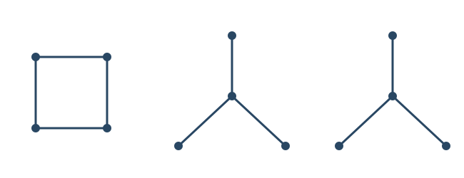

# A counterexample to two questions on acyclic polynomial roots

[](https://github.com/6/clank-lab/actions/workflows/acyclic-root-extrema.yml)

An acyclic polynomial counts the ways to choose vertices of a graph so that the edges between them form a [forest](https://en.wikipedia.org/wiki/Tree_(graph_theory)). Barton, Brown and Pike asked in 2020 whether one particular graph always has both the furthest-left real root and a root of greatest absolute value among graphs with the same number of vertices. A graph on twelve vertices answers both questions negatively. The construction builds on their proposed extremizer: splitting its star into two smaller stars changes just one coefficient and defeats both comparisons.



The picture shows the missing edges: the counterexample joins exactly those pairs of distinct vertices not joined in the picture.

Checked in Lean from the definitions; not yet reviewed by experts.

The proofs, the Lean formalization and the text were produced by AI models (from OpenAI and Anthropic), working under the author's direction.

[Read the paper](paper/paper.pdf) · [LaTeX source](paper/paper.tex)

## Check it

Install [elan](https://github.com/leanprover/elan), Git and a C compiler. From this folder:

```sh
cd lean
lake exe cache get
lake build
```

Allow about ten minutes after downloading the dependencies and at least 12 GB of memory. The default build checks the graph definition, both polynomials, the root comparisons, the final statement, small examples and axiom guards. See [the formalization notes](lean/README.md) for the dependency pins and the relation between the statement and the paper.

## Credits

Caroline Barton, Jason I. Brown and David A. Pike introduced the induced-forest polynomial studied here. Their [paper, *Acyclic polynomials of graphs*](https://ajc.maths.uq.edu.au/pdf/82/ajc_v82_p146.pdf), supplies the definition, the proposed extremal graph and the two questions answered in this note. Question 2.17 is the precise source of the comparison, and Lemma 2.18 gives the polynomial of their proposed extremizer. The counterexample modifies that construction; both the formulation of the problem and the useful quartic form come from their work.

The proof uses elementary counting, the intermediate value theorem and the triangle inequality. Its formalization uses [Lean](https://lean-lang.org/) and [Mathlib](https://github.com/leanprover-community/mathlib4), including their definitions of finite simple graphs, acyclicity, polynomials, real numbers and complex numbers. These libraries provide the foundations and general lemmas connecting the finite graph calculation to the root inequalities. Apache-2.0 (see the repository's LICENSE), except the third-party material listed in [THIRD_PARTY.md](THIRD_PARTY.md).

## Cite

```bibtex
@misc{GrahamAcyclicRootExtrema2026,
  author = {Graham, P.},
  title = {{A counterexample to two questions on acyclic polynomial roots}},
  year = {2026},
  howpublished = {\url{https://github.com/6/clank-lab/tree/acyclic-root-extrema-v1/results/acyclic-root-extrema}}
}
```
