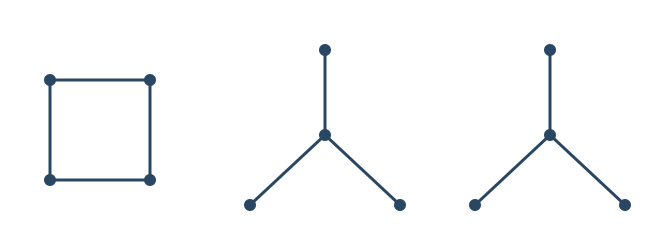

# A counterexample to two questions on acyclic polynomial roots

[](https://github.com/6/clank-lab/actions/workflows/acyclic-root-extrema.yml)

An acyclic polynomial counts the ways to choose vertices of a graph so that the edges between them form a [forest](https://en.wikipedia.org/wiki/Tree_(graph_theory)). Barton, Brown and Pike asked in 2020 whether one particular graph always has both the furthest-left real root and a root of greatest absolute value among graphs with the same number of vertices. A graph on twelve vertices answers both questions negatively. The construction builds on their proposed extremizer: splitting its star into two smaller stars changes just one coefficient and defeats both comparisons.



The picture shows the missing edges: the counterexample joins exactly those pairs of distinct vertices not joined in the picture.

Checked in Lean from the definitions; not yet reviewed by experts.

[Read the paper](paper/paper.pdf) · [LaTeX source](paper/paper.tex)

Archived on Zenodo: [doi:10.5281/zenodo.24412633](https://doi.org/10.5281/zenodo.24412633)

## Abstract

The acyclic polynomial of a graph counts its vertex subsets that induce forests, by their cardinality. We give a twelve-vertex graph whose acyclic polynomial has a real root smaller than every real root of the acyclic polynomial of the proposed extremal graph of Barton, Brown and Pike, and whose modulus exceeds that of every complex root of that polynomial. This answers both parts of their question on extremal acyclic roots negatively. Their work supplies the proposed graph, the complement of a four-cycle and a star, and a formula for its quartic polynomial. We replace that star by two three-leaf stars. The resulting polynomial differs only in its cubic coefficient. Exact sign evaluations and the triangle inequality separate the two root sets at radius eighty-six, without numerical root approximations. A Lean formalization proves the coefficient identities from induced-graph acyclicity and derives both failures of the universal assertions.

This work has not yet been reviewed by experts. The proofs, the Lean formalization and the text were produced by AI models (from OpenAI and Anthropic), working under the author's direction.

## Check it

Install [elan](https://github.com/leanprover/elan), Git and a C compiler. From this folder:

```sh
cd lean
lake exe cache get
lake build
```

Allow about ten minutes after downloading the dependencies and at least 12 GB of memory. The default build checks the graph definition, both polynomials, the root comparisons, the final statement, small examples and axiom guards. See [the formalization notes](lean/README.md) for the dependency pins and the relation between the statement and the paper.

## Credits

Caroline Barton, Jason I. Brown and David A. Pike introduced the induced-forest polynomial studied here. Their [paper, *Acyclic polynomials of graphs*](https://ajc.maths.uq.edu.au/pdf/82/ajc_v82_p146.pdf), supplies the definition, the proposed extremal graph and the two questions answered in this note. Question 2.17 is the precise source of the comparison, and Lemma 2.18 gives the polynomial of their proposed extremizer. The counterexample modifies that construction; both the formulation of the problem and the useful quartic form come from their work. Yuran Xiu gave an example of a graph whose acyclic polynomial is nonunimodal and has all its roots strictly in the left half-plane. In a second preprint, Xiu answered Barton, Brown and Pike's Question 3.3 by constructing a 230-vertex bipartite graph with a nonunimodal acyclic polynomial. Both preprints were posted on October 18, 2026, before the first release of this work on November 1, 2026. They are related prior work on other questions about the same polynomial. [Left-half-plane example](https://hexagonmath.org/abs/2610.00325v1) · [Bipartite example](https://hexagonmath.org/abs/2610.00326v1) · [Zenodo v1](https://doi.org/10.5281/zenodo.23862351)

The proof uses elementary counting, the intermediate value theorem and the triangle inequality. Its formalization uses [Lean](https://lean-lang.org/) and [Mathlib](https://github.com/leanprover-community/mathlib4), including their definitions of finite simple graphs, acyclicity, polynomials, real numbers and complex numbers. These libraries provide the foundations and general lemmas connecting the finite graph calculation to the root inequalities. Apache-2.0 (see the repository's LICENSE), except the third-party material listed in [THIRD_PARTY.md](THIRD_PARTY.md).

## Cite

```bibtex
@misc{GrahamAcyclicRootExtrema2026,
  author = {Graham, Peter},
  title = {{A counterexample to two questions on acyclic polynomial roots}},
  year = {2026},
  howpublished = {\url{https://github.com/6/clank-lab/tree/acyclic-root-extrema-v1/results/acyclic-root-extrema}},
  doi          = {10.5281/zenodo.24412633}
}
```
