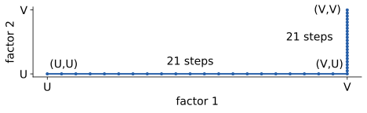

# A counterexample to the cocircuit diameter conjecture

[](https://github.com/6/clank-lab/actions/workflows/cocircuit-diameter-counterexample.yml)

A hyperplane arrangement has a graph on its oriented intersection rays, called the [cocircuit graph of an oriented matroid](https://en.wikipedia.org/wiki/Oriented_matroid). The conjectured diameter bound is $n-r+2$ for rank $r$ on $n$ elements. [Klee’s report](https://ems.press/content/serial-article-files/46818) attributes its introduction to Fukuda and Terlaky; Babson, Finschi and Fukuda posed an early farthest-pairs question (2001), and [Felsner and collaborators](https://arxiv.org/abs/1001.3534v1) restated the diameter question (2010). [Adler, De Loera, Klee and Zhang](https://doi.org/10.37236/9653) state the general bound and give a nonantipodal lower-bound example from Matschke, Santos and Weibel's non-Hirsch polytope. Using the numerical instance attributed to that polytope, Santos's product construction and the source certification work of Allamigeon, Canu and Strub, we prove a strict violation: a rationally realizable uniform example of rank 41 on 80 elements has two cocircuits with no walk of at most 41 edges between them. All signed intermediate cocircuits are allowed. Its diameter is at least 42; the exact whole-graph diameter is unknown.



Checked in Lean from the definitions; not yet reviewed by experts.

The proofs, the Lean formalization, the certificate checkers and the text were produced by AI models (from OpenAI and Anthropic), working under the author's direction.

[Read the paper](paper/paper.pdf) · [LaTeX source](paper/paper.tex)

## Check it

With [elan](https://github.com/leanprover/elan) installed:

```sh
python3 checks/bootstrap_kernel.py
cd lean
lake exe cache get
LEAN_NUM_THREADS=6 lake build
```

The complete proof build needs substantial memory and takes about half a day. The [Lean guide](lean/README.md) gives the exact statements, requirements and resumable build command. The [certificate checking guide](checks/README.md) gives a quick check with Python 3.11 or newer. It checks the source geometry, independent checker agreement and a small Lean control in a few minutes; it does not rebuild the final theorem. The public CI runs this quick check, with the CPU count set to its allocation:

```sh
python3 -m pip install -r checks/requirements.txt
python3 -I checks/quickcheck.py --cpus 2 --work /tmp/cocircuit-quick --checkpoint /tmp/cocircuit-results/quick.json --cpu-hours 1
```

The bootstrap command regenerates the omitted finite Lean modules from
the supplied certificates and checks every output against its SHA-256
manifest before the proof build. The quick command performs the required
control-only regeneration automatically. Generation alone does not check
the proof.

Lean checks the matrix sign-vector formulation and its full-graph lower bound, including the source matrix, complete vertex and edge cover, integer-potential inequalities and positive-weight chart identities. It uses its own positive functional and perturbations. The printed Vandermonde perturbations have written proofs and are not checked in Lean; the matrices are not identified. The standard oriented-matroid interpretation is outside Lean, as is the figure’s 42-edge upper bound for the pair, proved by following the two source paths.

The optional figure can be regenerated with [its script](checks/draw_path.py) and [dependencies](checks/requirements-figure.txt).

## Credits

- Ilan Adler, Jesús A. De Loera, Steven Klee and Zhenyang Zhang, [*Diameters of cocircuit graphs of oriented matroids: an update*](https://doi.org/10.37236/9653): the general conjecture, earlier nonantipodal example and sign-transition count, which we extend to walks leaving the nonnegative section.
- Benjamin Matschke, Francisco Santos and Christophe Weibel, [*The width of five-dimensional prismatoids*](https://arxiv.org/abs/1202.4701v2): the width-21 prismatoid underlying the attributed numerical instance.
- Francisco Santos, [*A counterexample to the Hirsch conjecture*](https://doi.org/10.4007/annals.2012.176.1.7): the Hirsch-counterexample framework and product amplification, with Klee–Walkup cited there.
- Xavier Allamigeon, Quentin Canu and Pierre-Yves Strub, [*A Formal Disproof of Hirsch Conjecture*](https://arxiv.org/abs/2301.04060v1): the source graph's Coq certification.
- Xavier Allamigeon, Ricardo D. Katz and Pierre-Yves Strub, [*Coq-Polyhedra*](https://github.com/Coq-Polyhedra/Coq-Polyhedra): the numerical inequality file used for our independent certificate.
- Eric Babson, Lukas Finschi and Komei Fukuda, [*Cocircuit graphs and efficient orientation reconstruction in oriented matroids*](https://doi.org/10.1006/eujc.2001.0481): the early farthest-pairs question.
- Lukas Finschi, [*A graph theoretical approach for reconstruction and generation of oriented matroids*](https://doi.org/10.3929/ethz-a-004255224): the distinction between farthest-pairs and diameter questions.
- Stefan Felsner, Ricardo Gómez, Kolja Knauer, Juan José Montellano-Ballesteros and Ricardo Strausz, [*Cubic time recognition of cocircuit graphs of uniform oriented matroids*](https://arxiv.org/abs/1001.3534v1): the uniform diameter question and its relation to nonantipodal pairs.
- Kolja Knauer, [*Lattices and Polyhedra from Graphs*](https://doi.org/10.14279/depositonce-2640): the earlier uniform questions in a chapter crediting joint work with Felsner, Gómez, Montellano-Ballesteros and Strausz.
- Steven Klee, [*Diameter bounds on cocircuit graphs of oriented matroids*](https://ems.press/content/serial-article-files/46818): the general bound and its attribution to Fukuda and Terlaky.
- Kolja Knauer, [*Oriented matroids and beyond: complexes, partial cubes, and corners*](https://pageperso.lis-lab.fr/~kolja.knauer/HDR_new_final_revision.pdf): a later restatement of the conjecture.
- Zhenyang Zhang, [*Combinatorial and Machine Learning Problems Motivated by the Simplex Method*](https://escholarship.org/uc/item/2nd082p3): later conjecture and lower-bound formulations.
- Kristóf Bérczi, Kolja Knauer, Luis Pedro Montejano and Benedek Nádor, [*Embracing exchange sequences and oriented matroid polyhedron diameter*](https://arxiv.org/abs/2606.19573v2): context on e-positive circuit graphs and embracing exchange distance.
- Grzegorz Świrszcz, Adam Zsolt Wagner, Geordie Williamson, Sam Blackwell, Bogdan Georgiev, Alex Davies, Ali Eslami, Sébastien Racanière, Theophane Weber and Pushmeet Kohli, [*Advancing Geometry with AI: Multi-agent Generation of Polytopes*](https://arxiv.org/abs/2502.05199v1): context on smaller non-Hirsch polytopes.
- Xavier Allamigeon, Yazid Id-Sahra and Pierre-Yves Strub, [*Formally Certifying the Vertex Set of a Polyhedron Faster than Informal Enumeration*](https://arxiv.org/abs/2610.11913v1): context on polyhedron certification.

Source versions and development provenance are in the [checking guide](checks/README.md#sources-used-during-development).

Apache-2.0 (see the repository's LICENSE), except the third-party material listed in [THIRD_PARTY.md](THIRD_PARTY.md).

## Cite

```bibtex
@misc{GrahamCocircuitDiameterCounterexample2026,
  author       = {Graham, P.},
  title        = {{A counterexample to the cocircuit diameter conjecture}},
  year         = {2026},
  howpublished = {\url{https://github.com/6/clank-lab/tree/cocircuit-diameter-counterexample-v1/results/cocircuit-diameter-counterexample}}
}
```
