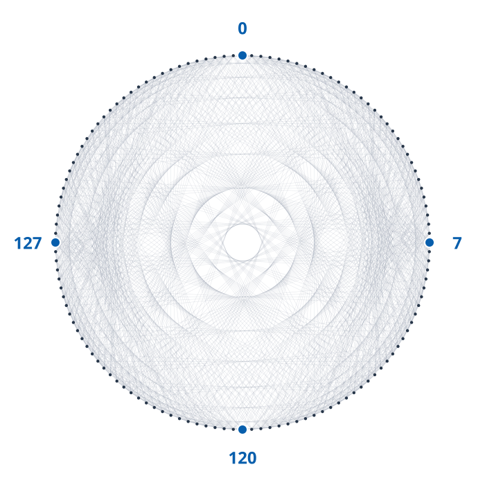

# Strongly cospectral sets in seven-dimensional cubelike graphs

[](https://github.com/6/clank-lab/actions/workflows/cubelike-cospectrality.yml)

A cubelike graph is a [Cayley graph](https://en.wikipedia.org/wiki/Cayley_graph) on binary strings: a pair is joined when its bitwise sum belongs to a chosen set of nonzero strings. Vertices are strongly cospectral when their coordinate vectors project to equal or opposite vectors in every adjacency eigenspace. In a [paper first posted in 2021](https://arxiv.org/abs/2109.07568), Arnbjörg Soffía Árnadóttir and Chris Godsil bounded the size of such sets, attained their bound in dimensions three through six, and asked whether it is tight in every dimension. We prove that in dimension seven the exact maximum is four, rather than their bound of eight, answering their question negatively. Their connected construction already attains four. The proof builds on their abelian character criterion and spectral identities, with an exact finite obstruction to larger sets; Peter Sin's constructions allow arbitrarily large strongly cospectral sets in higher dimensions.



Computer-assisted; not yet reviewed by experts.

The proofs, the Lean formalization, the certificate checkers and the text were produced by AI models (from OpenAI and Anthropic), working under the author's direction.

[Read the paper](paper/paper.pdf) · [LaTeX source](paper/paper.tex)

Archived on Zenodo: [doi:10.5281/zenodo.23603018](https://doi.org/10.5281/zenodo.23603018)

## Check it

Install Python 3, Git, and [elan](https://github.com/leanprover/elan), the standard Lean toolchain manager. From this folder, run:

```sh
python3 checks/check.py
cd lean
lake exe cache get
lake build
```

The Python check uses only the standard library. It checks the exact certificates, rejects deliberate corruptions, and checks the attaining graph. The Lean build proves the universal upper bound from the definition of strong cospectrality, including the finite certificate checks, coverage, final statement and permitted logical dependencies. Attainment is checked separately and uses Árnadóttir and Godsil's published construction. Allow a few hours for a first build. The [checking guide](checks/README.md) describes the certificates and controls; the [Lean guide](lean/README.md) explains the formal statement and kernel replay.

## Credits

Árnadóttir and Godsil posed the tightness question, proved the earlier upper bound, gave the abelian character criterion, and constructed the connected examples attaining four. The small-dimensional calibration examples came from Árnadóttir and Godsil's Example 8.4 and Appendix A. Their paper records their Sage computations and credits Gordon Royle's cubelike graph lists.

The underlying normal-Cayley character criterion is due to Peter Sin and Julien Sorci in [their earlier paper](https://arxiv.org/abs/2011.07566), first posted November 15, 2020.

Peter Sin's [large-set construction](https://arxiv.org/abs/2207.05211), first posted in 2022, establishes that strongly cospectral classes are unbounded as the dimension grows; the new upper bound concerns dimension seven. The formal proof uses Lean and the mathlib library. No third-party program or figure is reproduced.

Apache-2.0 (see the repository's LICENSE), except the third-party material listed in [THIRD_PARTY.md](THIRD_PARTY.md).

## Cite

```bibtex
@misc{GrahamCubelikeCospectrality2026,
  author       = {Graham, P.},
  title        = {{Strongly cospectral sets in seven-dimensional cubelike graphs}},
  year         = {2026},
  howpublished = {\url{https://github.com/6/clank-lab/tree/cubelike-cospectrality-v2/results/cubelike-cospectrality}},
  doi          = {10.5281/zenodo.23603018}
}
```
