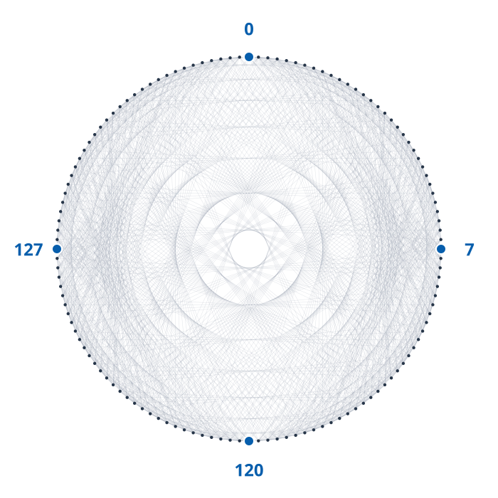

# Strongly cospectral sets in seven-dimensional cubelike graphs

[](https://github.com/6/clank-lab/actions/workflows/cubelike-cospectrality.yml)

A cubelike graph is a [Cayley graph](https://en.wikipedia.org/wiki/Cayley_graph) on binary strings: a pair is joined when its bitwise sum belongs to a chosen set of nonzero strings. Vertices are strongly cospectral when their coordinate vectors project to equal or opposite vectors in every adjacency eigenspace. In a [paper first posted in 2021](https://arxiv.org/abs/2109.07568), Arnbjörg Soffía Árnadóttir and Chris Godsil bounded the size of such sets, attained their bound in dimensions three through six, and asked whether it is tight in every dimension. We prove that in dimension seven the exact maximum is four, rather than their bound of eight, answering their question negatively. Their connected construction already attains four. The proof builds on their abelian character criterion and spectral identities, with an exact finite obstruction to larger sets; Peter Sin's constructions allow arbitrarily large strongly cospectral sets in higher dimensions.



Computer-assisted; not yet reviewed by experts.

[Read the paper](paper/paper.pdf) · [LaTeX source](paper/paper.tex)

Archived on Zenodo: [doi:10.5281/zenodo.24434879](https://doi.org/10.5281/zenodo.24434879)

## Abstract

Every set of pairwise strongly cospectral vertices in a cubelike graph on $128$ vertices has at most four elements, and a connected graph attains four. A cubelike graph is a Cayley graph of $\mathbb{F}_2^d$, here $d=7$; vertices are strongly cospectral if their orthogonal projections onto each adjacency eigenspace agree up to sign. Árnadóttir and Godsil proved the bound $2^{\lceil d/2\rceil-1}$ for $d\geq3$, attained it for $3\leq d\leq6$, supplied the connected construction used here, and asked whether it is tight in every dimension. For $d=7$ it is eight, so the answer is negative; Sin's construction gives arbitrarily large sets as $d$ grows. By Árnadóttir and Godsil's character criterion, building on one of Sin and Sorci, a class of eight would split the $128$ eigenvalues into eight groups of sixteen that share no value, each with a prescribed mean and residue modulo four. An exact finite inequality, certified by linear-programming duality, shows that their sum of squares would then exceed what Parseval's identity allows. The upper bound, including the certificate checks, is formalized in Lean; exact computations verify the attaining graph.

This work has not yet been reviewed by experts. The proofs, the Lean formalization, the certificate checkers and the text were produced by AI models (from OpenAI and Anthropic), working under the author's direction.

## Check it

Install Python 3, Git, and [elan](https://github.com/leanprover/elan), the standard Lean toolchain manager. From this folder, run:

```sh
python3 checks/check.py
cd lean
lake exe cache get
lake build
```

The Python check uses only the standard library. It checks the exact certificates, rejects deliberate corruptions, and checks the attaining graph. The Lean build proves the universal upper bound from the definition of strong cospectrality, including the finite certificate checks, coverage, final statement and permitted logical dependencies. Attainment is checked separately and uses Árnadóttir and Godsil's published construction. Allow a few hours for a first build. The [checking guide](checks/README.md) describes the certificates and controls; the [Lean guide](lean/README.md) explains the formal statement and kernel replay.

## Credits

- Arnbjörg Soffía Árnadóttir and Chris Godsil, [Strongly cospectral vertices in normal Cayley graphs](https://arxiv.org/abs/2109.07568): the tightness question, upper bound, abelian character criterion, attaining construction and Sage calibration examples.

- Peter Sin and Julien Sorci, [Continuous-time Quantum Walks on Cayley Graphs of Extraspecial Groups](https://arxiv.org/abs/2011.07566): the underlying normal-Cayley character criterion.

- Bernasconi, Godsil and Severini, [Quantum networks on cubelike graphs](https://doi.org/10.1103/PhysRevA.78.052320): cubelike state-transfer background.

- Cheung and Godsil, [Perfect state transfer in cubelike graphs](https://doi.org/10.1016/j.laa.2011.04.022): cubelike state-transfer background.

- Chris Godsil, [State transfer on graphs](https://doi.org/10.1016/j.disc.2011.06.032): state-transfer background.

- Godsil and Smith, [Strongly cospectral vertices](https://ajc.maths.uq.edu.au/pdf/88/ajc_v88_p001.pdf): strong-cospectrality background.

- Arnbjörg Soffía Árnadóttir, [State Transfer & Strong Cospectrality in Cayley Graphs](http://hdl.handle.net/10012/18494): the earlier cubelike bound, calibration and tightness question.

- Gordon Royle, [cubelike graph lists on 32 and 64 vertices (acknowledged by Árnadóttir and Godsil)](https://arxiv.org/abs/2109.07568): lists underlying the earlier calibration.

- Hermie Monterde, [Strong cospectrality and twin vertices in weighted graphs](https://arxiv.org/abs/2111.01265v2): context on extending normal-Cayley multiplicity bounds.

- Peter Sin, [Large sets of Strongly Cospectral Vertices in Cayley Graphs](https://arxiv.org/abs/2207.05211): the unbounded large-dimension context.

- Chris Godsil, [When Do a Few Eigenvectors of Graph Laplacians Not Determine the Graph? (2012 answer)](https://mathoverflow.net/a/105020): character eigenvectors and binary-codeword weights.

- Subiono2021, [Sagemath-Cells teaching README](https://github.com/Subiono2021/Sagemath-Cells/tree/08f5ca4d0198f2d1573df722283862ec80a31f49): a SageMath constructor and five-dimensional example.

- Gabriel Coutinho, Emanuel Juliano and Thomás Jung Spier, [The spectrum of symmetric decorated paths](https://arxiv.org/abs/2305.09406v1): related eigenvalue-spacing and state-transfer context.

- Qihang Wang, [Integral Cayley graphs and abelian rigidity in cores of cubelike graphs](https://doi.org/10.5281/zenodo.23445385): related cubelike-core context.

- Leonardo de Moura and Sebastian Ullrich, [The Lean 4 Theorem Prover and Programming Language](https://lean-lang.org/papers/lean4.pdf): the proof language.

- mathlib Community, [The Lean Mathematical Library](https://arxiv.org/abs/1910.09336): the formal proof library.

- Google OR-Tools, [CP-SAT Solver](https://developers.google.com/optimization/cp/cp_solver): research cross-checks.

- maxime-fleury, [open-problems-lab: reproducible attacks and certificates for open problems in mathematics](https://github.com/maxime-fleury/open-problems-lab): related group-invariant Ramsey searches on Cayley graphs beyond cyclic groups.

- Elham Sharifiyazdi, [The Clique Number of Generalized Hamming Graphs](https://nbn-resolving.org/urn:nbn:de:gbv:104-1087818): nearby clique-number results for distance-at-most-d Hamming graphs.

Apache-2.0 (see the repository's LICENSE), except the third-party material listed in [THIRD_PARTY.md](THIRD_PARTY.md).

## Cite

```bibtex
@misc{GrahamCubelikeCospectrality2026,
  author       = {Graham, Peter},
  title        = {{Strongly cospectral sets in seven-dimensional cubelike graphs}},
  year         = {2026},
  howpublished = {\url{https://github.com/6/clank-lab/tree/cubelike-cospectrality-v3/results/cubelike-cospectrality}},
  doi          = {10.5281/zenodo.24434879}
}
```
