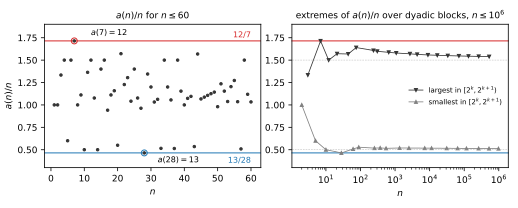

# Sharp linear bounds for the EKG sequence

[](https://github.com/6/clank-lab/actions/workflows/ekg-bounds.yml)

The [EKG sequence](https://mathworld.wolfram.com/EKGSequence.html)
([OEIS A064413](https://oeis.org/A064413)) starts with 1 and 2, then
repeatedly takes the smallest unused positive integer that shares a factor
greater than 1 with the previous term: 1, 2, 4, 6, 3, 9, 12, 8, 10, 5, 15, …
Most terms $a(n)$ are close to $n$. Each odd prime $p$ comes right after
$2p$ and right before $3p$; when $a(n) = p$, $p$ is about $n/2$, and the
next term $3p$ is about $3n/2$.

In 2002 Lagarias, Rains and Sloane conjectured that the smallest and
largest values of $a(n)/n$ occur at $n = 28$ and $n = 7$
([Conjecture 3](https://arxiv.org/abs/math/0204011), end of §4): for every
$n \ge 1$,

$$\frac{13}{28}\,n \le a(n) \le \frac{12}{7}\,n,$$

with equality only at $a(28) = 13$ and $a(7) = 12$. We prove this.



Lagarias, Rains and Sloane proved $n/260 \le a(n) \le 14n$. Hofman and
Pilipczuk (2008) proved that $a(n)/n$ tends to $1/2$ when $a(n)$ is prime,
to $3/2$ when $a(n)$ is three times a prime, and to $1$ otherwise. Tomer
Haver's *Explicit rates for the EKG sequence* (2026) made these limits
explicit and checked them in Lean, and our earlier
[second-order asymptotic](https://doi.org/10.5281/zenodo.23493113) built on
his work. None of these gives the sharp constants at every $n$: the
explicit estimates apply only from astronomically large thresholds. The
new step is a self-improving bound on how many even numbers are used
before the smallest even number not yet used, closed with the large sieve.
It makes the explicit estimates work once that smallest unused even number
passes about $1.3 \times 10^{10}$, which happens within the first
$1.6 \times 10^{10}$ terms; those terms are computed.

The deduction is a Lean proof from the definition of the sequence,
conditional on computed premises. It uses
Haver's Lean estimates, and explicit prime-counting bounds and large-sieve
inequalities that are also proved in Lean. Its only premises are four
computed facts: three about the first $1.6 \times 10^{10}$ terms, each
computed by two independent programs that agree, and an interval-arithmetic
certificate for the middle range, checked by a separate program written
from the Lean statement. That the programs compute the quantities named in
the Lean premises was checked by reading the code, not by machine.

Computer-assisted; not yet reviewed by experts.

The proofs, the Lean formalization, the programs and the text were produced by AI models (from OpenAI and Anthropic), working under the author's direction.

[Read the paper](paper/paper.pdf) · [LaTeX source](paper/paper.tex)

## Check it

The Lean proof is a standard Lake project. Install
[elan](https://github.com/leanprover/elan#installation), then run:

```sh
cd lean
lake exe cache get
lake build
```

The build takes about an hour on two cores, with up to about 8 GB of
memory per Lean process. It checks the exact statement of the theorem and
of its four premises, the first thirty terms of the sequence, and that the
proof uses only Lean's standard axioms. [lean/README.md](lean/README.md)
explains the statement and the layout.

The four premises are checked by programs. With Python 3.10 or later, GNU
g++ and gcc, and `pip install -r checks/requirements.txt`, run from this
folder:

```sh
python3 checks/check.py quick --work /tmp/ekg-bounds-quick
```

This takes a few minutes. It checks the middle-range certificate in full
and rejects seven corrupted copies of it, and it replays the first
$10^8$ terms with both prefix programs and the direct minimality checker,
comparing them with the recorded results and rejecting two corrupted
prefixes. It does not recompute the full prefix. That is

```sh
python3 checks/check.py full --work /tmp/ekg-bounds-full
```

which runs both programs to $1.6 \times 10^{10}$ terms and compares every
recorded checkpoint; it takes about three hours and needs about 72 GB and
33 GB of memory for the two programs.
[checks/README.md](checks/README.md) gives the details.

## Credits

The conjecture, the definition and the rule that each term is the least
unused multiple of a prime factor of its predecessor are due to
[Lagarias, Rains and Sloane (2002)](https://doi.org/10.1080/10586458.2002.10504486).
[Hofman and Pilipczuk (2008)](https://cs.uwaterloo.ca/journals/JIS/VOL11/Hofman/hofman1.html)
proved the prime pattern $2p, p, 3p$ and the crossing lemma used
throughout. Tomer Haver's
[*Explicit rates for the EKG sequence*](https://doi.org/10.5281/zenodo.23129632)
(version 3, October 2026) supplies the Lean definition of the sequence, the
counting identity and the explicit bounds on early even terms, spans and
missing composites, used here as proved Lean theorems and sharpened in the
middle range. The prime-counting bounds rest on Rosser and Schoenfeld's
(1962) bound for $\psi(x)$ and Chebyshev's (1852) lower bound, formalized
in [IEANTN](https://github.com/teorth/IEANTN) (T. Tao and contributors)
with [LeanCert](https://github.com/alerad/leancert); the arithmetic large
sieve of Montgomery (1968) and Montgomery and Vaughan (1973) comes from
OpenAI's [mathematics formalizations](https://github.com/openai/math).
Lean, mathlib and their contributors supplied the formal infrastructure,
and the cover checker uses Arb through python-flint.

Apache-2.0 (see the repository's LICENSE), except the third-party material listed in [THIRD_PARTY.md](THIRD_PARTY.md).

## Cite

```bibtex
@misc{GrahamEkgBounds2026,
  author       = {Graham, P.},
  title        = {{Sharp linear bounds for the EKG sequence}},
  year         = {2026},
  howpublished = {\url{https://github.com/6/clank-lab/tree/ekg-bounds-v1/results/ekg-bounds}}
}
```
