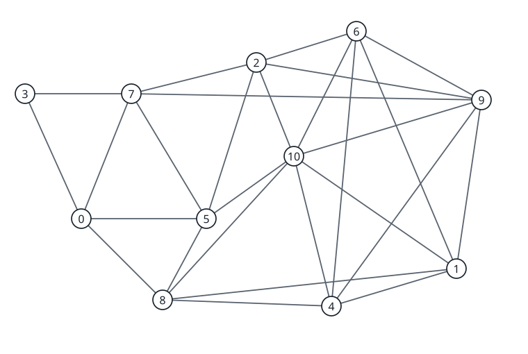

# Greedy play can require more colors in the coloring game

[](https://github.com/6/clank-lab/actions/workflows/game-grundy-gap.yml)

In the [graph coloring game](https://en.wikipedia.org/wiki/Game_chromatic_number), Alice and Bob take turns coloring a vertex, keeping adjacent vertices different. Alice wants the whole graph colored; Bob wants to prevent this. The game chromatic number is the smallest palette with which Alice can win. In the greedy game, each player chooses a vertex and must use its smallest available positive color; Alice minimizes the number of colors and Bob maximizes it. Havet and Zhu asked in [June 2011, Problem 5](https://inria.hal.science/inria-00600738v1/document), whether greedy play always needs at most the game chromatic number. [Hollom's Question 3.4](https://arxiv.org/abs/2308.03528v2) restates this question and explains an obstacle to transferring strategies between the games. We answer its first part negatively with a graph satisfying

$$
\chi_g(G) = 5, \qquad \Gamma_g(G) = 6.
$$

This example does not resolve the second part of Havet and Zhu's question, concerning arbitrarily large game Grundy number compared with game chromatic number.

Computer-assisted; not yet reviewed by experts.

The proofs, the search code, the certificate checkers and the text were produced by AI models (from OpenAI and Anthropic), working under the author's direction.

[Read the paper](paper/paper.pdf) · [LaTeX source](paper/paper.tex)

Archived on Zenodo: [doi:10.5281/zenodo.23758053](https://doi.org/10.5281/zenodo.23758053)



## Check it

Python 3.10 or later is sufficient; [requirements.txt](requirements.txt) lists the requirements. From this folder, run:

```sh
python3 -I checks/verify.py
```

The command checks the three strategy certificates with two independent implementations, requires both to reject the corruption tests, checks the clique and degree bounds, and checks that the figures match the graph. It needs only this folder and Python's standard library. The [checker documentation](checks/README.md) explains the certificate format and the proof obligations.

## Credits

Frédéric Havet and Xuding Zhu's [The game Grundy number of graphs](https://inria.hal.science/inria-00600738v1/document) introduced the game Grundy number and posed the question. Their crowns, isolated-vertex reversal, seven-vertex path and four-cycle examples provided checks of the game rules. Lawrence Hollom's [`On monotonicity in Maker-Breaker graph colouring games`](https://arxiv.org/abs/2308.03528v2) restated the question, explained the ordered-game obstruction and supplied another calibration example.

An outside AI model suggested the clique and degree observations used for the exact values. Tomasz Krawczyk and Bartosz Walczak's [Asymmetric coloring games on incomparability graphs](https://arxiv.org/abs/1503.04748) supplies context for the reverse comparison. Related work includes Mou, Sun and Zhang's [The game chromatic number of generalized Mycielski graphs of paths and cycles](https://arxiv.org/abs/2609.02283), on ordinary-game bounds, and Chawda, Nanoti and Sankarnarayanan's [On the majority game chromatic number of forests and other graphs](https://arxiv.org/abs/2609.23803), on the majority constraint. The full work-by-work list, including connected, majority and other coloring-game variants and complexity results, is in [Further credits](checks/README.md#further-credits).

Apache-2.0 (see the repository's LICENSE), except the third-party material listed in [THIRD_PARTY.md](THIRD_PARTY.md).

## Cite

```bibtex
@misc{GrahamGameGrundyGap2026,
  author       = {Graham, P.},
  title        = {{Greedy play can require more colors in the coloring game}},
  year         = {2026},
  howpublished = {\url{https://github.com/6/clank-lab/tree/game-grundy-gap-v3/results/game-grundy-gap}},
  doi          = {10.5281/zenodo.23758053}
}
```
