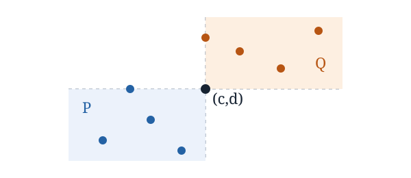

# A proof of Geneson's continuous gluing conjecture

[](https://github.com/6/clank-lab/actions/workflows/geneson-continuous-gluing.yml)

How much [area](https://en.wikipedia.org/wiki/Lebesgue_measure) can an open region inside a square have while avoiding a given pattern of points? A copy may stretch horizontal and vertical distances, but may not shrink them. Jesse Geneson asked in [2021](https://arxiv.org/abs/2105.04864v1) whether joining two patterns at opposite corners makes their maximum avoiding area at most the sum of the two separate maxima. We prove this for every positive square side length and arbitrary planar patterns, including infinite ones. The argument builds on Geneson's continuous formulation and Balázs Keszegh's discrete gluing theorem.

<p align="center"></p>

Precisely, if $P$ and $Q$ both contain $(c,d)$, all points of $P$ lie southwest of the anchor and all points of $Q$ lie northeast of it, with the boundary lines included, then for every $n>0$,

$$\mathrm{opx}(n,P\cup Q)\leq\mathrm{opx}(n,P)+\mathrm{opx}(n,Q).$$

Here $\mathrm{opx}(n,R)$ is the supremum of the areas of ambient-open subsets of the closed square of side $n$ that avoid $R$.

Checked in Lean from the definitions; not yet reviewed by experts.

The proofs, the Lean formalization and the text were produced by AI models (from OpenAI and Anthropic), working under the author's direction.

[Read the paper](paper/paper.pdf) · [LaTeX source](paper/paper.tex)

Archived on Zenodo: [doi:10.5281/zenodo.23914513](https://doi.org/10.5281/zenodo.23914513)

## Check it

Install [Lean through elan](https://lean-lang.org/install/), then run from this folder:

```sh
cd lean
lake exe cache get
lake build
```

Internet access is needed to fetch dependencies. Allow several minutes for downloading and building, with about 8 GB of available memory. Once dependencies are cached, checking the proof takes about a minute. [Lean details](lean/README.md) describe the pinned dependencies, statement checks and semantic controls.

## Credits

Jesse Geneson introduced the continuous extremal function in *Continuous Turán numbers* and posed the statement proved here as Conjecture 6.3, first in the 2021 preprint and then in the 2024 journal article. This paper proves that conjecture with the same coordinate-expansion definition and without finiteness assumptions on the patterns. Balázs Keszegh's finite gluing theorem (2009, Theorem 2.2 in *On linear forbidden submatrices*) is the predecessor. Its partition by possible gluing corners supplies the combinatorial idea used here; Geneson's Theorem 3.1 also explains the relation between finite continuous patterns and forbidden matrices.

The additional argument uses compact spaces of coordinate maps to make the corner set measurable and to preserve avoidance in a small open neighborhood of a compact set. Lebesgue measure's inner regularity then transfers the partition bound to open sets. The formal proof uses Lean and mathlib for topology, measure theory and real analysis.

Apache-2.0 (see the repository's LICENSE).

## Cite

```bibtex
@misc{GrahamGenesonContinuousGluing2026,
  author = {Graham, P.},
  title = {{A proof of Geneson's continuous gluing conjecture}},
  year = {2026},
  howpublished = {\url{https://github.com/6/clank-lab/tree/geneson-continuous-gluing-v1/results/geneson-continuous-gluing}},
  doi          = {10.5281/zenodo.23914513}
}
```
