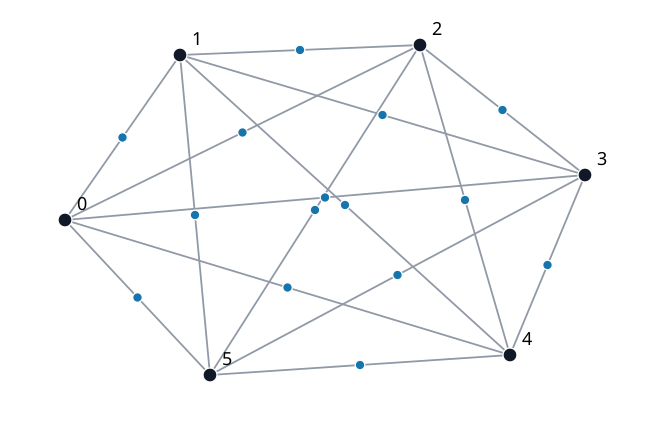

# A subdivided 6-clique breaks a conjectured sum bound for independent monophonic-position colorings

[](https://github.com/6/clank-lab/actions/workflows/independent-monophonic-ng.yml)

Start with six mutually connected vertices and [subdivide](https://en.wikipedia.org/wiki/Homeomorphism_(graph_theory)) each edge once, making a 21-vertex graph. Color its vertices so that adjacent vertices have different colors and no [induced path](https://en.wikipedia.org/wiki/Induced_path) contains three vertices of one color. In 2024, Ullas Chandran S. V., Gabriele Di Stefano, S. Haritha, Elias John Thomas and James Tuite conjectured that the minimum numbers of colors for any graph and its complement sum to at most its order plus one. This graph needs at least 8 colors and its complement at least 15, so their sum is at least 23, exceeding 22 and disproving the monophonic sum inequality of their [Conjecture 9.3](https://arxiv.org/abs/2408.13494v2), a bound of Nordhaus–Gaddum type. The proof builds on their definitions and conjecture.

Computer-assisted; not yet reviewed by experts.

The proofs, the code and the text were produced by AI models (from OpenAI and Anthropic), working under the author's direction.

[Read the paper](paper/paper.pdf) · [LaTeX source](paper/paper.tex)



## Check it

From this directory, on Linux with Python, GCC and internet access:

```sh
python3 checks/check.py
```

The command downloads the pinned certificate checkers, reconstructs the graph and formulas, checks four certificates with both checkers, and tests rejected corruptions. Allow about a minute and 1 GB of memory. Dependencies are in [requirements.txt](checks/requirements.txt). The paper gives a self-contained hand proof and explicit colorings. The [checking notes](checks/README.md) explain the supplementary certificate checks and their assumptions, and [list the prior work examined and the unread sources](checks/README.md#prior-work-and-unread-sources).

## Credits

Chandran, Di Stefano, Haritha, Thomas and Tuite introduced the position-coloring framework and posed the conjecture disproved here in *Colouring a graph with position sets*. Their work supplies the definitions and the conjecture, and reports Grahame Erskine's computer search confirming the conjecture for all graphs with at most ten vertices. Chandran, Sandi Klavžar, P. K. Neethu and Tuite's later [*Monophonic position sets of Cartesian and lexicographic products of graphs*](https://doi.org/10.1007/s40314-026-03901-3), published online in *Computational and Applied Mathematics* on September 11, 2026, studies monophonic position sets in graph products; this result does not use it.

The proof classifies the permitted color classes and counts the members of a cover. Supplementary propositional certificates cross-check the lower bounds. Nathan Wetzler, Marijn Heule and Warren A. Hunt, Jr.'s drat-trim checks the DRAT certificates and produces LRAT certificates; Yong Kiam Tan, Marijn Heule and Magnus O. Myreen's verified CakeML checker cake_lpr checks those independently. [Further credits](checks/README.md#further-credits) give the related literature, encoding and solver references. Apache-2.0 (see the repository's LICENSE), except the third-party material listed in [THIRD_PARTY.md](THIRD_PARTY.md).

## Cite

```bibtex
@misc{GrahamIndependentMonophonicNg2026,
  author = {Graham, P.},
  title = {{A subdivided 6-clique breaks a conjectured sum bound for independent monophonic-position colorings}},
  year = {2026},
  howpublished = {\url{https://github.com/6/clank-lab/tree/independent-monophonic-ng-v1/results/independent-monophonic-ng}}
}
```
