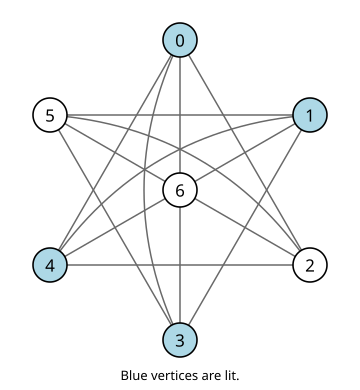

# A counterexample to a lit-only sigma-game conjecture

[](https://github.com/6/clank-lab/actions/workflows/lit-only-sigma.yml)

In the [sigma-game](https://doi.org/10.37236/701), pressing a vertex of a graph toggles the lights at its neighbors. The lit-only rule permits pressing only a light that is on. For a starting configuration $x$, write $ML_G(x)$ and $`ML_G^*(x)`$ for the fewest lights left on in the two games, and let $D(G)$ be the largest difference $`ML_G^*(x)-ML_G(x)`$ over the same starting configuration.

Goldwasser, Wang and Wu's Conjecture 5, published in 2011, predicts that a connected graph with $D(G)>|V(G)|/2$ must be complete $m$-partite with $m\equiv3\pmod4$. Their complete multipartite examples motivate the question, which Wu and Xiang repeat in their 2019 survey. The implication fails: the complement of the disjoint union of a six-cycle and an isolated vertex is connected and not complete multipartite, but the configuration shown below has $ML_G(x)=0$ and $`ML_G^*(x)=4>7/2`$.



The closed set consists exactly of three configuration types: two antipodal outer pairs with the hub off (three states), all six outer vertices with the hub off (one state), or three consecutive outer vertices with the hub on (six states). It is exactly the lit-only orbit of the displayed start.

For every integer $m\geq1$, replace each vertex by $m$ nonadjacent copies and each base edge by all cross-fiber edges. From the uniform lift $x_m$ of the displayed start, the minima are $ML_{G_m}(x_m)=0$ and $`ML_{G_m}^*(x_m)=4m`$. Thus $D(G_m)\geq4m>7m/2$ on $7m$ vertices. Each graph is connected and is not complete multipartite. No exact graph-wide discrepancy value over nonuniform starts is asserted.

The proof gives two unrestricted moves that turn all lights off and a set of configurations closed under every lit-only move, all with at least four lights on. Lean proves the counterexample from the definitions, including the three-type orbit and the uniform blow-up theorem for all positive integers $m$. Sequence projection and lifting preserve lit-only legality, and weights scale by $m$. Two separately written programs also check the finite certificate. No claim of minimality is made.

Checked in Lean from the definitions; not yet reviewed by experts.

The proofs, the Lean formalization, the certificate checkers and the text were produced by AI models (from OpenAI and Anthropic), working under the author's direction.

[Read the paper](paper/paper.pdf) · [LaTeX source](paper/paper.tex)

Archived on Zenodo: [doi:10.5281/zenodo.23608956](https://doi.org/10.5281/zenodo.23608956)

## Check it

With [elan](https://github.com/leanprover/elan) installed, build the proof from this folder:

```sh
cd lean
lake exe cache get
lake build
cd ..
```

The build checks the theorem statements, definition checks and guarded axiom reports. [Lean documentation](lean/README.md) gives replay instructions and the correspondence with the source definitions.

Python 3.10 or later, with no external packages, checks the result in a few seconds. From this folder:

```sh
python3 checks/check.py
```

Both checkers accept the certificate and reject a copy with one required configuration removed. The command also checks that the figures and the retained ten-row regression table match the certificate. [Checker documentation](checks/README.md) explains the representation and scope.

## Credits

John Goldwasser, Xinmao Wang and Yaokun Wu studied the difference parameter, gave the motivating examples, and posed [Conjecture 5 in their paper on unicyclic and grid graphs](https://doi.org/10.37236/701), published October 31, 2011. Their earlier theoretical and experimental investigations are the starting point of this question.

Yaokun Wu and Ziqing Xiang's [2019 survey](https://ziqing.org/data/The%20lit-only%20sigma-game%20-%20Some%20Mathematics%20behind%20a%20puzzle%20for%20kids.pdf) restates the implication as Conjecture 3.3 and describes their computational exploration of the game's phase spaces. Wu's [line-graph work](https://doi.org/10.1016/j.ejc.2008.02.003) and Jonas Sjöstrand's [general reachability theory](https://arxiv.org/abs/2312.03933), first posted in December 2023 and published in 2025, provide related orbit descriptions. The present proof uses the explicit finite certificate and does not require those classifications. No code or data from those works are included.

An outside AI model suggested the three-type description and the uniform blow-up extension proved here.

Apache-2.0 (see the repository's LICENSE), except the third-party material listed in [THIRD_PARTY.md](THIRD_PARTY.md).

## Cite

```bibtex
@misc{GrahamLitOnlySigma2026,
  author       = {Graham, P.},
  title        = {{A counterexample to a lit-only sigma-game conjecture}},
  year         = {2026},
  howpublished = {\url{https://github.com/6/clank-lab/tree/lit-only-sigma-v3/results/lit-only-sigma}},
  doi          = {10.5281/zenodo.23608956}
}
```
