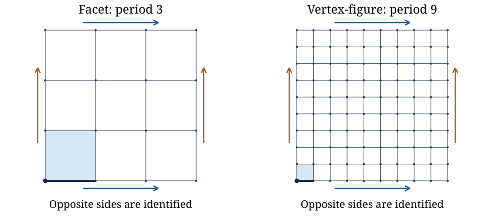

# Existence of locally toroidal regular 4-polytopes

[](https://github.com/6/clank-lab/actions/workflows/locally-toroidal-polytopes.yml)

A [locally toroidal regular 4-polytope](https://en.wikipedia.org/wiki/Abstract_regular_polytope) is an abstract polytope whose facets and vertex-figures are maps on tori. Peter McMullen and Egon Schulte developed their classification; Egon Schulte and Asia Ivić Weiss asked in [Problem 16 (2006)](https://arxiv.org/abs/math/0608397) for a classification of the remaining family: for which parameters these polytopes exist, what their groups are, and when they are finite. This work proves the existence half of that problem and of McMullen–Schulte's 2002 Conjecture 10C7: the universal regular 4-polytope $`\{\{4,4\}_{(s,0)},\{4,4\}_{(u,0)}\}`$ exists for every pair of distinct odd integers $s,u\geq3$, with no gcd restriction. Here $`\{4,4\}_{(s,0)}`$ is the square grid wrapped onto a torus with period $s$ in both directions. Finiteness of the universal polytopes and group classification remain open.

McMullen–Schulte's book records the finite example with periods 3 and 5 and its dual. This theorem gives existence for every distinct odd pair, including pairs sharing a factor. The hardest new step proves that the facet and vertex-figure groups overlap exactly in their common dihedral subgroup, using a commutator argument that allows independent periods. The classical toroidal presentations and the correspondence between groups and regular polytopes are reused.

Checked in Lean from the definitions; not yet reviewed by experts.

The proofs, the Lean formalization and the text were produced by AI models (from OpenAI and Anthropic), working under the author's direction.

[Read the paper](paper/paper.pdf) · [LaTeX source](paper/paper.tex)

Archived on Zenodo: [doi:10.5281/zenodo.23743790](https://doi.org/10.5281/zenodo.23743790)



Facet and vertex-figure maps for the theorem's example with periods 3 and 9. Identify opposite sides following the matching arrows; repeated boundary points become the same torus vertices. The shaded square, thick edge and dot form a base flag. The drawing is generated from modular grid data and checked against the vertex, edge and square definition of these maps.

## Check it

Install [elan](https://github.com/leanprover/elan), the standard Lean toolchain manager, and Git. From this folder:

```sh
cd lean
lake exe cache get
lake build
```

The project selects its Lean version automatically. The build checks the theorem, the geometric torus identification, the universal polytope construction, and the axiom guards. See [the Lean guide](lean/README.md) for the theorem statements.

## Credits

Peter McMullen and Egon Schulte's [Abstract Regular Polytopes](https://doi.org/10.1017/CBO9780511546686) supplies the polytope theory, Conjecture 10C7 and the finite example, crediting G. Havas's enumeration and Leytem's group identification. Egon Schulte and Asia Ivić Weiss posed the classification question in [Problems on polytopes, their groups, and realizations](https://arxiv.org/abs/math/0608397). H. S. M. Coxeter and W. O. J. Moser's [Generators and Relations for Discrete Groups](https://doi.org/10.1007/978-3-662-21943-0) supplies the toroidal-map presentations used here.

McMullen and Schulte's [Regular polytopes of type {4,4,3} and {4,4,4}](https://doi.org/10.1007/BF01204723) provides locally toroidal background. The formal proof uses [Lean](https://github.com/leanprover/lean4) and [Mathlib](https://github.com/leanprover-community/mathlib4), developed by their contributors. Wei-Juan Zhang's [More on chiral polytopes of type {4, 4, …, 4} with solvable automorphism groups](https://doi.org/10.1515/jgth-2022-0124) gives related chiral constructions. Claudio Alexandre Piedade's [Faithful permutation representations of C-groups](https://hdl.handle.net/10773/33912) gives related representations. Egon Schulte's [Regular incidence-polytopes with Euclidean or toroidal faces and vertex-figures](https://doi.org/10.1016/0097-3165(85)90093-7) and [Amalgamation of Regular Incidence-Polytopes](https://doi.org/10.1112/plms/s3-56.2.303) provide related frameworks. The full work-by-work list, including related constructions and representations, is in [Further credits](checks/README.md#further-credits).

Apache-2.0 (see the repository's LICENSE), except the third-party material listed in [THIRD_PARTY.md](THIRD_PARTY.md).

## Cite

```bibtex
@misc{GrahamLocallyToroidalPolytopes2026,
  author       = {Graham, P.},
  title        = {{Existence of locally toroidal regular 4-polytopes}},
  year         = {2026},
  howpublished = {\url{https://github.com/6/clank-lab/tree/locally-toroidal-polytopes-v3/results/locally-toroidal-polytopes}},
  doi          = {10.5281/zenodo.23743790}
}
```
