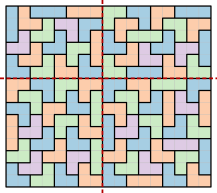

# Locked tromino tilings of rectangles

[](https://github.com/6/clank-lab/actions/workflows/locked-trominoes.yml)

A [tromino](https://en.wikipedia.org/wiki/Polyomino) is a set of three grid
cells joined along their sides, straight or L-shaped. A tiling of a
rectangle by trominoes is locked if no two of its tiles can be removed and
their six cells covered by two trominoes in a different way, although the
rectangle has other tromino tilings. Jamie Tucker-Foltz introduced locked
tilings in 2023, in [Locked polyomino tilings](https://arxiv.org/abs/2307.15996v4),
as plans that no step of the [ReCom](https://doi.org/10.1162/99608f92.eb30390f)
redistricting Markov chain can change, including the grid model in which every district
has three cells. Tucker-Foltz proved that no rectangle with a side of length at most 3
has a locked tromino tiling (Theorem 3.1), constructed locked tilings of
the $m \times n$ rectangle whenever $3$ divides $m$, $m \ge 6$ and $n \ge 100$
(Theorem 3.2), and conjectured that $n \ge 4$ suffices. The same construction
also covers some widths below 100. Tucker-Foltz reports locked $6 \times 4$
tilings (Section 3), and the $6 \times 6$ example extends by flipped copies to rectangles with both sides divisible
by 6 (Section 1, Figures 2–3).



We prove Tucker-Foltz's conjecture. With Tucker-Foltz's Theorem 3.1 and the area count, this
settles which rectangles have a locked tromino tiling: the $m \times n$
rectangle has one if and only if $3$ divides $mn$ and $\min(m, n) \ge 4$.
As in Tucker-Foltz's proof of Theorem 3.2, the tilings are glued together
from explicit locked blocks, mostly of heights 6 and 9. Our construction uses a
pair of blocks for each width from 4 to 55 (at width 5, heights 9 and 12,
plus single tilings of the $6 \times 5$ and $15 \times 5$ rectangles) and
four blocks of widths 8 and 9 that cover every larger width. Making Tucker-Foltz's block-gluing argument explicit, our gluing lemma
turns each width into a finite check: when blocks meet along
full rows and columns, two tiles can only recombine inside one block or
across one shared side.

Lean checks the conjecture from the definitions, including the gluing lemma
and every block, and two independently written programs check the blocks
again. The "only if" direction is the area count and Theorem 3.1 of Tucker-Foltz's
preprint, which the paper cites and does not formalize. The
result concerns this grid model only, not redistricting in practice.

Checked in Lean from the definitions; not yet reviewed by experts.

The proofs, the Lean formalization, the certificate checkers and the text were produced by AI models (from OpenAI and Anthropic), working under the author's direction.

[Read the paper](paper/paper.pdf) · [LaTeX source](paper/paper.tex)

Archived on Zenodo: [doi:10.5281/zenodo.23638798](https://doi.org/10.5281/zenodo.23638798)

The DOI above identifies version 3.

## Check it

The blocks are in `data/`, as JSON lists of cells. Python 3.10 or later,
with no third-party packages, checks them in about a minute:

```sh
python3 checks/check.py
```

It runs two separately written checkers on every block and every seam,
checks that the blocks are exactly those the proof needs, that both
checkers reject planted errors, that the Lean files hold the same
coordinates, and that the figures in the paper are drawn from them. As a
control it recovers Tucker-Foltz's counts of locked tilings of the
$6 \times 4$ and $6 \times 6$ rectangles. The
[checker documentation](checks/README.md) has the details.

Install [elan](https://github.com/leanprover/elan), then check the Lean
proof. It uses Lean's standard library only, with no Mathlib, so there is no
cache to fetch:

```sh
cd lean
lake build
```

The build takes about 15 minutes of processor time and up to about 3 GB of
memory for each module it builds in parallel; on a machine with less than
4 GB of memory per core, limit the parallel modules as the
[Lean documentation](lean/README.md) describes. That page also explains the
formal statement.

## Credits

Jamie Tucker-Foltz posed the problem, gave the definitions, proved the case
of grids with a side of at most 3 and the case $n \ge 100$ by the block
method followed here, and computed the $6 \times 4$ and $6 \times 6$ cases
used as controls. Daryl DeFord, Moon Duchin and Justin Solomon introduced the
ReCom chain. Lean and its contributors supplied the formal-proof system.
The block searches used [PySAT](https://github.com/pysathq/pysat) and [CaDiCaL](https://github.com/arminbiere/cadical).

Mridul Aanjaneya and Sudebkumar Prasant Pal earlier showed that the same
rectangles have [fault-free L-tromino tilings](https://arxiv.org/abs/math/0610925).
Their condition forbids full cuts crossing no tile; locked tilings instead
forbid two-tile recombinations, as the paper explains.

Apache-2.0 (see the repository's LICENSE), except the third-party material listed in [THIRD_PARTY.md](THIRD_PARTY.md).

## Cite

```bibtex
@misc{GrahamLockedTrominoes2026,
  author       = {Graham, P.},
  title        = {{Locked tromino tilings of rectangles}},
  year         = {2026},
  howpublished = {\url{https://github.com/6/clank-lab/tree/locked-trominoes-v4/results/locked-trominoes}},
  doi          = {10.5281/zenodo.23638798}
}
```
