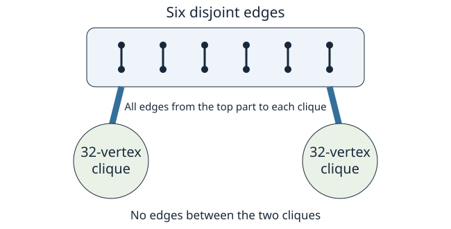

# Counts of maximal matchings in a graph need not be log-concave

[](https://github.com/6/clank-lab/actions/workflows/maximal-matching-logconcavity.yml)

A [matching](https://en.wikipedia.org/wiki/Matching_(graph_theory)) pairs vertices along edges without using any vertex twice. It is maximal when no further edge can be added. Došlić and Short asked in [2015](https://arxiv.org/abs/1511.00590v1) whether the numbers of maximal matchings of successive sizes are always [log-concave](https://en.wikipedia.org/wiki/Logarithmically_concave_sequence): each count squared is at least the product of its neighbors. Building on their view of the vertices left uncovered, we answer no. In the 76-vertex graph shown below, the counts at sizes 35, 36 and 37 violate that inequality.



Computer-assisted; not yet reviewed by experts.

The proofs, the code and the text were produced by AI models (from OpenAI and Anthropic), working under the author's direction.

[Read the paper](paper/paper.pdf) · [LaTeX source](paper/paper.tex)

## Check it

From this folder, with Python 3.10 or later:

```sh
python3 -I checks/verify.py
```

The check uses only the standard library and takes less than a second on a typical contemporary CPU. It checks the graph, reproduces all counts by two methods, verifies the strict inequality, compares small examples, and rejects deliberate corruptions. [Requirements and further credits](checks/README.md) describe the computation.

## Credits

Tomislav Došlić and Taylor Short posed the log-concavity question in [Maximal matchings in polyspiro and benzenoid chains](https://doi.org/10.2298/AADM161106003D), with the question on page 20 of their preprint. Their discussion of independent uncovered vertex sets is the starting point for our count; each such set is weighted by the number of perfect matchings of its complement. Tomislav Došlić and Ivana Zubac also explicitly asked the all-graph question in [Counting maximal matchings in linear polymers](https://doi.org/10.26493/1855-3974.851.167), page 275. The counterexample answers its log-concavity part; its counts are unimodal.

The calculation uses exact Python integers, a factorial sum, and a separate recurrence that pairs one vertex at a time. A generic calculation on small labeled graphs checks the specialized formulas. The paper uses LaTeX and PGF/TikZ. [Further credits](checks/README.md#further-credits) give related work on maximal matching polynomials and their enumeration. Apache-2.0 (see the repository's LICENSE).

## Cite

```bibtex
@misc{GrahamMaximalMatchingLogconcavity2026,
  author = {Graham, P.},
  title = {{Counts of maximal matchings in a graph need not be log-concave}},
  year = {2026},
  howpublished = {\url{https://github.com/6/clank-lab/tree/maximal-matching-logconcavity-v1/results/maximal-matching-logconcavity}}
}
```
