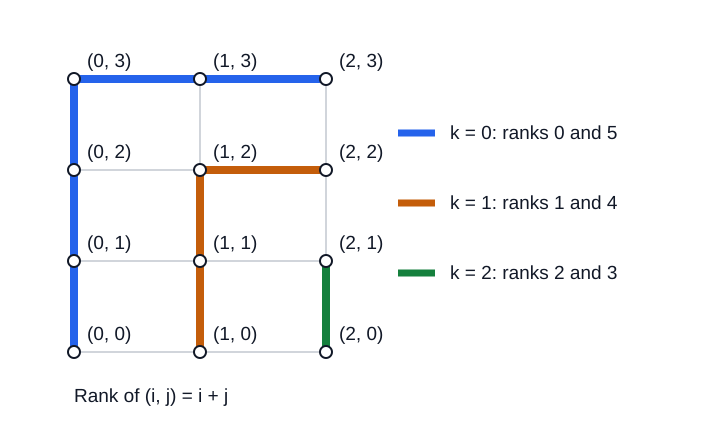

# Symmetric chains in noncrossing partition lattices

[](https://github.com/6/clank-lab/actions/workflows/noncrossing-symmetric-chains.yml)

A [noncrossing partition lattice](https://en.wikipedia.org/wiki/Noncrossing_partition) organizes factorizations of a Coxeter element in a [complex reflection group](https://en.wikipedia.org/wiki/Complex_reflection_group). A symmetric chain decomposition partitions it into chains that move one rank at a time and start and end equally far from the bottom and top. Henri Mühle asked in [2015](https://arxiv.org/abs/1509.06942v1) whether these lattices always have such a decomposition. Simion and Ullman, Reiner, Bessis and Corran, and Mühle established the infinite families and most exceptional cases. This work supplies the remaining exceptional cases and proves the chain assertion for every finite well-generated complex reflection group and every Coxeter element, including products. It does not settle Mühle's stronger Boolean-decomposition question.

Computer-assisted; not yet reviewed by experts.

The proofs, the Lean formalization, the certificate checkers and the text were produced by AI models (from OpenAI and Anthropic), working under the author's direction.

[Read the paper](paper/paper.pdf) · [LaTeX source](paper/paper.tex)



## Check it

Use Python 3, Node.js, GAP with its SmallGrp library, and Lean through [elan](https://github.com/leanprover/elan). On Debian or Ubuntu, install the native requirements with `sudo apt-get install python3 nodejs gap-core gap-libs gap-smallgrp`. From this folder:

```sh
python3 checks/verify.py
cd lean
lake build
```

The first command reconstructs the six remaining intervals, checks their complete vertex and cover sets, checks every chain certificate with two independent implementations, and requires altered certificates to fail. The Lake build checks the abstract interval, product, transfer, and exceptional-reduction lemmas. It uses Lean's standard library, so there is no Mathlib cache to fetch. The endpoint statement is included; the classification and the published decomposition theorems are inputs to the paper's written reduction, rather than theorems proved in Lean. See the [checker guide](checks/README.md) and [Lean guide](lean/README.md) for the verification boundary.

## Credits

Henri Mühle posed the question, proved the $G(d,d,n)$ result and the small exceptional cases, and established the strong Sperner property in general. Rodica Simion and Daniel Ullman supplied the type-A decomposition; Victor Reiner supplied the type-B chains; David Bessis and Ruth Corran identified the other $G(d,1,n)$ lattices with type B. Patricia Hersh strengthened the type-B result to a Boolean decomposition. Mühle also credits Eleni Tzanaki's unpublished type-D construction. Reiner, Vivien Ripoll and Christian Stump proved the reflection-automorphism result used to cover every Coxeter element. Geoffrey Shephard and John Todd classified the groups. Drew Armstrong describes the real reflection models; Bessis records the invariant degrees. John Conway and Neil Sloane's construction, as developed by Manabu Oura and Jiro Sekiguchi, supplies the complex exceptional models. The paper discusses related work and gives the exact source statements used. Griggs's matching construction, in Tomon's iterative form, guided the chain search. The product construction goes back to de Bruijn, van Ebbenhorst Tengbergen and Kruyswijk; Srinivasan gives a modern account. Verification uses GAP, its SmallGrp library, Python, Node.js, and Lean.

Apache-2.0 (see the repository's LICENSE), except the third-party material listed in [THIRD_PARTY.md](THIRD_PARTY.md).

## Cite

```bibtex
@misc{GrahamNoncrossingSymmetricChains2026,
  author       = {Graham, P.},
  title        = {{Symmetric chains in noncrossing partition lattices}},
  year         = {2026},
  howpublished = {\url{https://github.com/6/clank-lab/tree/noncrossing-symmetric-chains-v1/results/noncrossing-symmetric-chains}}
}
```
