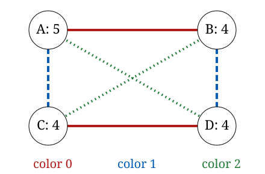

# The three-color Ramsey number of the 10-vertex path

[](https://github.com/6/clank-lab/actions/workflows/path-ramsey.yml)

Color each edge of a [complete graph](https://mathworld.wolfram.com/CompleteGraph.html)
with one of three colors. [Ramsey's theorem](https://en.wikipedia.org/wiki/Ramsey%27s_theorem)
says that with enough vertices some long [path](https://mathworld.wolfram.com/PathGraph.html)
has all its edges the same color; the three-color Ramsey number
$R(P_n, P_n, P_n)$ is the smallest number of vertices that forces a
one-colored path $P_n$ on $n$ vertices. Dybizbański, Dzido and Radziszowski (DDR)'s
[Conjecture 2, arXiv:1207.5851v3, Section 2](https://arxiv.org/abs/1207.5851v3)
states the formula below and attributes its suggestion to Faudree and Schelp
(1975), quoting “they feel”:

$$R(P_n, P_n, P_n) = 2n - 2 + (n \bmod 2).$$

Theorem 1 in Gyárfás, Ruszinkó, Sárközy and Szemerédi's
[author manuscript dated July 9, 2012, Section 1.1](https://www.renyi.hu/~gyarfas/Cikkek/120_sharp3cfin.pdf)
proves this formula for all sufficiently large $n$ (published in 2007,
with a corrigendum in 2008). Dybizbański, Dzido and Radziszowski proved
$R(P_8, P_8, P_8)=14$ in Theorem 10 and $R(P_9, P_9, P_9)\le17$ in
Theorem 8; with their Section 2 lower bound, the latter gives equality $17$.
[Radziszowski's survey, revision 18, p. 65, Sections 6.4 and 6.4.1(c)](https://www.cs.rit.edu/~spr/ElJC/ejcram18.pdf)
records the formula through nine vertices and the ten-vertex path as the
first open case. We prove that

$$R(P_{10}, P_{10}, P_{10}) = 18,$$

as conjectured: every 3-coloring of the edges of $K_{18}$ has a one-colored
path on 10 vertices. The new bound is the upper bound $18$; the matching
$K_{17}$ coloring is the even-case blow-up in Gyárfás, Ruszinkó, Sárközy
and Szemerédi's Section 1.1 after Theorem 1, also given in DDR's Section 2.
In that coloring each color has two label
classes, of 9 and 8 vertices, and every edge of the color lies inside one of
them, so a one-colored connected piece has at most 9 vertices. This settles the case $n = 10$; the general conjecture remains open.



The proof is a SAT computation, checked as a Lean formalization with trusted
native evaluation. Every coloring of $K_{18}$ without a one-colored $P_{10}$
contains a one-colored $P_9$, since $R(P_9, P_9, P_9) \le 17$, so it can be
relabeled to have that path in a fixed place and then reduced further by
symmetry; the resulting formula is split into 15,956 pieces, a further
certificate shows the pieces cover every case, and each piece is refuted with
a certificate. Lean proves from the definitions that this chain loses no
coloring, and proves the lower bound by its kernel. The certificate checks
(the 15,956 pieces, the cover and the smaller cases) and one comparison of the
formula with its definition run Lean's verified certificate checker as
compiled code (`Lean.ofReduceBool`), so they trust Lean's compiler as well as
its kernel. The same refutations, before their conversion for Lean, were also
checked by the verified checker cake_lpr, and a separate checker with its own
code re-checked every piece. The upper bounds for $n \le 9$ that the
computation uses, $R(P_9, P_9, P_9) \le 17$ among them, are re-derived by the
same method rather than taken from the literature.

Checked in Lean from the definitions, with compiled evaluation; not yet reviewed by experts.

The proofs, the Lean formalization, the search code, the certificate checkers and the text were produced by AI models (from OpenAI and Anthropic), working under the author's direction.

[Read the paper](paper/paper.pdf) · [LaTeX source](paper/paper.tex)

Archived on Zenodo: [doi:10.5281/zenodo.23634505](https://doi.org/10.5281/zenodo.23634505)

## Check it

The Lean proof is a standard Lake project. With
[elan](https://github.com/leanprover/elan) installed, run from this folder:

```sh
cd lean
lake exe cache get
lake build
```

This takes a few minutes and about 8 GB of disk for the Mathlib cache. It
checks the reduction from colorings to formulas, the lower bound, the value
18 with the certificate facts as hypotheses, the statements and their
axioms. It needs no generated data.

The certificates are about 60 GB, so they aren't included: the bundled
solver regenerates them and Lean checks them. They're also archived on
Zenodo, 36 GB compressed, at
[doi:10.5281/zenodo.23562432](https://doi.org/10.5281/zenodo.23562432);
its README explains how to check them without rerunning the solver. This needs Python 3.9 or
later (standard library only), git, gcc, g++, make and network access to
GitHub, besides elan. The quick check re-solves the smaller cases and
checks them, the cover and a random sample of cubes, both in Lean and with
cake_lpr; it also runs the encoding auditor and planted errors, which must
be rejected. It takes about fifteen minutes:

```sh
python3 checks/check.py quick --work /tmp/path-ramsey-work
```

The full check re-solves every one of the 15,956 cubes and checks each of
them in Lean, together with the smaller cases and the cover, then builds the
final theorem `R3_P10_eq_18 : ramsey3Path 10 = 18` with
`lake build R3P10Final`; only this step establishes the value in Lean. It
uses as many cores as are available, resumes when rerun and needs about
70 GB of disk; it took 249 and 301 CPU-hours in our two runs (the second
is recorded in [COMPLETION.md](COMPLETION.md)):

```sh
python3 checks/check.py full --work /tmp/path-ramsey-work
```

Adding `--cross-check` to that command also runs the independent check that
doesn't use Lean on every cube: the path-clause checker, the input checker
and the verified checker cake_lpr. The record of a completed full check,
with its axiom output and toolchain, is in [COMPLETION.md](COMPLETION.md).

[Corrections and interpretation of historical records](checks/CORRECTIONS.md)
explain the control-count and documentation errors retained in the earlier
text, and distinguish preserved measurements from this edition's checks.

Details for specialists are in [the Lean notes](lean/README.md) and
[the checking notes](checks/README.md). The preceding edition's detailed background and credits are retained in
[the historical background](checks/historical-background.tex), and its
independent checks, computing costs and replay account in
[the checking record](checks/checking-record.tex), with
[the formal-development details](checks/formal-development.tex),
[the formalization controls](checks/formal-controls.tex) and the earlier
[construction credit](checks/construction-credit.tex) and
[ladder context](checks/ladder-context.tex), with the earlier
[bibliography](checks/bibliography-background.tex) and
[cube context](checks/cube-context.tex).

## Credits

The prior path and cycle Ramsey literature is credited to
R. J. Faudree and R. H. Schelp; J. Dybizbański, T. Dzido and
S. Radziszowski; A. Figaj and T. Łuczak; A. Gyárfás, M. Ruszinkó,
G. N. Sárközy and E. Szemerédi; S. Letzter; R. W. Irving;
Yang Yuansheng and P. Rowlinson; N. F. Galindez; Z. Shao, H. Jiang,
X. Xu and S. Wang; and J. Zhang. The paper retains their bibliographic
credits; the preceding edition's full credit and historical account remain
in [its landing page](checks/landing-page-background.md) and the checking
background. Nearby method credit also belongs to M. Kirchweger,
P. Manrique and S. Szeider, [IJCAR 2026, abstract and Section 1](https://doi.org/10.1007/978-3-032-32589-1_8).
The
computation
uses A. Biere's CaDiCaL solver and its user-propagator interface by
K. Fazekas, A. Niemetz, M. Preiner, M. Kirchweger, S. Szeider and A. Biere;
drat-trim by N. Wetzler, M. Heule and W. Hunt; and cake_lpr by Y. K. Tan,
M. Heule and M. Myreen. Lean, its LRAT checker and Mathlib, with their
contributors, supplied the formal-development infrastructure.

Apache-2.0 (see the repository's LICENSE), except the third-party material listed in [THIRD_PARTY.md](THIRD_PARTY.md).

## Cite

```bibtex
@misc{GrahamPathRamsey2026,
  author       = {Graham, P.},
  title        = {{The three-color Ramsey number of the 10-vertex path}},
  year         = {2026},
  howpublished = {\url{https://github.com/6/clank-lab/tree/path-ramsey-v6/results/path-ramsey}},
  doi          = {10.5281/zenodo.23634505}
}
```
