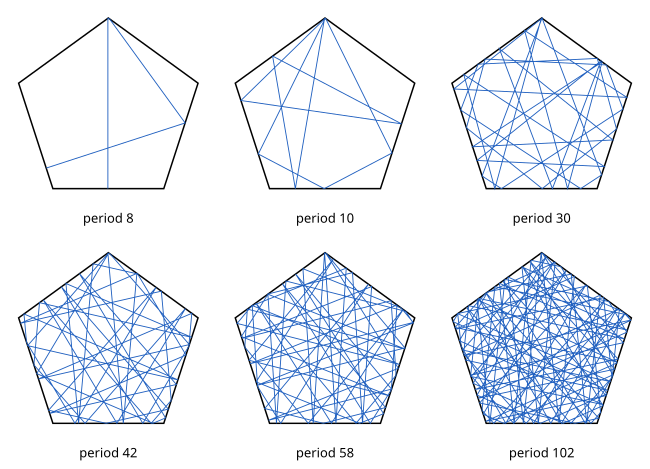

# Combinatorial periods of asymmetric billiard trajectories in the regular pentagon

[](https://github.com/6/clank-lab/actions/workflows/pentagon-billiard-periods.yml)

A [billiard](https://en.wikipedia.org/wiki/Dynamical_billiards) ball in a [regular pentagon](https://mathworld.wolfram.com/RegularPentagon.html) travels in straight lines and bounces off the sides, angle of incidence equal to angle of reflection. A trajectory that never hits a corner and eventually returns to its starting point and direction is periodic, and its combinatorial period is the number of bounces before it repeats. Some periodic trajectories look the same after a rotation of the pentagon by a fifth of a turn; the others are called asymmetric. In [2018](https://arxiv.org/abs/1810.11310v2) Diana Davis and Samuel Lelièvre conjectured (their Conjecture 4.3) that every even number other than 2, 12, 14 and 18 is the combinatorial period of an asymmetric periodic trajectory, after checking every period up to 4000. Alex Kontorovich and Xin Zhang ([IMRN, 2025](https://doi.org/10.1093/imrn/rnaf227)) recast the question in terms of an orbit of a semigroup of 2 × 2 matrices and proved that almost every even number occurs. We prove that every even number other than 2, 12, 14 and 18 occurs. We do not treat whether the four periods 2, 12, 14 and 18 occur.

The proof rests on a theorem of Diana Davis, Dmitry Fuchs and Serge Tabachnikov, in the form stated by Kontorovich and Zhang: each vector $(a + b\varphi, c + d\varphi)$ of the semigroup orbit with $(d-b) + 2(c-a)$ divisible by 5 gives an asymmetric trajectory of period $n = 2\ell$, twice the half-period $\ell = a+b+c+d$, where $\varphi$ is the golden ratio. Families of orbit vectors built on the semigroup's parabolic elements give arithmetic progressions of half-periods, and 379 of them cover every half-period from 2 on except nine. Six of those nine come from the explicit trajectories drawn below; the other three are halves of excluded periods.



Written proof, with Lean and computer checks; not yet reviewed by experts.

The proofs, the Lean formalization and the text were produced by AI models (from OpenAI and Anthropic), working under the author's direction.

[Read the paper](paper/paper.pdf) · [LaTeX source](paper/paper.tex)

Archived on Zenodo: [doi:10.5281/zenodo.24119275](https://doi.org/10.5281/zenodo.24119275)

## Check it

Install Lean using [elan](https://github.com/leanprover/elan). The Lean development uses no external libraries; the first build downloads the Lean toolchain, and the build itself takes under a minute, with about 2 GB of memory.

```sh
cd lean
lake build
```

The build checks the covering argument, the deduction of the main theorem from the cited period theorem and the six small periods, the axioms used and a few examples. The period theorem itself is assumed as one named axiom, and billiards are not formalized. The six explicit trajectories are checked in exact arithmetic by two independently written programs, which need only Python 3.10 or later; from this folder, the check takes about a second:

```sh
python3 checks/check.py
```

[Lean details](lean/README.md) give how the formal statements match the paper, and [the checkers' notes](checks/README.md) describe the two programs and their data.

## Credits

Diana Davis and Samuel Lelièvre posed the question as Conjecture 4.3 of *Periodic paths on the pentagon, double pentagon and golden L*, after computing the periods up to 4000. The result rests above all on Alex Kontorovich and Xin Zhang's *On the local-global conjecture for combinatorial period lengths of closed billiards on the regular pentagon* (International Mathematics Research Notices, 2025): its Theorem 2.1, with the description of the long saddle connections before it, is the one cited input, and its proof of the density theorem already produced periods from products of powers of the parabolic generators.

That theorem is due to Diana Davis, Dmitry Fuchs and Serge Tabachnikov (*Periodic trajectories in the regular pentagon*, Moscow Mathematical Journal, 2011, Theorem 11). The arithmetic is formalized with Lean 4. [Further credits](checks/README.md#further-credits) give the exact references.

Apache-2.0 (see the repository's LICENSE).

## Cite

```bibtex
@misc{GrahamPentagonBilliardPeriods2026,
  author = {Graham, P.},
  title = {{Combinatorial periods of asymmetric billiard trajectories in the regular pentagon}},
  year = {2026},
  howpublished = {\url{https://github.com/6/clank-lab/tree/pentagon-billiard-periods-v1/results/pentagon-billiard-periods}},
  doi          = {10.5281/zenodo.24119275}
}
```
