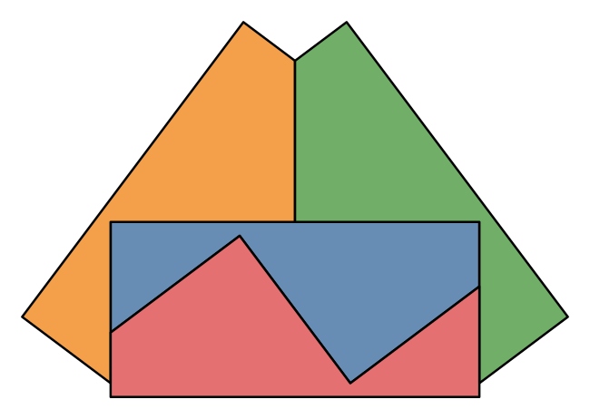

# No holeless tetrad of four congruent pentagons

[](https://github.com/6/clank-lab/actions/workflows/pentagon-tetrads.yml)

A [tetrad](https://en.wikipedia.org/wiki/Tetrad_(geometry_puzzle)) is a set of four regions in the plane, with no overlaps, in which every two regions share a stretch of boundary. The puzzle asks for tetrads whose four regions are congruent: copies of one shape, possibly mirrored. Scott Kim found four congruent hexagons that form a tetrad with no hole (pictured), and four congruent pentagons can form a tetrad around a hole. In 2020 [Walter Trump asked](https://www.trump.de/tetrads/question-14/question-14.htm) whether pentagons can do it without the hole, judging that “extremely unlikely” but adding “I have not seen a proof”; the Wikipedia article lists it as unknown. We prove that they cannot: no four congruent pentagons, convex or not and mirror images allowed, form a tetrad whose union has no hole. This builds on Trump's questions and examples and on his proof that convex tiles never form a tetrad.

Triangles and quadrilaterals cannot form a holeless tetrad either, so six is the least number of sides of a polygon whose congruent copies form one. This answers the question of the smallest such polygon, raised in Martin Gardner's account of the puzzle and listed as open by [Juris Čerņenoks and Andrejs Cibulis](https://doi.org/10.22364/bjmc.2018.6.2.01) in 2018.



Computer-assisted; not yet reviewed by experts.

The proofs, the checking programs and the text were produced by AI models (from OpenAI and Anthropic), working under the author's direction.

[Read the paper](paper/paper.pdf) · [LaTeX source](paper/paper.tex)

## Check it

With Python 3.12 or newer, from this folder:

```sh
python3 -m pip install -r checks/requirements.txt
python3 checks/check.py
```

This takes about three minutes on two cores. It reproduces the three possible boundary maps by two separate enumerations, checks that the 116 surviving cases fall into 22 classes under relabeling with a closing member in each, checks every closure certificate with a verifier that does not use the search code, and checks that a corrupted certificate is rejected. `python3 checks/check.py --full` also reruns the exact angle screen over all placements, including the triangle and quadrilateral cases (about five CPU-hours; `--full --part K/8` splits it). The [checking guide](checks/README.md) describes each step and the data files.

## Credits

Walter Trump posed the question and conjectured the answer on his pages [Further questions about tetrads](https://www.trump.de/tetrads/contents.htm) (Questions 14 and 15, 2020), whose pentagon tetrads with holes, by Trump, Livio Zucca and others, and whose proof that convex tiles fail (Question 18) framed this work. The puzzle goes back to Michael R. W. Buckley, who named the tetrad in 1975, and to Martin Gardner's account of it, which includes Scott Kim's hexagon tetrad. David Eppstein asked the same question in [2021](https://11011110.github.io/blog/2021/04/30/linkage.html), and Juris Čerņenoks and Andrejs Cibulis listed the smallest polygon for a holeless tetrad among their open problems.

The proof bounds the tiles' boundary map by Euler's formula, enumerates the maps and corner placements, and decides the linear conditions with exact rational linear programming. The closure certificates were produced with the ball arithmetic of [python-flint](https://github.com/flintlib/python-flint) and [SymPy](https://www.sympy.org/), and are checked with [mpmath](https://mpmath.org/)'s interval arithmetic; the search also uses [NumPy](https://numpy.org/) and [SciPy](https://scipy.org/). Further credits are in the [checking guide](checks/README.md#further-credits).

Apache-2.0 (see the repository's LICENSE), except the third-party material listed in [THIRD_PARTY.md](THIRD_PARTY.md).

## Cite

```bibtex
@misc{GrahamPentagonTetrads2026,
  author       = {Graham, P.},
  title        = {{No holeless tetrad of four congruent pentagons}},
  year         = {2026},
  howpublished = {\url{https://github.com/6/clank-lab/tree/pentagon-tetrads-v1/results/pentagon-tetrads}}
}
```
