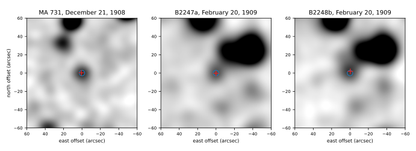

# Candidate images of Pluto on archival plates from 1908 and 1909

[](https://github.com/6/clank-lab/actions/workflows/pluto-prediscovery.yml)

[Pluto](https://en.wikipedia.org/wiki/Pluto) was found by Clyde Tombaugh in 1930. Astronomers then searched older photographs for it. The earliest measurements used in the [Minor Planet Center's orbit of Pluto](https://minorplanetcenter.net/db_search/show_object?object_id=134340) come from two Heidelberg plates of January 1914. An amateur team at Yerkes Observatory reported images on plates of August and November 1909; we found no published measured positions for them. B. E. Schaefer searched the Harvard plate collection in 1982 and again in 2004 and found nothing earlier. The published list of the 1982 search does not include the MA series, and the account of the 2004 search does not list its plates.

We find faint, star-like images at Pluto's predicted position on three public plate scans, a separate image on each. One is Harvard plate MA 731, exposed on December 21, 1908 (UT). The other two are the Heidelberg plates B2247a and B2248b, taken together on February 20, 1909. The Harvard archive's exposure midpoint for MA 731 is 5.8 hours later than the one given by asteroid trails on the same plate, so a search at the archive time looks in the wrong place.

Each image lies within 2 arcseconds of Pluto's predicted position, about as close as comparably faint stars measured the same way lie to their catalog positions. Their brightness, blue magnitude 16.0 to 16.6, is consistent with Pluto's at the plates' precision. Two independent measurements of the same scans agree. The catalogs and comparison plates searched show no steady source bright enough to make the images, and no known asteroid is predicted there from its nominal orbit. When all three predictions were moved by the same random offset, a match as close and as strong on all three plates occurred in none of 230,352 trials. The search's looser rule, any signal at least four times the noise in the measurement window, matched all three plates in 8,581 trials, 3,360 of them with no Gaia star at the match on any plate; most of these are the outer light of bright stars near the window. These are rates per trial for the three plates reported, not the probability that the identification is wrong. A [shuffled sheet](data/blind.pdf) shows each image among 11 unrelated peaks of the same strength on its plate ([key](data/blind-key.json)). The identification rests on where and when the images appear, not on how they look.

The images are near the plates' limits, and the 1908 date rests on the single Harvard plate. Among the earlier plates in the three public archives searched that we could assess, none is deep enough; many could not be assessed, and other collections are not covered. If the identification is correct, the Heidelberg pair alone predates the Yerkes plates of August 1909, and MA 731 predates both. We offer it as a hypothesis for experts. Examining the original glass, above all MA 731, is the key next check.



Computer-assisted; not yet reviewed by experts.

The proofs, the measurements, the code and the text were produced by AI models (from OpenAI and Anthropic), working under the author's direction.

[Read the paper](paper/paper.pdf) · [LaTeX source](paper/paper.tex)

Archived on Zenodo: [doi:10.5281/zenodo.24376801](https://doi.org/10.5281/zenodo.24376801)

## Check it

Tested with Python 3.14:

```
pip install -r checks/requirements.txt
python checks/rerun.py WORK
```

This downloads the public scans and catalogs (about 0.6 GB) into the folder `WORK`, dates the exposures from asteroid trails, measures the three plates and the 1914 and 1923 Heidelberg control plates, runs the random-position, injection, faint-star, Gaia and SkyBoT controls, and compares 44 numbers with [data/expected.json](data/expected.json). It takes about ten minutes, mostly downloading, and about 1.2 GB of memory. The figure and the blinded sheet are drawn by `checks/figure.py`; Method A, the deep catalogs and the asteroid integration are recorded, not rerun. `python checks/census.py WORK` rebuilds the census of earlier plates in under an hour, mostly waiting on the Harvard service; its exposure-level list is [data/census-exposures.csv](data/census-exposures.csv). [checks/README.md](checks/README.md) describes the method, every control and the second, independent measurement.

## Credits

Clyde Tombaugh found Pluto at Lowell Observatory in 1930. E. C. Bower listed the prediscovery images of 1914 to 1927, beginning with the Heidelberg pair of January 1914, exposed by F. Kaiser and measured by Max Wolf. P. J. Melotte reported, then withdrew, a possible 1903 image. A. D. Walker found, C. D. Boyd measured and Bower reduced a Harvard image of 1914 that Schaefer and colleagues later doubted. G. Buchwald, M. DiMario and W. Wild reported the Yerkes images of 1909, and W. Osborn and F. Mills re-examined them. B. E. Schaefer searched the Harvard plates in 1982 and 2004. Schaefer, M. W. Buie and L. T. Smith described those searches, measured Pluto's 1930s color and showed that Harvard's MA plates match the Johnson B system. Their account defined the question this work takes up.

The plates were taken by Harvard College Observatory and by August Kopff at Heidelberg. The scans come from Harvard's [DASCH](https://dasch.cfa.harvard.edu/) project (J. Grindlay, P. K. G. Williams and colleagues) and the [Heidelberg Digitized Astronomical Plates](https://dc.g-vo.org/lswscans/res/positions/q/info) (H. Mandel, K. Birkle and M. Demleitner). Positions come from [JPL Horizons](https://ssd.jpl.nasa.gov/horizons/) (Pluto orbit PLU060, planetary ephemeris DE441), known bodies from [IMCCE SkyBoT](https://ssp.imcce.fr/webservices/skybot/) and the JPL Small-Body Database integrated with REBOUND and ASSIST, stars from Gaia DR3 and its synthetic photometry and from APASS, and further plates from APPLAUSE DR4. Murtagh and colleagues recently ran a related DASCH search for the distant object 2026 ED138. Further credits are in [checks/README.md](checks/README.md#further-credits). Apache-2.0 (see the repository's LICENSE), except the third-party material listed in [THIRD_PARTY.md](THIRD_PARTY.md).

## Cite

```bibtex
@misc{GrahamPlutoPrediscovery2026,
  author = {Graham, P.},
  title = {{Candidate images of Pluto on archival plates from 1908 and 1909}},
  year = {2026},
  howpublished = {\url{https://github.com/6/clank-lab/tree/pluto-prediscovery-v1/results/pluto-prediscovery}},
  doi          = {10.5281/zenodo.24376801}
}
```
