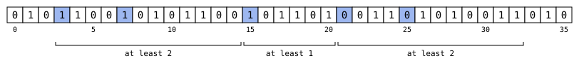

# A generalized pseudostandard prefix with no string attractor of size four

[](https://github.com/6/clank-lab/actions/workflows/pseudostandard-attractors.yml)

A [string attractor](https://doi.org/10.1145/3188745.3188814) of a finite word is a set of positions such that every factor (every block of consecutive letters) has an occurrence covering one of them; the smallest size of such a set measures how repetitive the word is. Binary generalized pseudostandard sequences are infinite 0–1 sequences built by repeatedly extending a word to the shortest palindrome, or the shortest antipalindrome (a word equal to its reversal with 0 and 1 exchanged), that starts with it. A directive bi-sequence $(\Delta, \Theta)$ says which letter to append and which closure to take at each step, and each word obtained is a pseudopalindromic prefix of the sequence: a prefix that is a palindrome or an antipalindrome.

Ľubomíra Dvořáková and Veronika Hendrychová determined the minimal attractors of these prefixes for the standard complementary-symmetric Rote sequences, gave attractors of at most three positions for the pseudostandard sequences (those built with antipalindromic closures only), minimal for the $n$-th prefix, $n\geq2$, unless $\Delta$ begins $01^{n-1}$ (taking $\Delta$ to begin with 0), and conjectured in August 2023, from computer experiments, that the pseudopalindromic prefixes of every binary generalized pseudostandard sequence have a string attractor of at most four positions ([preprint](https://arxiv.org/abs/2308.00850v1), published in [DMTCS 26:3](https://doi.org/10.46298/dmtcs.12385) in 2024). The [Thue–Morse sequence](https://en.wikipedia.org/wiki/Thue%E2%80%93Morse_sequence) belongs to the family, and its pseudopalindromic prefixes of length $2^n$ need exactly four positions for $n\geq4$, as Kutsukake and coauthors proved in [On repetitiveness measures of Thue–Morse words](https://arxiv.org/abs/2005.09524).

The bound fails at length 36. For $\Delta$ beginning $00101$ and $\Theta$ beginning $EEEER$, the fifth word of the closure recurrence is the palindromic prefix

$$w_5 = 010110010101100101101001101010011010,$$

which has no attractor of four positions; $\lbrace 3, 7, 15, 21, 25\rbrace$ (counting from 0) is an attractor of five. A second example has length 43. The example lies outside the subclasses that Dvořáková and Hendrychová's theorems cover, so their proved results stand. We do not claim that 36 is the shortest length, and whether some constant bounds the attractor sizes for the whole family remains open.

The lower bound has a short written proof: seven factors, each occurring once or twice, force two positions in $[3, 14]$, one in $[15, 20]$ and two in $[21, 32]$. The upper bound is checked against a table of the 48 factors that fit between or beside the chosen positions. Two programs, written separately, check both bounds from the definitions.



Computer-assisted; not yet reviewed by experts.

The proofs, the certificate checkers and the text were produced by AI models (from OpenAI and Anthropic), working under the author's direction.

[Read the paper](paper/paper.pdf) · [LaTeX source](paper/paper.tex)

Archived on Zenodo: [doi:10.5281/zenodo.23751684](https://doi.org/10.5281/zenodo.23751684)

## Check it

Python 3.10 or later, with no packages to install, checks everything in a few seconds:

```sh
python3 checks/check.py
```

It runs both checkers on the two examples, checks the seven-factor obstruction and the upper-bound table in `data/` with the proof checker, and confirms that each input in `data/rejected/` is rejected by each checker that reads it. [Checker documentation](checks/README.md) explains what each program checks.

## Credits

Ľubomíra Dvořáková and Veronika Hendrychová's [String attractors of Rote sequences](https://doi.org/10.46298/dmtcs.12385) supplies the conjecture, definitions and control examples. Dominik Kempa and Nicola Prezza's [At the roots of dictionary compression: string attractors](https://doi.org/10.1145/3188745.3188814) introduces string attractors. Aldo de Luca and Alessandro De Luca's [Pseudopalindrome closure operators in free monoids](https://www.sciencedirect.com/science/article/pii/S0304397506004245) introduces generalized pseudostandard sequences.

Alexandre Blondin Massé, Geneviève Paquin, Hugo Tremblay and Laurent Vuillon's [On generalized pseudostandard words over binary alphabets](https://cs.uwaterloo.ca/journals/JIS/VOL16/Blondin/blondin.pdf) supplies the description of Rote sequences used here. Kanaru Kutsukake, Takuya Matsumoto, Yuto Nakashima, Shunsuke Inenaga, Hideo Bannai and Masayuki Takeda's [On repetitiveness measures of Thue–Morse words](https://arxiv.org/abs/2005.09524) supplies the Thue–Morse attractors used for the comparison above.

The checking documentation also gives further credits and source notes.

Apache-2.0 (see the repository's LICENSE), except the third-party material listed in [THIRD_PARTY.md](THIRD_PARTY.md).

## Cite

```bibtex
@misc{GrahamPseudostandardAttractors2026,
  author       = {Graham, P.},
  title        = {{A generalized pseudostandard prefix with no string attractor of size four}},
  year         = {2026},
  howpublished = {\url{https://github.com/6/clank-lab/tree/pseudostandard-attractors-v3/results/pseudostandard-attractors}},
  doi          = {10.5281/zenodo.23751684}
}
```
