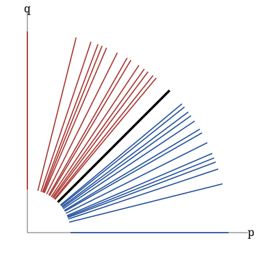

# A conjecture of Elgin, Reading and Stella on rank-two scattering coefficients

[](https://github.com/6/clank-lab/actions/workflows/scattering-coefficients.yml)

[Scattering diagrams](https://arxiv.org/abs/0902.0779) in the plane are collections of rays, each carrying a power series, determined by two initial lines through a consistency condition; in rank two they encode the wall-crossing behind [cluster algebras](https://en.wikipedia.org/wiki/Cluster_algebra). For the diagram whose initial lines carry $1+x^b$ and $1+y^c$, the coefficients $\tau^{b,c}(i,j)$ of these series have few known formulas. Thomas Elgin, Nathan Reading and Salvatore Stella [computed many of them and conjectured](https://arxiv.org/abs/2404.11381) closed formulas along various rays (first posted on April 17, 2024; published in 2026). Amanda Burcroff, Kyungyong Lee, Lang Mou, Gregg Musiker and Markus Reineke [proved Conjectures 1–3, 5–10 and 14–18](https://arxiv.org/abs/2511.14672) (first posted on November 18, 2025; published in 2026) and recorded Conjecture 13 as unsolved and mysterious from both the quiver-moduli and tight-grading points of view. Ryota Akagi [proved Conjectures 1, 2, 3, 5, 6, 11 and 15](https://arxiv.org/abs/2507.21916) by another method (first posted on July 29, 2025). This work proves Conjecture 13: for every $j \ge 1$,

$$\tau^{1,5}(2j,j) = \frac{1}{j}\sum_{\ell} \binom{\ell}{j+1-\ell}\binom{j+\ell-1}{\ell},$$

so the values are $2, 5, 17, 64, 259, \ldots$ Up to sign and a shift of index, these numbers form the [OEIS sequence A217596](https://oeis.org/A217596), contributed by Vladimir Kruchinin in 2013, whose generating function is algebraic; Burcroff and coauthors noted the match. What was open is that the scattering coefficients equal them. The coefficients are taken in the convention of Burcroff and coauthors: $\tau^{1,5}(2j,j)$ is the coefficient of $(x^2y^5)^j$ in the series on the ray through $(2,5)$ of the diagram with initial lines $1+x$ and $1+y^5$. This is the convention of Elgin, Reading and Stella's table and code; their definition as printed attaches the two exponents the other way round, and the paper explains this point.

The proof follows a single ray of one scattering diagram rather than all of them. After a change of lattice, the fifth power of the ray's function is the diagonal factor of the fifth power of an explicit automorphism of $\mathbb{Q}[[u,w]]$, and a filtration argument with the Poisson bracket turns the factorization into a first-order differential equation whose unique solution is an algebraic series. The definitions of scattering diagrams and of $\tau$ are those of Burcroff and coauthors; nothing else is assumed. The ordered factorization of Kontsevich and Soibelman and the change of lattice are proved again in the formalization, rather than cited.

Checked in Lean from the definitions; not yet reviewed by experts.

The proofs, the Lean formalization and the text were produced by AI models (from OpenAI and Anthropic), working under the author's direction.

[Read the paper](paper/paper.pdf) · [LaTeX source](paper/paper.tex)

Archived on Zenodo: [doi:10.5281/zenodo.23571933](https://doi.org/10.5281/zenodo.23571933)



The rays $(p,q)$ that carry a nontrivial function, up to total degree 12, in the ordered factorization of $T^5$, where $T$ is the automorphism of $\mathbb{Q}[[u,w]]$ with $T(u) = u(1+u+w)/(1+u)$ and $T(w) = w/(1+u)$. The function on the thick diagonal ray is the fifth power of the series in the theorem. Blue rays lie below the diagonal and red rays above it; the proof uses only which side each ray is on. The drawing is generated from an exact computation of the factorization.

## Check it

Install [elan](https://github.com/leanprover/elan), the standard Lean toolchain manager, and Git. From this folder:

```sh
cd lean
lake exe cache get
lake build
```

The project selects its Lean version automatically. The build takes a few minutes with the Mathlib cache and about 8 GB of memory. It checks the theorem, the examples and the axiom guards. See [the Lean guide](lean/README.md) for the statement and definitions.

## Credits

The conjecture, the computations that suggested it, and the code that produces the coefficients are due to Thomas Elgin, Nathan Reading and Salvatore Stella. The definition of the coefficients used here, the change of lattice, and the record of the conjecture's status are due to Amanda Burcroff, Kyungyong Lee, Lang Mou, Gregg Musiker and Markus Reineke. Scattering diagrams were introduced by Maxim Kontsevich and Yan Soibelman and by Mark Gross and Bernd Siebert, and became central to cluster algebras through the work of Mark Gross, Paul Hacking, Sean Keel and Maxim Kontsevich; the ordered factorization is due to Kontsevich and Soibelman, and we use it in the formulation of Mark Gross, Rahul Pandharipande and Bernd Siebert. Burcroff, Lee, Mou, Musiker and Reineke proved Conjectures 1–3, 5–10 and 14–18, and Ryota Akagi proved Conjectures 1, 2, 3, 5, 6, 11 and 15, the latter crediting the proof of 11 to Burcroff, Lee and Mou. The OEIS entry A217596 is due to Vladimir Kruchinin, with functional equations added by Paul D. Hanna, a recurrence by Peter Bala, and a combinatorial interpretation and formulas by Muhammed Sefa Saydam. The paper gives the references. The Lean project uses Lean and Mathlib.

Apache-2.0 (see the repository's LICENSE), except the third-party material listed in [THIRD_PARTY.md](THIRD_PARTY.md).

## Cite

```bibtex
@misc{GrahamScatteringCoefficients2026,
  author       = {Graham, P.},
  title        = {{A conjecture of Elgin, Reading and Stella on rank-two scattering coefficients}},
  year         = {2026},
  howpublished = {\url{https://github.com/6/clank-lab/tree/scattering-coefficients-v2/results/scattering-coefficients}},
  doi          = {10.5281/zenodo.23571933}
}
```
