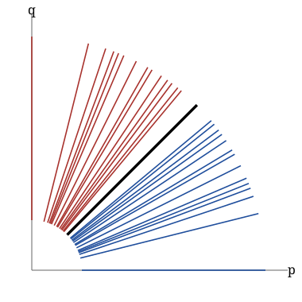

# A conjecture of Elgin, Reading and Stella on rank-two scattering coefficients

[](https://github.com/6/clank-lab/actions/workflows/scattering-coefficients.yml)

[Scattering diagrams](https://arxiv.org/abs/0902.0779) in the plane are collections of rays, each carrying a power series, determined by two initial lines through a consistency condition; in rank two they encode the wall-crossing behind [cluster algebras](https://en.wikipedia.org/wiki/Cluster_algebra). For the diagram whose initial lines carry $1+x^b$ and $1+y^c$, the coefficients $\tau^{b,c}(i,j)$ of these series have few known formulas. Thomas Elgin, Nathan Reading and Salvatore Stella [computed many of them and conjectured](https://arxiv.org/abs/2404.11381) closed formulas along various rays (first posted on April 17, 2024; published in 2026). Amanda Burcroff, Kyungyong Lee, Lang Mou, Gregg Musiker and Markus Reineke [proved Conjectures 1–3, 5–10 and 14–18](https://arxiv.org/abs/2511.14672) (first posted on November 18, 2025; published in 2026) and recorded Conjecture 13 as unsolved and mysterious from both the quiver-moduli and tight-grading points of view. Ryota Akagi [proved Conjectures 1, 2, 3, 5, 6, 11 and 15](https://arxiv.org/abs/2507.21916) by another method (first posted on July 29, 2025); Akagi credits the complete proof of Conjecture 11 to Burcroff, Lee and Mou, supplied after that first version. This work proves Conjecture 13: for every $j \ge 1$,

$$\tau^{1,5}(2j,j) = \frac{1}{j}\sum_{\ell} \binom{\ell}{j+1-\ell}\binom{j+\ell-1}{\ell},$$

so the values are $2, 5, 17, 64, 259, \ldots$ Up to sign and a shift of index, these numbers form the [OEIS sequence A217596 (https://oeis.org/A217596)](https://oeis.org/A217596), contributed by Vladimir Kruchinin in 2013, whose generating function is algebraic; Burcroff and coauthors noted the match and deduced algebraicity and exponential growth rate 27/5 conditionally on the conjecture (§9.3). The theorem identifies the scattering coefficients with this sequence. The coefficients are taken in the convention of Burcroff and coauthors: $\tau^{1,5}(2j,j)$ is the coefficient of $(x^2y^5)^j$ in the series on the ray through $(2,5)$ of the diagram with initial lines $1+x$ and $1+y^5$. This is the convention of Elgin, Reading and Stella's table and code; Remark B.2 of the paper quotes the printed definition and explains the parameter correspondence.

The coefficient theorem for the stated formal definitions is checked in Lean using Mathlib; the identification with the literature's conventions is a written argument.



The rays $(p,q)$ that carry a nontrivial function, up to total degree 12, in the ordered factorization of $T^5$, where $T$ is the automorphism of $\mathbb{Q}[[u,w]]$ with $T(u) = u(1+u+w)/(1+u)$ and $T(w) = w/(1+u)$. The function on the thick diagonal ray is the fifth power of the series in the theorem. Blue rays lie below the diagonal and red rays above it; the proof uses only which side each ray is on. The drawing is generated from an exact computation of the factorization.

Checked in Lean from the definitions; not yet reviewed by experts.

[Read the paper](paper/paper.pdf) · [LaTeX source](paper/paper.tex)

Archived on Zenodo: [doi:10.5281/zenodo.24433538](https://doi.org/10.5281/zenodo.24433538)

## Abstract

In the rank-two cluster scattering diagram with initial walls $1+x$ and $1+y^5$, the ray through $(2,5)$ carries the series $1+\sum_{j\geq1}\tau^{1,5}(2j,j)(x^2y^5)^j$. We prove that $\tau^{1,5}(2j,j)=\frac1j\sum_{\ell}\binom{\ell}{j-\ell+1}\binom{j+\ell-1}{\ell}$ for every $j\geq1$, as Elgin, Reading and Stella conjectured (their Conjecture 13). Burcroff, Lee, Mou, Musiker and Reineke proved Conjectures 1–3, 5–10 and 14–18 and called Conjecture 13 “mysterious from both the quiver moduli and tight grading points of view.” The binomial sum was already recorded in the OEIS by Vladimir Kruchinin, with a functional equation by Paul D. Hanna. Using Kontsevich and Soibelman's ordered factorization and the change of lattice of Gross, Hacking, Keel and Kontsevich, we reduce the problem to factoring the fifth power of an explicit automorphism of $\mathbb{Q}[[u,w]]$; a grading separates the diagonal wall from all others and yields a differential equation whose unique solution is algebraic. OpenAI's earlier, closely related quantum scattering framework admits the same incoming multiplicities but states no formula for these coefficients. The coefficient identity is formalized in Lean from the definitions.

This work has not yet been reviewed by experts. The proofs, the Lean formalization and the text were produced by AI models (from OpenAI and Anthropic), working under the author's direction.

## Check it

Install [elan](https://github.com/leanprover/elan), the standard Lean toolchain manager, and Git. From this folder:

```sh
cd lean
lake exe cache get
lake build
```

The project selects its Lean version automatically. The build takes a few minutes with the Mathlib cache and about 8 GB of memory. It checks the theorem, the examples and the axiom guards. See [the Lean guide](lean/README.md) for the statement and definitions.

### Formal statement and checking details

The paper displays `ErsConj13.ers_conjecture_13` and explains its mathematical scope. In the formal definitions, `Slope` is the nonnegative rationals with a top element for the vertical ray; the slope $5/2$ represents $(2,5)$. `IsConsistentFamily` requires constant term 1 at every slope and the ascending-product identity on both generators modulo every finite total degree. `ersCoeff j` is the displayed binomial sum through index $j+1$; the natural-number subtractions do not truncate for $j \ge 1$. The [definition files and guide](lean/README.md) give the full definitions and dependency pins.

The formal proof uses factorization uniqueness instead of logarithms and Bala's recurrence instead of Lagrange inversion. Its correspondence with the paper is:

| Paper | Lean declaration |
| --- | --- |
| Poisson walls | `wall_bracket` |
| Ordered factorization | `factor_exists`, `factor_unique` |
| Change of lattice | `transport5_consistent` |
| Monomial substitution | `transport_consistent` |
| Filtration | `realization` |
| Three-component extraction | `V1` |
| Cocycle and quadratic factorization | `cocycle`, `quad_root`, `one_add_P_factor`, `lemma_E` |
| Euler identity and Poisson equation | `euler_conj`, `lemma_SE` |
| Differential equation | `exact_identity`, `ode_of_SE` |
| Uniqueness | `ode_unique` |
| Algebraic solution | `c5_identity`, `S_cubic` |

The axiom guards require exactly `propext`, `Classical.choice` and `Quot.sound`. The original independent check of the unchanged formal development took 10 minutes 15 seconds on ARM64 Linux with Cortex-X925 and Cortex-A725 processors and twelve CPU cores allocated. The acceptance record's maximum process RSS was 7,519,304 KiB; it is not an aggregate-memory measurement. The convention checks agree with the Elgin–Reading–Stella code through $j=12$; these finite checks are separate from the proof.

## Credits

The conjecture, the computations that suggested it, and the [code (https://github.com/Etn40ff/scatcoef)](https://github.com/Etn40ff/scatcoef) that produces the coefficients are due to Thomas Elgin, Nathan Reading and Salvatore Stella. We follow Amanda Burcroff, Kyungyong Lee, Lang Mou, Gregg Musiker and Markus Reineke’s definitions of scattering diagrams and coefficients, Proposition 2.5 formulation of the change of lattice, and status account; the change of lattice originates in Mark Gross, Paul Hacking, Sean Keel and Maxim Kontsevich’s Example 1.15. Scattering diagrams were introduced by Maxim Kontsevich and Yan Soibelman and by Mark Gross and Bernd Siebert, and became central to cluster algebras through the work of Mark Gross, Paul Hacking, Sean Keel and Maxim Kontsevich; the ordered factorization is due to Kontsevich and Soibelman, and we use it in the formulation of Mark Gross, Rahul Pandharipande and Bernd Siebert. Burcroff, Lee, Mou, Musiker and Reineke proved Conjectures 1–3, 5–10 and 14–18, and Ryota Akagi proved Conjectures 1, 2, 3, 5, 6, 11 and 15, the latter crediting the proof of 11 to Burcroff, Lee and Mou. The OEIS entry A217596 is due to Vladimir Kruchinin, with functional equations added by Paul D. Hanna, a recurrence by Peter Bala, and a combinatorial interpretation and formulas by Muhammed Sefa Saydam. The paper gives the references. The Lean project uses Lean and Mathlib.

Burcroff, Lee and Mou develop the general tight-grading formula in [Positivity of generalized cluster scattering diagrams](https://arxiv.org/abs/2503.03719), the full proof of the framework announced in their 2025 paper; nothing additional from that preprint is used here.

OpenAI's manuscript [Elementary positivity of chromatic quasisymmetric functions](https://github.com/openai/math/tree/7ef5c0cc5ca4b0e072b7a050fca09ab24bc6fa3a/preprints/Elementary-Positivity-of-Chromatic-Quasisymmetric-Functions-September-24-2026), dated September 24, 2026 and first posted on GitHub on October 6, 2026, develops a closely related quantum scattering framework: its Proposition 4.2 gives positive factors on every wall, also when “the simple incoming data are replaced by allowed products of elementary units”, which matches our five-and-one incoming multiplicities. It states no formula for these coefficients, and nothing from it is used here.

Hipolito Treffinger's [scattering diagrams for Artin algebras](https://arxiv.org/abs/2608.04233), first posted August 4, 2026, are nearby work; nothing from that work is used here.

Apache-2.0 (see the repository's LICENSE), except the third-party material listed in [THIRD_PARTY.md](THIRD_PARTY.md).

## Cite

```bibtex
@misc{GrahamScatteringCoefficients2026,
  author       = {Graham, Peter},
  title        = {{A conjecture of Elgin, Reading and Stella on rank-two scattering coefficients}},
  year         = {2026},
  howpublished = {\url{https://github.com/6/clank-lab/tree/scattering-coefficients-v4/results/scattering-coefficients}},
  doi          = {10.5281/zenodo.24433538}
}
```
