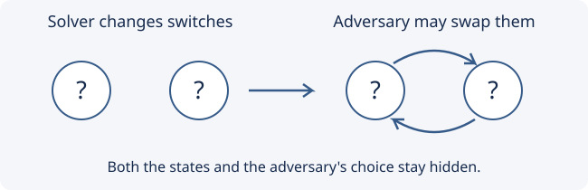

# A classification of solvable spinning-switches puzzles

[](https://github.com/6/clank-lab/actions/workflows/spinning-switches.yml)

Imagine switches that you can change without seeing their states, while an adversary secretly permutes their positions after each move. A predetermined sequence must visit every possible configuration, whatever permutations the adversary chooses. The algebraic model is a [wreath product](https://en.wikipedia.org/wiki/Wreath_product). In [Open Question 31 of a 2023 paper](https://arxiv.org/abs/2210.09408v1), Peter Kagey asked which such puzzles admit a sequence. We prove that, for nontrivial finite switch and adversary groups and a faithful action on finitely many positions, a sequence exists exactly when both groups have orders that are powers of the same prime. This extends Kagey's classification for abelian switch groups and uses Kagey's sufficient condition.



In particular, two interchangeable switches with states in the symmetric group $S_3$, and three cyclically permuted switches with states in the alternating group $A_4$, admit no such sequence. ndkrempel reported on [MathOverflow](https://mathoverflow.net/a/423643) on December 7, 2025 that Theorem 26 fails, and Kagey acknowledged the error there on December 8, 2025, noting that Example 27 fails. The contribution here is the classification.

Checked in Lean from the definitions; not yet reviewed by experts.

The proofs, the Lean formalization and the text were produced by AI models (from OpenAI and Anthropic), working under the author's direction.

[Read the paper](paper/paper.pdf) · [LaTeX source](paper/paper.tex)

## Check it

Install [elan](https://github.com/leanprover/elan), Git, and a C compiler. From this folder run:

```sh
cd lean
lake exe cache get
lake build
```

Allow several minutes for the proof after downloading the dependencies; a first installation also needs several gigabytes of disk space. The build checks the theorem, its statement, small examples, and its axioms. [Lean details](lean/README.md) give the correspondence with the paper.

## Credits

Peter Kagey's *Spinning switches on a wreath product* supplies the group-action model, the definition of a surjective strategy, and Open Question 31. Theorem 22 establishes sufficiency for groups of prime-power order, and Theorem 23 classifies the abelian case; statement numbers refer to the arXiv version. The present necessity proof includes nonabelian switch groups. Credit for identifying the failure of Theorem 26 belongs to ndkrempel's MathOverflow comment of December 7, 2025, followed by Kagey's acknowledgment on December 8, 2025 that Example 27 fails. Neither that correction nor the sufficient condition is claimed as new here.

The proof tracks configurations excluded by the moves and uses elementary finite-group theory. Sufficiency is formalized through the upper central series. The formal development uses [Lean](https://lean-lang.org/) and [Mathlib](https://github.com/leanprover-community/mathlib4), including their group-action, semidirect-product, and finite-group libraries. Apache-2.0 (see the repository's LICENSE), except the third-party material listed in [THIRD_PARTY.md](THIRD_PARTY.md).

## Cite

```bibtex
@misc{GrahamSpinningSwitches2026,
  author = {Graham, P.},
  title = {{A classification of solvable spinning-switches puzzles}},
  year = {2026},
  howpublished = {\url{https://github.com/6/clank-lab/tree/spinning-switches-v1/results/spinning-switches}}
}
```
