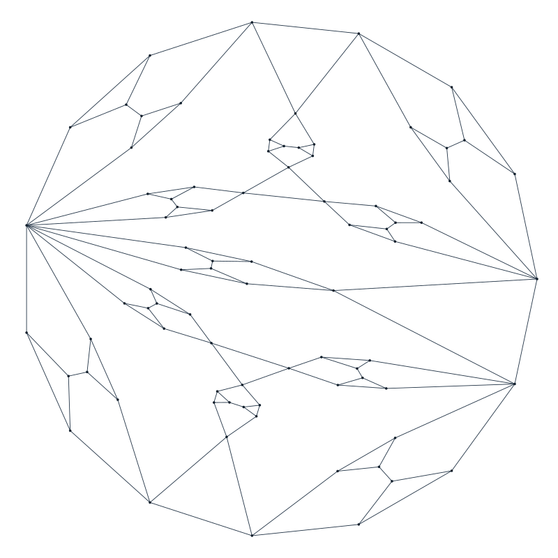

# A planar graph with no 4- or 9-cycles that is not 3-colorable

[](https://github.com/6/clank-lab/actions/workflows/steinberg-c4-c9.yml)

A [proper three-coloring](https://en.wikipedia.org/wiki/Graph_coloring) assigns three colors to a graph's vertices so that adjacent vertices differ. [Problem 1.2 of Kang, Jin and Wang, arXiv:1506.04629v1](https://arxiv.org/abs/1506.04629v1), attributed there to Lu, Wang, Wang, Bu, Montassier and Raspaud (2009), asks which lengths from five through nine, together with length four, force this property for planar graphs. Here an 82-vertex planar graph without four- or nine-cycles has no proper three-coloring, answering the length-nine case. Cohen-Addad, Hebdige, Král', Li and Salgado's [Theorem 3, arXiv:1604.05108v2](https://arxiv.org/abs/1604.05108v2), concerns the four-and-five pair. No minimum-order claim is made.



Checked in Lean from the definitions; not yet reviewed by experts.

The proofs, the Lean formalization, the search code, the certificate checkers and the text were produced by AI models (from OpenAI and Anthropic), working under the author's direction.

[Read the paper](paper/paper.pdf) · [LaTeX source](paper/paper.tex)

Archived on Zenodo: [doi:10.5281/zenodo.23644204](https://doi.org/10.5281/zenodo.23644204)

## Check it

Install [elan](https://github.com/leanprover/elan), then check the Lean proof:

```sh
cd lean
lake exe cache get
lake build
cd ..
```

Python 3.10 or later, a C compiler and a POSIX shell check the retained certificates and corruption controls:

```sh
sh checks/check.sh
```

No Python packages are required. Lean checks a crossing-free straight-line drawing with rational coordinates, exclusion of four- and nine-cycles, and non-three-colorability, proving the counterexample from the definitions. The paper also gives written arguments and executable checks for the Ore construction, four-criticality and edge minimum. [Lean documentation](lean/README.md) gives the exact formal statement. [Checker documentation](checks/README.md) explains the retained criticality, construction and independent executable checks.

## Credits

The construction uses Ore composition as defined in Kostochka and Yancey, [arXiv:1408.0846v3, Section 1 and Theorem 4](https://arxiv.org/abs/1408.0846v3). Lu and coauthors are credited for the question through Kang, Jin and Wang's Problem 1.2; Kang, Jin, Liu and Wang's arXiv:2001.00166v1 also records it as Problem 1.2 (with Jin first in that version). Cohen-Addad and coauthors are credited for Theorem 3 cited above. The paper's bibliography also credits Kang, Jin and Zhu, Dai, Wang and Xu, Chen, Dai, Nie, Wang and Yu, and Xiao and Huang. [Context and reading limits](checks/context.md) records incomplete source coverage. Marijn Heule and Nathan Wetzler's drat-trim checks the SAT certificate, generated with Armin Biere and collaborators' CaDiCaL.

The Lean proof uses Lean and Mathlib contributors' libraries and the LRAT verification methodology of Cruz-Filipe, Heule, Hunt, Kaufmann and Schneider-Kamp.

Apache-2.0 (see the repository's LICENSE), except the third-party material listed in [THIRD_PARTY.md](THIRD_PARTY.md).

## Cite

```bibtex
@misc{GrahamSteinbergC4C92026,
  author       = {Graham, P.},
  title        = {{A planar graph without four- or nine-cycles that is not three-colorable}},
  year         = {2026},
  howpublished = {\url{https://github.com/6/clank-lab/tree/steinberg-c4-c9-v7/results/steinberg-c4-c9}},
  doi          = {10.5281/zenodo.23644204}
}
```
