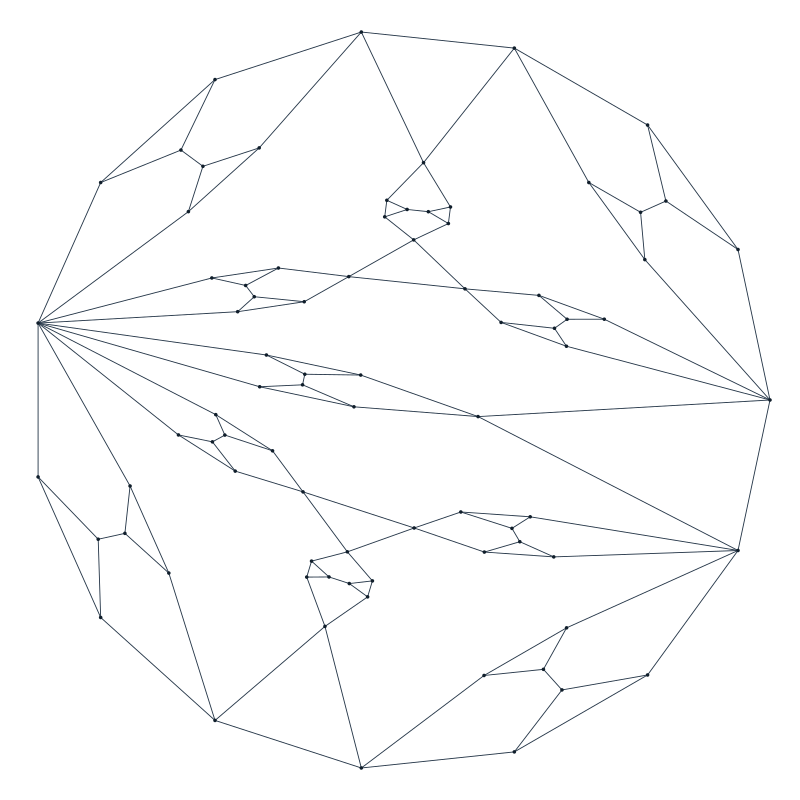

# A planar graph with no 4- or 9-cycles that is not 3-colorable

[](https://github.com/6/clank-lab/actions/workflows/steinberg-c4-c9.yml)

A [proper three-coloring](https://en.wikipedia.org/wiki/Graph_coloring) assigns three colors to a graph's vertices so that adjacent vertices differ. [Problem 1.2 of Kang, Jin and Wang, arXiv:1506.04629v1](https://arxiv.org/abs/1506.04629v1), attributed there to Lu, Wang, Wang, Bu, Montassier and Raspaud (2009), asks which lengths from five through nine, together with length four, force this property for planar graphs. Here an 82-vertex planar graph without four- or nine-cycles has no proper three-coloring, answering the length-nine case. Cohen-Addad, Hebdige, Král', Li and Salgado's [Theorem 3, arXiv:1604.05108v2](https://arxiv.org/abs/1604.05108v2), concerns the four-and-five pair. No minimum-order claim is made.



Written proof, with Lean and computer checks; not yet reviewed by experts.

[Read the paper](paper/paper.pdf) · [LaTeX source](paper/paper.tex)

Archived on Zenodo: [doi:10.5281/zenodo.23644204](https://doi.org/10.5281/zenodo.23644204)

## Abstract

We give an 82-vertex planar graph without cycles of length four or nine that is not three-colorable. Steinberg conjectured in 1976 that planar graphs without cycles of length four or five are three-colorable; Cohen-Addad, Hebdige, Král', Li and Salgado disproved this, and their graph contains a nine-cycle. Lu, Wang, Wang, Bu, Montassier and Raspaud asked, as recorded by Kang, Jin and Wang, for which lengths from five to nine every planar graph without cycles of that length or of length four is three-colorable. Our graph answers the length-nine case negatively. It is built from 27 complete graphs on four vertices by Ore compositions, the edge-deletion and vertex-splitting operation of Dirac, Hajós, Gallai and Ore. It is four-critical: every proper subgraph is three-colorable. Its 136 edges attain Kostochka and Yancey's lower bound, so no four-critical graph on 82 vertices has fewer edges. Lean checks planarity, the exclusion of four- and nine-cycles, and non-three-colorability; criticality and the edge minimum rest on the written proof.

This work has not yet been reviewed by experts. The proofs, the Lean formalization, the search code, the certificate checkers and the text were produced by AI models (from OpenAI and Anthropic), working under the author's direction.

## Check it

Install [elan](https://github.com/leanprover/elan), then check the Lean proof:

```sh
cd lean
lake exe cache get
lake build
cd ..
```

Python 3.10 or later, a C compiler and a POSIX shell check the retained certificates and corruption controls:

```sh
sh checks/check.sh
```

No Python packages are required. Lean checks a crossing-free straight-line drawing with rational coordinates, exclusion of four- and nine-cycles, and non-three-colorability, proving the counterexample from the definitions. The paper also gives written arguments and executable checks for the Ore construction, four-criticality and edge minimum. [Lean documentation](lean/README.md) gives the exact formal statement. [Checker documentation](checks/README.md) explains the retained criticality, construction and independent executable checks.

## Credits

The question comes from H. Lu, Y. Wang, W. Wang, Y. Bu, M. Montassier and A. Raspaud's [On the 3-colorability of planar graphs without 4-, 7- and 9-cycles](https://doi.org/10.1016/j.disc.2009.02.030), as attributed in Problem 1.2 of Y. Kang, L. Jin and Y. Wang's [The 3-colorability of planar graphs without cycles of length 4, 6 and 9](https://arxiv.org/abs/1506.04629v1). A. Kostochka and M. Yancey's [A Brooks-type result for sparse critical graphs](https://arxiv.org/abs/1408.0846v3) supplies the Ore composition used in the construction.

[Lean 4](https://github.com/leanprover/lean4), by the Lean contributors, and [Mathlib](https://github.com/leanprover-community/mathlib4), by the Mathlib contributors, supply the proof assistant and formal-proof libraries. Armin Biere and collaborators' [CaDiCaL](https://github.com/arminbiere/cadical) generates the SAT certificate, checked by Marijn Heule and Nathan Wetzler's [drat-trim](https://github.com/marijnheule/drat-trim). L. Cruz-Filipe, M. Heule, W. Hunt, M. Kaufmann and P. Schneider-Kamp's [Efficient Certified RAT Verification](https://doi.org/10.1007/978-3-319-63046-5_14) supplies the LRAT verification methodology.

The checking documentation also gives further credits and source notes.

Apache-2.0 (see the repository's LICENSE), except the third-party material listed in [THIRD_PARTY.md](THIRD_PARTY.md).

## Cite

```bibtex
@misc{GrahamSteinbergC4C92026,
  author       = {Graham, Peter},
  title        = {{A planar graph without four- or nine-cycles that is not three-colorable}},
  year         = {2026},
  howpublished = {\url{https://github.com/6/clank-lab/tree/steinberg-c4-c9-v8/results/steinberg-c4-c9}},
  doi          = {10.5281/zenodo.23644204}
}
```
