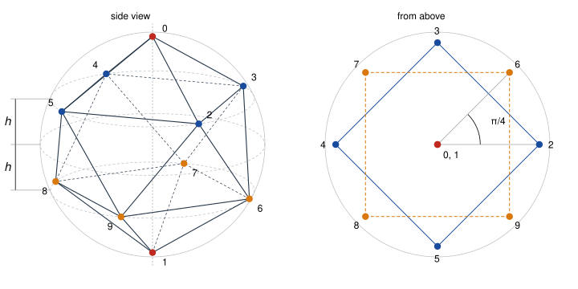

# The Thomson problem for N = 10

[](https://github.com/6/clank-lab/actions/workflows/thomson-10.yml)

For $N = 10$ equal charges on a sphere, is the familiar arrangement of two poles and two offset squares the unique arrangement of least repulsion? This is a case of the [Thomson problem](https://en.wikipedia.org/wiki/Thomson_problem), introduced by J. J. Thomson in 1904. We prove that this $D_{4d}$ bicapped square antiprism uniquely minimizes Coulomb energy among all ten distinct points on the unit sphere, up to orthogonal maps (including reflections) and relabeling. The proof directly adapts [Aravind Karthigeyan's MIT-licensed $N=9$ Lean project](https://github.com/aravindkarthigeyan/thomson-n9-lean).



The candidate's height is specified by an exact equation. Lean proves that the height exists and is unique in its specified interval, that the candidate consists of distinct unit vectors, and that every competitor has at least its energy, with equality exactly for congruent configurations. No symmetry is assumed of competitors. The proof first localizes every competitor of no greater energy, then uses orthogonal alignment and a local energy bound covering all spherical perturbations to force equality with the candidate.

The proof follows the $N=9$ design and reuses most of its Lean code, but that machinery did not reach ten points in three places. A three-point energy certificate belongs to one configuration, and one sharp at the antiprism, missing its energy by less than $10^{-30}$, was needed; this was the hardest step. The poles are antipodal, so inner product $-1$ is a genuine contact that the $N=9$ classification of inner-product patterns excludes, and its argument that some three points are far from coplanar fails and is replaced. The local energy bound needs a new $30 \times 30$ Hessian certificate, with a smaller spectral gap than at $N=9$.

Checked in Lean from the definitions; not yet reviewed by experts.

The proofs, the Lean formalization, the certificate checkers and the text were produced by AI models (from OpenAI and Anthropic), working under the author's direction.

[Read the paper](paper/paper.pdf) · [LaTeX source](paper/paper.tex)

## Check it

Install [elan](https://github.com/leanprover/elan) and Python 3.10 or later. From this folder:

```sh
cd lean
lake exe cache get
lake build
cd ..
python3 -I checks/check.py
```

The Python checker independently implements checks of the same rational certificates and rejects eight corruptions; it also checks that the figure shows the candidate's points. Lean proves the geometric and analytic obligations. Python also checks a separate rigorous enclosure of the candidate energy $E$, $32.716949460147 < E < 32.716949460149$, outside the Lean theorem. The [Lean guide](lean/README.md) and [checking guide](checks/README.md) give the exact height interval, theorem hypotheses, axioms, certificate sizes, dependency versions, memory requirements and qualified build timing.

## Credits

[Karthigeyan's October 6, 2026 project](https://github.com/aravindkarthigeyan/thomson-n9-lean/blob/168ff0c98cab4dfda0460ba55f8d169070ac385e/README.md) proves the nine-point tricapped trigonal prism uniquely optimal; it too is unreviewed. We substantially adapt its Lean code, certificate design, window classification and local-to-global argument. Our contribution is the $N=10$ instance and its certificates. [THIRD_PARTY.md](THIRD_PARTY.md) records origins, changes and the MIT license; upstream prose was not copied.

Classical credits include [Föppl (1912), $N=4$](https://www.mathunion.org/fileadmin/ICM/Proceedings/ICM1912.2/ICM1912.2.ocr.pdf), [Yudin (1992; English translation 1993), $N=6$](https://www.mathnet.ru/eng/dm737), and [Schwartz (2010 preprint; 2013 journal), $N=5$](https://arxiv.org/abs/1001.3702). Andreev proved $N=12$ in 1996; [Cohn and Kumar (2007)](https://arxiv.org/html/math/0607446) credit him and prove universal optimality for the tetrahedron, octahedron and icosahedron.

[Hung Tran and Vals AI (September 2026)](https://www.vals.ai/blogs/thomson-n7-lean-proof) proved unique optimality for $N=7$ with Lean. [Kryvonos, Liehr and Taylor (September 2026)](https://arxiv.org/abs/2609.22077) proved unique Coulomb and logarithmic optimality for $N=8$, with Lean verification. [Joseph Tooby-Smith and Alex Zughaid (September 2026)](https://github.com/jstoobysmith/Thomson-N-8-Warrant/blob/2c35d62e07d72686931da4bc3e062d668e858eda/README.md) also supplied a Lean-checked $N=8$ Coulomb warrant, described as work in progress.

The bounds build on [Delsarte–Goethals–Seidel (1977)](https://doi.org/10.1007/BF03187604), Yudin, [Bachoc–Vallentin (2008)](https://arxiv.org/abs/math/0608426) and [Cohn–Woo (2012)](https://arxiv.org/abs/1103.0485).

Concurrent work by saberwatchmanga (formerly terry2418) proves [$N=10$ local minimality (October 7, 2026)](https://github.com/saberwatchmanga/-lean-finite-certificates/tree/7ba9eb38db36c9cb957ff26758b66bbacc31d8bc/Thomson10LocalMinimum) and [a chord bound (October 11, 2026)](https://github.com/saberwatchmanga/-lean-finite-certificates/tree/bc74bc050f4c39123e894b3fd3873ba17f60289a/Thomson10Chord1935), not global optimality. Neither is a premise here. Both chord and separation arguments use $32.717$, the candidate energy rounded upward; we cannot establish whether our cutoff was chosen independently or taken from that work.

The enclosure agrees with the numerical energy of [Erber–Hockney (1991)](https://lss.fnal.gov/archive/1991/pub/Pub-91-222-T.pdf) and the $D_{4d}$ entry in the [Cambridge Cluster Database](https://www-wales.ch.cam.ac.uk/~wales/CCD/Thomson/table.html). Numerical identification, rigorous proof and formal proof with uniqueness are distinct. To our knowledge no earlier rigorous proof for $N=10$ exists, and we make no priority claim.

Apache-2.0 (see the repository's LICENSE), except the third-party material listed in [THIRD_PARTY.md](THIRD_PARTY.md).

## Cite

```bibtex
@misc{GrahamThomson102026,
  author       = {Graham, P.},
  title        = {{The Thomson problem for N = 10}},
  year         = {2026},
  howpublished = {\url{https://github.com/6/clank-lab/tree/thomson-10-v2/results/thomson-10}}
}
```
