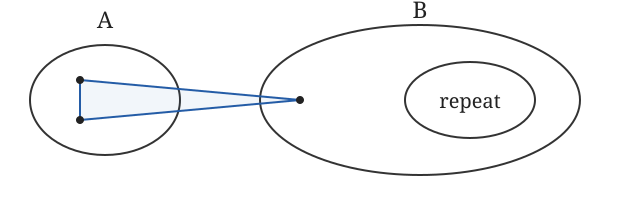

# Exact certificates and packaging checks

The [formalization guide](FORMALIZATION.md) states the exact endpoint,
trust boundary and scope of the recorded replay and adapter checks.

Python 3.11 or newer is enough for source materialization and its controls:

```sh
python3 -I checks/materialize.py
python3 -I checks/materialize.py --check
python3 -I checks/test_bootstrap.py
python3 -I checks/generate_public_guard.py --check
```

These commands do not run Lean, SDP checkers, or a new acceptance procedure.
The compressed inputs contain the exact integer certificates and the
unchanged finite proof sources. The materializer authenticates its
manifest, inputs, recipes, checkers, and output bytes. It regenerates 634
bounded arithmetic modules and 82 range assembly modules, without changing
any proof body. Other large finite tables and Gram/cover sources are
materialized from compressed text. These are untrusted source quotations;
only subsequent Lean checking establishes their proof obligations.

The pinned NumPy version requires Python 3.12 or newer. To run the full
original finite certificate pairs and corruptions:

```sh
python3 -m pip install -r checks/requirements.txt
python3 -I checks/quickcheck.py --cpus 2
```

Set `--cpus` to the actual allocated CPUs. A C++17 compiler with OpenMP,
GMP C++ headers and libraries is also required. NumPy and gmpy2 versions
in the requirements file identify the measured environment. The complete
finite check passed in 4 minutes 34 seconds on two allocated CPUs, with
peak resident memory about 1.7 GB. All eight separate parts also passed.

P32 has two independently written integer checkers, a five-level feasibility
witness, four semantic certificate mutations checked by both implementations,
and a planted cover gap rejected by both: ten rejections. P33 has independent
C++-backed and grouped Python checkers. For each coefficient 1 and 3999/4000,
both accept the original and reject a changed class coefficient, a non-PSD
block, a negative multiplier, a changed cancellative-link predicate, and a
cover gap. The mutation changes the first class coefficient with refreshed
metadata, so hash rejection alone cannot satisfy the semantic test. The
cover control omits the empty canonical class at the first boundary.

The wrapper checks parsed mathematical fields, full corruption counts,
explicit `REJECT:` responses, and the cover rejection reason. A missing
executable, import error, or other setup failure is a failed check. It also
compares the two P32 original summaries when run together. P33's original
corruption driver changes only its CPU-count environment variable in this
export; the mathematical checkers and certificate inputs are unchanged.

`--list` shows eight nonempty CI parts; `--part K/8` selects one. The parts
partition all four P32 steps and all 24 P33 case/checker pairs exactly once.
The groups use measured task times; their separate runs took 48–93 seconds
each with one checker worker, while two parts ran concurrently. The default
runs the full original protocols and compares both P32 original summaries.
Every part checks its exact assigned records and rejects setup failures.
The public workflow runs these eight parts and the source-reconstruction
controls separately, with one final status depending on all of them.

The full Lean rebuild is documented in the formal-proof guide. Its recorded
48 CPU-hours exceed the public CI limit; these finite and reconstruction
jobs do not claim to run it. The exact-axiom adapter was separately compiled
and exercised against the accepted compiled dependencies, with a fresh
typed probe and the exact dependency-name guard. That direct execution
does not establish that the standalone Lake build or its scheduling has
been exercised, and it is not a new replay of the dependency proofs.

The quick certificate check proves finite identities and covers. It does
not rebuild the asymptotic theorem, substitute for the original independent
acceptance, or establish a kernel-only proof. Source hash changes and
synthetic report mutations are packaging/parser controls, distinct from
semantic corruption rejection and compiler replay.

## Sources used during development

The colored setup and degree and local-maximality constraints follow Bodnár, León, Liu and Pikhurko's [notebook headed *The Turán number of {C5,K4}*](https://github.com/bodnalev/supplementary_files/blob/5766324d010da24a66271c0fbe38460cd377985b/no_cl/no_c5_k4.ipynb), zero-based cells 1 and 4. Cell 3 concerns the uncolored max-cut calculation; cells 5–6 solve and round. The notebook pin and the [supplementary collection pin](https://github.com/bodnalev/supplementary_files/tree/72375e0474ba4651b4299edd648f66465254b64e) are distinct. The notebook uses Bodnár's SageMath framework, documented in *FlagAlgebraToolbox: Flag Algebra Computations in SageMath*, [arXiv:2601.06590v3](https://arxiv.org/abs/2601.06590v3), §§1.2 and 2.4. That version documents release 0.3; the earlier notebook does not identify a release tag. Jeong, Park, Im, Lee and Yang's *A New Upper Bound for the Turán Density of the Tetrahedron*, [arXiv:2609.27495v2](https://arxiv.org/abs/2609.27495v2), §§2.5 and 3, combines degree-stationarity with an exact seven-vertex certificate and a Lean proof for the tetrahedron. Their stationarity criterion specializes Razborov's *Flag algebras*, §4.3, Corollary 4.6(a). These are relevant computational predecessors and adjacent work; the present certificates establish the two C5-only partition estimates.

Emil R. Vaughan's [*Flagmatic User's Guide*](https://github.com/emil79/flagmatic/blob/7b31ee6f855a72da98a726fd930678e21151adbd/doc/UsersGuide.tex), Problems section, includes the three-uniform tight five-cycle as an input; the guide also explains numerical semidefinite bounds and exact rounding. Maya Sankar's *The Turán Density of 4-Uniform Tight Cycles*, [arXiv:2411.01782v3](https://arxiv.org/abs/2411.01782v3), §§2–3, develops a coloring framework for tight-cycle homomorphisms across uniformities. Its long-cycle arguments require further stability and embedding steps; they do not supply the fixed-five-cycle certificates used here.

David E. Thompson's *An exactly certified upper bound of 0.5604007071302298 for the tetrahedron density, and the structure that stops it*, [Zenodo 22196487](https://doi.org/10.5281/zenodo.22196487), §2, describes color refinement, regularity constraints and alternating semidefinite optimization, followed by exact certification. Thompson's companion *Certified barriers for Turán's tetrahedron problem: exact ceilings at levels 6 and 7*, [Zenodo 22197769](https://doi.org/10.5281/zenodo.22197769), §2, gives exact integer-ray and rational LDLT checks; §3 reports a measured numerical bound and the exact-certificate work still needed. These are related certification methods for the tetrahedron; their claimed barriers are specific to the certificate classes studied there. Bartłomiej Kielak, Daniel Král’, Ander Lamaison, Hong Liu, Xichao Shu and Zhuo Wu's *Solution of uniform Turán's Tetrahedron Problem*, [arXiv:2609.08336v3](https://arxiv.org/abs/2609.08336v3), Lemma 16, uses a finite certificate for consistent colored three-graphs in a uniform-density argument. Uniform density differs from the ordinary global density considered here. These comparisons use selected primary passages; the external certificates were not independently checked for this paper.

[Mubayi and Rödl](https://doi.org/10.1006/jcta.2002.3284), Construction 1, give the recursive lower construction; their acknowledgments credit Y. Kohayakawa's discussions. [Mubayi, Pikhurko and Sudakov](https://opikhurko.warwick.ac.uk/E/MubayiPikhurkoSudakov11aim.pdf), §2.4, Conjecture 7, state the equality. [Kamčev, Letzter and Pokrovskiy](https://arxiv.org/abs/2209.08134v3) establish the long-cycle predecessor. Their good-coloring and cherry-component approach was considered during development. Their Theorem 2.4 assumes the absence of the specified pseudocycles; five-cycle-freeness alone does not supply that premise. The upper-bound architecture, partition estimates and reduction are Bodnár–León–Liu–Pikhurko's; their 2025 theorem treats a forbidden pair and longer cycles. This proof establishes the two estimates for the five-cycle alone, using weighted link inequalities, exact rational certificates and their finite-sampling interpretation. The method builds on Razborov's [flag algebras](https://doi.org/10.2178/jsl/1203350785).

[Falgas-Ravry and Vaughan](https://arxiv.org/abs/1201.4326v1), §3.1, Proposition 25 and Theorem 27, establish the sharp bound for hypergraphs whose edges are the triples inducing a directed out-star in a digraph. [Huang](https://arxiv.org/abs/1303.3101v2), §§2 and 4, gives an analytic proof of the directed-star result. Falgas-Ravry and Vaughan's iterated digraph blowup induces the Mubayi–Rödl three-graph; the digraph construction itself is theirs. Development use of this route was mediated through the KLP and Huang sources; a direct development read of Falgas-Ravry–Vaughan is not established. This restricted class does not include every five-cycle-free hypergraph.

Xizhi Liu's earlier [C5-only numerical optimization notebook](https://github.com/xliu2022/xliu2022.github.io/blob/1b5c8b15c545ea15587f8240bd2149a29aaba857/FlagAlgebra_Certificate/HypergraphGeneralizeTuran/script/C53_count.ipynb), last changed February 6, 2026, is related exact-topic computation. Alper Ferudun's [October 16, 2026 preprint](https://doi.org/10.5281/zenodo.23421447) gives an exact logarithmic-state optimization of the classical recursive family and its quadratic term. The recursive family is shared; no dependence on that algorithm or its second-order expansion is identified in the accepted endpoint handoff. The source and dependency audit remains incomplete. Ferudun expressly leaves an upper bound for arbitrary five-cycle-free hypergraphs outside that work.

Mubayi, Pikhurko and Sudakov, §2.4, record Razborov's earlier upper bound $\pi(C_5^3)<0.4683$, citing *On 3-Hypergraphs with Forbidden 4-Vertex Configurations* (2010), DOI 10.1137/090747476. That bound is cited here through their text; the original paper was not read in full.

For the different problem of forbidding the cycle with one edge deleted, Balogh and Luo's *Turán density of long tight cycle minus one hyperedge*, arXiv:2303.10530v2, determines density $1/4$ for sufficiently long lengths not divisible by three. [Bodnár–León–Liu–Pikhurko](https://arxiv.org/abs/2412.21011v3) and independently [Lidický–Mattes–Pfender](https://arxiv.org/abs/2409.14257v2) determine density $1/4$ for the five-cycle minus an edge. [Jeong, Park, Hyun, Oum and Yang](https://arxiv.org/abs/2607.23500v2) formalize flag algebras for finite simple graphs; the present proof treats three-uniform hypergraphs directly. Lean and mathlib supply the underlying formal mathematics.

Balogh and Luo's orientability and link-component analysis was also considered during development; Claim 4.4 of arXiv:2303.10530v2, p. 10, concerns the stronger orientable, five-cycle-minus-an-edge-free setting. That premise is not imported here. Bodnár–León–Liu–Pikhurko's minus-edge paper supplied a strict bad-edge/missing-edge defect and recursive template, while Lidický–Mattes–Pfender's independent minus-edge work informed the complete-cut and recursive-refinement approach. The retained development readings name arXiv:2412.21011v2 and arXiv:2409.14257v1; the selected passages checked for this guide are v3, Proposition 3.3 and the end of Lemma 4.1, and v2, Lemma 9 and the recursion discussion, respectively. The earlier versions were not compared. These stronger forbidden-family results do not supply the missing five-cycle-only estimates.

Nannan Chen, Yuzhen Qi, Caihong Yang and Hongbin Zhao's *Exact Turán densities in triple systems*, [arXiv:2507.07360v1](https://arxiv.org/abs/2507.07360v1), Lemma 2.2, informed the exploratory bad-edge/missing-edge refinement approach. Its stronger forbidden family differs from five-cycle-freeness; this is development-method credit, without an established dependency of the accepted certificates. The source itself credits Mubayi–Rödl's construction and the Bodnár–León–Liu–Pikhurko method. Only the selected original opening and lemma statement were checked for this guide; the proof of Lemma 2.2 was not read.

Sources also informed approaches tried during development. Ascoli, He and Yu's *Polynomial-to-exponential transition in 3-uniform Ramsey numbers*, [arXiv:2507.09434v1](https://arxiv.org/abs/2507.09434v1), §2 and Lemma 2.6, informed a recursive-defect approach; their exact recursive extremizer concerns hypergraphs whose tight components are tripartite. The final proof uses BLLP's partition estimates without assuming that component structure. Schoenberg's Euclidean distance-matrix characterization, [DOI 10.2307/1968654](https://doi.org/10.2307/1968654), Annals of Mathematics 36 (1935), 724–732, Theorem 1, pp. 724–726, informed a second-order codegree approach; that theorem characterizes positive pairwise distances through an anchored Gram matrix, and the passage to the anchored Gram matrix and coincident-point cases requires additional algebra. Goemans and Williamson's *Improved Approximation Algorithms for Maximum Cut and Satisfiability Problems Using Semidefinite Programming*, [DOI 10.1145/227683.227684](https://doi.org/10.1145/227683.227684), informed a random-hyperplane approach using the pair-sign expectation. The distance-matrix and random-hyperplane arguments are not premises of the accepted finite certificates.

### Further development methods and source limits

Baum and Eagon's *An inequality with applications to statistical estimation for probabilistic functions of Markov processes and to a model for ecology* (DOI 10.1090/S0002-9904-1967-11751-8) is credited for the named multiplicative-update method in exploratory Lagrangian searches. Its original body was not obtained. Static inspection of the updates does not establish their numerical implementations' monotonicity or global optimization. Dinkelbach's *On Nonlinear Fractional Programming* (DOI 10.1287/mnsc.13.7.492) supplies the fractional/parametric method lineage; the source check reached metadata and a retained web-tool abstract transcript, rather than the original body, theorem or proof. That abstract presents Jagannathan’s theorem as its basis; no origin claim for the parametric idea is made here.

Frankl and Rödl's *Hypergraphs do not jump* (DOI 10.1007/BF02579215) is credited for the uncovered-pair weight-transfer reduction, checked through Frankl, Peng, Rödl and Talbot's *A note on the jumping constant conjecture of Erdős* (DOI 10.1016/j.jctb.2006.05.004), Lemma 2.2(a), pp. 206–207. The proof’s “Cf. [4]” compares with the 1984 work; it is not an explicit proof-attribution statement. The original body remains unread. The reduction transfers weight and deletes a zero-weight vertex. It does not license arbitrary identifications preserving a forbidden-subgraph condition. The 2007 paper was read during source checking; a development read of it is not established. An earlier Lean route contains merge and weight-transfer lemmas; its endpoint dependence has not been audited, so no claim of non-reliance on this reduction is made.

The normalized extremal-density limit follows from the averaging argument that Keevash and Bodnár–León–Liu–Pikhurko attribute to Katona–Nemetz–Simonovits. The Hungarian original's body was not read. The general forbidden-hypergraph statement was checked through Peter Keevash's *Hypergraph Turán Problems*, §2, and BLLP's introduction. The author-hosted survey copy was checked in selected passages, without authentication of a published edition. Terence Tao's *A correspondence principle between (hyper)graph theory and probability theory, and the (hyper)graph removal lemma*, arXiv:math/0602037v2, §8, Theorem 8.1, supplies the one-way removal implication from few copies to edge cleanup. It does not establish a converse. These two sources were used for current checking, without backdating them into development.

Chen, Liu, Qi and Yang's matching-restricted symmetrization was considered during development, with a failed proposed transfer; the available record does not establish a resulting proof artifact. Gruslys, Letzter and Morrison's compression lemmas were also considered. Neither source supplies preservation of five-cycle-freeness. Raymond, Saunderson, Singh and Thomas's symmetry-reduced sum-of-squares representation motivated another approach. Restricting to an equality face was a separate development extrapolation, and that route produced no sum-of-squares certificate.

Some source comparisons concern different density notions. Balogh, Luo and Sankar's codegree paper states the ordinary five-cycle density as a conjecture in its introduction. Lin, Wang, Zhou and Zhou explicitly discuss uniform five-cycle density and report the cycle result of Bucić, Cooper, Král’, Mohr and Munhá Correia; the cycle theorem has now been checked against the selected original introduction and Theorem 1.1, as detailed below, while the palette precursor bodies remain unread. Yang's bipartite-link counterexample uses an unequal blowup of a nine-vertex hypergraph with tournament-triangle triples inside the classes, then balanced blowups; it is not described here as recursive. Johnston and Lu's nonuniform comparison uses arXiv:1301.1870v1, dated January 9, 2013; a later cover compilation date is not a new arXiv version. Their Lubell-density framework (§2.1, Example 2, pp. 7–8, and §3, pp. 8–10) was considered during development. A transfer to the five-cycle problem was not established, and that comparison is not used as a premise of the present proof.

A development reading attributed a pair-averaging Fact 2.3 to Yan and Peng's *Lagrangian-Perfect Hypergraphs*, DOI 10.1007/s00026-022-00634-y. The publisher metadata and subscription preview authenticate that work's identity; its body and the historical edition remain unverified. Separately, Yan and Peng's *Lagrangian densities of some 3-uniform hypergraphs*, [arXiv:2209.13250v1](https://arxiv.org/abs/2209.13250v1), Fact 2.3, p. 6, proves the averaging statement for nonnegative weights summing to one when both asymmetric links are empty. If all weights are positive and the pair belongs to an edge, equality forces the two weights to be equal. That page and its proof were read, including the rendered page. The identity of the preprint with the journal edition has not been authenticated; the preprint is credited separately. Neither this source check nor the averaging identity establishes a five-cycle-preserving transfer.

### Additional literature and comparisons

Hou, Liu, Zhang, Zhao and Zhu's *Odd hypergraph Mantel theorems* (arXiv:2510.10590) is also a downstream neighbor of the Bodnár–León–Liu–Pikhurko delete-and-duplicate and flag-algebra method. Its title and identifier below are credit, without a claim of non-reliance.

The following work-specific records credit literature considered during development or selected source comparisons. They also include works discussed only as nearby context. Selected passages, abstracts and reported references do not establish complete reading or a proof dependency. All entries are retained here; none is omitted on the ground that its problem differs.

| Work | Primary identifier or locator |
| --- | --- |
| Turán density of long tight cycle minus one hyperedge | `2303.10530` |
| On 3-Hypergraphs with Forbidden 4-Vertex Configurations | `10.1137/090747476` |
| On the Turán Number of Triple Systems | `10.1006/jcta.2002.3284` |
| Hypergraph Turán Problem: Some Open Questions | `https://opikhurko.warwick.ac.uk/E/MubayiPikhurkoSudakov11aim.pdf` |
| The Turán density of tight cycles in three-uniform hypergraphs | `2209.08134` |
| The Turán density of short tight cycles | `2506.03223` |
| An Exact Logarithmic-State Algorithm for Recursive Tight-Cycle Constructions | `10.5281/zenodo.23421447` |
| The Turán density of the tight 5-cycle minus one edge | `2412.21011` |
| The Hypergraph Turán Densities of Tight Cycles Minus an Edge | `2409.14257` |
| Formalizing Flag Algebras in Lean | `2607.23500` |
| The Turán number of {C5,K4} (supplementary notebook) | `https://github.com/bodnalev/supplementary_files/tree/72375e0474ba4651b4299edd648f66465254b64e`; `https://github.com/bodnalev/supplementary_files/blob/5766324d010da24a66271c0fbe38460cd377985b/no_cl/no_c5_k4.ipynb` |
| C53_count.ipynb | `https://github.com/xliu2022/xliu2022.github.io/blob/1b5c8b15c545ea15587f8240bd2149a29aaba857/FlagAlgebra_Certificate/HypergraphGeneralizeTuran/script/C53_count.ipynb` |
| Weighted Turán theorems with applications to Ramsey-Turán type of problems | `2302.07859`; `10.1002/jgt.23244` |
| Lagrangian-Perfect Hypergraphs | `10.1007/s00026-022-00634-y` |
| Turan Problems on Non-uniform Hypergraphs | `1301.1870` |
| Hypergraph Lagrangians I: The Frankl-Füredi conjecture is false | `https://shohamlet.github.io/papers/lagrangians1.pdf` |
| Codegree thresholds for covering 3-uniform hypergraphs | `1512.01144` |
| Finite Hypergraph Families with Rich Extremal Turán Constructions via Mixing Patterns | `2212.08636`; `10.1017/fms.2025.12` |
| Nearly all $k$-SAT functions are unate | `2209.04894` |
| Turán Problems for Mixed Graphs | `2210.12888`; `10.1016/j.jctb.2024.02.004` |
| Palettes determine uniform Turán density | `2408.09643` |
| Strong Forms of Stability from Flag Algebra Calculations | `1706.02612` |
| Symmetric Sums of Squares over $k$-Subset Hypercubes | `1606.05639` |
| A unified approach to hypergraph stability | `2104.00167`; `10.1016/j.jctb.2022.08.008` |
| When entropy meets Turán: new proofs and hypergraph Turán results | `2412.08075` |
| On Possible Turan Densities | `1204.4423` |
| 3-uniform hypergraphs: modular decomposition and realization by tournaments | `1805.04607` |
| Nonbacktracking spectral clustering of nonuniform hypergraphs | `2204.13586` |
| Exact Turán densities in triple systems | `2507.07360` |
| Turán numbers of $4$-uniform tight even cycles minus one edge | `2606.22828` |
| Turán density of tight cycles minus one edge in the $\ell_2$-norm | `2507.00812` |
| Turán densities of hypergraph augmentations | `2610.11757` |
| Turán H-densities for 3-graphs | `1201.4326`; `10.37236/2733` |
| On the maximum induced density of directed stars and related problems | `1303.3101` |
| Polynomial-to-exponential transition in 3-uniform Ramsey numbers | `2507.09434` |
| Improved Approximation Algorithms for Maximum Cut and Satisfiability Problems Using Semidefinite Programming | `10.1145/227683.227684`; `https://math.mit.edu/~goemans/PAPERS/maxcut-jacm.pdf` |
| FlagAlgebraToolbox: Flag Algebra Computations in SageMath | `2601.06590`; `https://github.com/bodnalev/sage` |
| A New Upper Bound for the Turán Density of the Tetrahedron | `2609.27495` |
| On codegree Turán density of the 3-uniform tight cycle $C_{11}$ | `2409.02765` |
| The codegree Turán density of $3$-uniform tight cycles | `2408.02588` |
| The codegree Turán density of tight cycles | `2512.23011` |
| A Jump in the Codegree Turán Densities of Long Tight Cycles | `2602.18398` |
| Tree suspensions and transfer functions for single degree Turán spectra | `2607.06518` |
| Hypergraphs with a quarter uniform Turán density | `2305.11749` |
| Odd hypergraph Mantel theorems | `2510.10590` |
| Improved Sidorenko bound for hypergraph Turan densities | `2610.18944` |
| A counterexample to the Erdős–Sós bipartite-link conjecture | `2610.11642` |
| On the Exact Turán Number of $F^-_{4,3}$ | `2609.29903` |
| Triple systems with bounded matching number: some constructions and exact Turán number | `2511.17000` |
| Positive co-degree densities and jumps | `2412.08597`; `10.5802/igt.16` |
| Hypergraphs of arbitrary uniformity with vanishing codegree Turán density | `2503.23591` |
| Positive co-degree density of hypergraphs | `2207.05639` |
| Flag algebras | `10.2178/jsl/1203350785` |
| Applications of flag algebras to problems in extremal graph theory | `10.31274/td-20260804-158`; `https://dr.lib.iastate.edu/handle/20.500.12876/106753` |
| Flagmatic User’s Guide | `https://raw.githubusercontent.com/emil79/flagmatic/7b31ee6f855a72da98a726fd930678e21151adbd/doc/UsersGuide.tex`; `https://github.com/emil79/flagmatic/blob/7b31ee6f855a72da98a726fd930678e21151adbd/doc/UsersGuide.tex` |
| Remarks to Maurice Fréchet’s Article “Sur la définition axiomatique d’une classe d’espace distanciés vectoriellement applicable sur l’espace de Hilbert” | `10.2307/1968654` |
| On a hypergraph Turán problem of Balogh-Bohman-Bollobás-Zhao | `2606.12133v1` |
| A note on the t-partite link problem of Füredi | `2605.11049v1` |
| Tight bounds for rainbow partial F-tiling in edge-colored complete hypergraphs | `2406.14083v2`; `10.1002/jgt.23282` |
| Coloring one-headed directed hypergraphs | `2503.00189v1` |
| The Turán Density of 4-Uniform Tight Cycles | `2411.01782v3`; `10.19086/aic.2026.4` |
| Matroidal Kővári–Sós–Turán Supersaturation Global Punctured-Flat Compatibility and Off-Span Bounds | `10.5281/zenodo.23629161` |
| Small Counterexamples to the All-n Form of the Exact Codegree Conjecture for Tight Hamiltonian Cycles | `10.5281/zenodo.23006718` |
| Lower and Upper Bounds for Small Canonical and Ordered Ramsey Numbers | `2511.04364v1`; Miyasaki’s thesis, Chapter 3, printed pp. 53–55 |
| Rainbow Turán numbers for short brooms | `2502.16057v1` |
| Maximum number of conflicts in phylogenetic trees | Miyasaki’s [thesis](https://dr.lib.iastate.edu/handle/20.500.12876/106753), Chapter 2, printed pp. 18–19 |
| Small q-kernels in digraphs with minimum in-degree δ | `2606.16971v1` |
| An exactly certified upper bound of 0.5604007071302298 for the tetrahedron density, and the structure that stops it | `10.5281/zenodo.22196487` |
| Certified barriers for Turán's tetrahedron problem: exact ceilings at levels 6 and 7 | `10.5281/zenodo.22197769` |
| The Extremal Number of Tight Cycles | `10.1093/imrn/rnaa396` |
| Solution of Hypergraph Turan problem | `1603.00766v4` |
| Extremal problems in uniformly dense hypergraphs and digraphs | `2603.10766v1` |
| Solution of uniform Turán’s Tetrahedron Problem | `2609.08336v3` |
| Component Symmetry and Tightness in Dimension Two | `10.5281/zenodo.23477149` |
| Maximum density of induced 5-cycle is achieved by an iterated blow-up of 5-cycle | `https://doi.org/10.1016/j.ejc.2015.08.006`; `https://arxiv.org/abs/1411.4645`; `https://lidicky.name/pub/c5.pdf` |
| On Nonlinear Fractional Programming | `https://doi.org/10.1287/mnsc.13.7.492` |
| An inequality with applications to statistical estimation for probabilistic functions of Markov processes and to a model for ecology | `https://doi.org/10.1090/S0002-9904-1967-11751-8`; `https://zbmath.org/?q=an:0157.11101` |
| Hypergraphs do not jump | `https://doi.org/10.1007/BF02579215` |
| A note on the jumping constant conjecture of Erdős | `https://doi.org/10.1016/j.jctb.2006.05.004`; `https://www.renyi.hu/~pfrankl/j93.pdf` |
| Újabb bizonyítás a Turán-féle gráftételre és megjegyzések bizonyos általánosításaira | `https://real.mtak.hu/21126/1/paper_2.pdf` |
| Hypergraph Turán Problems | `https://people.maths.ox.ac.uk/keevash/papers/turan-survey.pdf` |
| A correspondence principle between (hyper)graph theory and probability theory, and the (hyper)graph removal lemma | `https://arxiv.org/pdf/math/0602037v2` |

The following earlier works are credited as reported by the named later source. Their original bodies were not read in this source-comparison batch, and the later-source bibliography does not authenticate every original edition. These reported origins remain distinct from direct development inputs.

| Reported earlier work | Read through |
| --- | --- |
| K. Gatermann, P. A. Parrilo: Symmetry groups, semidefinite programs, and sums of squares | Symmetric Sums of Squares over $k$-Subset Hypercubes |
| D. Grigoriev: Complexity of Positivstellensatz proofs for the knapsack | Symmetric Sums of Squares over $k$-Subset Hypercubes |
| T. Lee, A. Prakash, R. de Wolf, H. Yuen: On the sum-of-squares degree of symmetric quadratic functions | Symmetric Sums of Squares over $k$-Subset Hypercubes |
| Hong Liu, Christian Reiher, Maryam Sharifzadeh, Katherine Staden: High dimensional geometric constructions for Ramsey-Turán theory | Weighted Turán theorems with applications to Ramsey-Turán type of problems |
| P. Frankl, Z. Füredi: Extremal problems whose solutions are the blowups of the small Witt-designs | Hypergraph Lagrangians I: The Frankl-Füredi conjecture is false |
| Zoltán Füredi: The maximum number of edges in a minimal graph of diameter 2 | Nearly all $k$-SAT functions are unate |
| J. W. Cooper: Uniform Turán density | Palettes determine uniform Turán density |
| C. Reiher: Extremal problems in uniformly dense hypergraphs | Palettes determine uniform Turán density |
| V. Rödl: On universality of graphs with uniformly distributed edges | Palettes determine uniform Turán density |
| C. Reiher, V. Rödl, M. Schacht: Hypergraphs with vanishing Turán density in uniformly dense hypergraphs | Palettes determine uniform Turán density |
| C. K. Storm: The Zeta Function of a Hypergraph | Nonbacktracking spectral clustering of nonuniform hypergraphs |
| M. C. Angelini, F. Caltagirone, F. Krzakala, L. Zdeborová: Spectral detection on sparse hypergraphs | Nonbacktracking spectral clustering of nonuniform hypergraphs |
| L. Stephan, Y. Zhu: Sparse random hypergraphs: Non-backtracking spectra and community detection | Nonbacktracking spectral clustering of nonuniform hypergraphs |
| J. Brown, A. Sidorenko: The inducibility of complete bipartite graphs | On the maximum induced density of directed stars and related problems |
| L. Shi: On Turán densities of small triple graphs | Exact Turán densities in triple systems |
| D. Gerbner, C. Tompkins, J. Zhou: On hypergraph Turán problems with bounded matching number | Triple systems with bounded matching number: some constructions and exact Turán number |
| J. Han, A. Lo, N. Sanhueza-Matamala: Covering and tiling hypergraphs with tight cycles | A Jump in the Codegree Turán Densities of Long Tight Cycles |
| Zoltán Füredi: A proof of the stability of extremal graphs, Simonovits’ stability from Szemerédi’s regularity | A note on the t-partite link problem of Füredi |
| B. Bagchi, B. Datta, J. Spreer: Tight triangulations of closed 3-manifolds | Component Symmetry and Tightness in Dimension Two |
| Z. Wu: Positive co-degree Turán number for C5 and C5− | Positive co-degree density of hypergraphs |
| D. de Caen, Z. Füredi: The maximum size of 3-uniform hypergraphs not containing a Fano plane | On the Exact Turán Number of $F^-_{4,3}$ |
| T. Gowers: Hypergraph regularity and the multidimensional Szemerédi theorem | A correspondence principle between (hyper)graph theory and probability theory, and the (hyper)graph removal lemma |
| B. Nagle, V. Rödl, M. Schacht: The counting lemma for regular k-uniform hypergraphs | A correspondence principle between (hyper)graph theory and probability theory, and the (hyper)graph removal lemma |
| V. Rödl, M. Schacht: Regular partitions of hypergraphs | A correspondence principle between (hyper)graph theory and probability theory, and the (hyper)graph removal lemma |
| V. Rödl, J. Skokan: Regularity lemma for k-uniform hypergraphs | A correspondence principle between (hyper)graph theory and probability theory, and the (hyper)graph removal lemma |
| V. Rödl, J. Skokan: Applications of the regularity lemma for uniform hypergraphs | A correspondence principle between (hyper)graph theory and probability theory, and the (hyper)graph removal lemma |

Hou, Hou, Liu, Zeng and Zhang's *A note on the t-partite link problem of Füredi*, [arXiv:2605.11049v1](https://arxiv.org/abs/2605.11049v1), Theorem 1.1 and §2, attributes the recursive projective-plane construction to Goldwasser. Those passages and the bibliography were read; they supply no original-work locator, so Goldwasser's original remains unidentified and unread.

Graph symmetrization is credited to A. A. Zykov's *On some properties of linear complexes*, Matematicheskii Sbornik (N.S.) 24(66), no. 2 (1949), 163–188 ([original Russian scan](https://www.mathnet.ru/eng/sm5974)). Liu, Mubayi and Reiher's *A unified approach to hypergraph stability*, arXiv:2104.00167v2, §1.2 and reference [40], identifies that origin. Selected original passages on symmetric vertices and cloning, pp. 180 and 186–187, were read; this is not a full translation or an assertion that the graph theorem transfers to general three-uniform hypergraphs. The motivating hypergraph framework remains Liu, Mubayi and Reiher's, with Chen, Liu, Qi and Yang's bounded-matching variant a considered comparison. Direct development reading of Zykov's original is not established.

Baber’s *Turán densities of hypercubes*, [arXiv:1201.3587v2](https://arxiv.org/abs/1201.3587v2), §5.1, pp. 13–14, supplies the partially defined red-blue vertex-colored 3-graph encoding. Section 5.1.1, pp. 14–16, adapts earlier digraph regularity constraints to covering forbidden 3-graph families, using an almost-regular sequence at a fixed density. Jeong and collaborators and Thompson’s two tetrahedron comparisons report this method lineage. Those selected original passages and rendered pp. 13–15 were read; the ancillary data and complete calculation were not checked. The version is dated November 13, 2012; its centered November 4, 2018 compilation date is not a posting date.

The preceding digraph method is due to Jan Hladký, Daniel Kráľ and Sergey Norin, *Counting flags in triangle-free digraphs*, [arXiv:0908.2791v4](https://arxiv.org/abs/0908.2791v4), Observations 3.1–3.2, §4, equation (4.1) and Lemma 4.2, pp. 9–11. These selected passages and rendered pages were read. The outregularity identities apply to the chosen regular extremal limit, not every digraph or arbitrary 3-graph. Baber cites the earlier conference account; that edition and the journal body were not read here. The original title page identifies Norin, resolving the spelling in the reported reference.

The uniform-cycle source reported by Lin and collaborators is Bucić, Cooper, Kráľ, Mohr and Munhá Correia, *Uniform Turán density of cycles*, [arXiv:2112.01385v2](https://arxiv.org/abs/2112.01385v2), Theorem 1.1, p. 3. For length at least five the uniform density is 4/27 when the length is not divisible by three, and zero otherwise. The source credits the zero case to Reiher–Rödl–Schacht and tripartiteness, and the preceding five-cycle lower-bound construction to Reiher. Uniform density imposes a density condition on every linear-sized vertex subset; it differs from the ordinary-density endpoint proved here. Only the introduction and theorem statement, pp. 1–3, were read, including their rendered pages; the remaining embedding proof and journal body were not checked.

These selected original checks qualify the method and nearby-result credits. They do not establish a direct development read, a method transfer or an endpoint dependency.

### Additional bounded source comparisons

The Ulam.AI UnsolvedMath record AIM-COMBINATORICS-0153 (record id 20001028; metadata dated August 14, 2026) reports an exact deficit identity, weighted stability for level-dependent Mubayi–Rödl recursion and an optimized finite recurrence. This is construction-side overlap, and the record leaves the unrestricted upper bound open. Only the pinned dataset record was read, not the underlying attempt or proof. No independence or priority conclusion follows from that limited reading.

Graph-Theory-LLM-Proofs' retained attempt `2404.02021__01` on Conjecture 4.3 of *On off-diagonal hypergraph Ramsey numbers* considers fixed blowups, strong-homomorphic cores, pair-neighborhood suspension and a tight-five-cycle-minus candidate. The attempt does not definitively identify that source with the tight-five-cycle-minus graph. Its complete output labels the result partial; its serialized verdict is unknown. The reported recurrence gives 2 to the order of n log n, rather than the required exponential bound in n. The original paper and the rest of the repository were not read. The related methods are credited without treating the attempt as an accepted proof or establishing endpoint reliance.

The AIM-derived candidate `188a6ef4ef775da8` and its exact curation row reproduce the tight-five-cycle conjecture and its Mubayi–Rödl construction, Razborov bound and Mubayi–Pikhurko–Sudakov source. The curation acceptance concerns an explicit open conjecture, not a solution. The original AIM page was not read in this comparison; its derivative locator and the UnsolvedMath locator were not reconciled.

Google DeepMind's pinned Superhuman, Aletheia and FutureMath README indexes were read as indexes only. The Aletheia index names Lee–Seo's `Lower bounds for multivariate independence polynomials and their generalisations`, arXiv:2602.02450. That is a candidate identity for an earlier abbreviated mention, not an authenticated binding or a read of the paper. The linked bodies and full FutureMath collection were not read; no collection-wide absence or non-use conclusion is made.

Some historical development notes leave a bare Schoenberg identity unresolved. The Annals work credited above is a development-route credit, not a retrospective identification of that name. The Thompson pointer remains ambiguous between two authenticated linked manuscripts. Ferudun’s deposit 23421447 is an identified candidate, with unavailable landing-page access and no PDF or proof read in the affected record. The Razborov SDP references receive flag-algebra method credit, without a read of the original paper. A bare Flagmatic software reference does not establish an edition; a separate recovery request is bound to the guide candidate. These limits assert neither non-use nor independent discovery. Xizhi Liu’s [pinned publication-page and notebook collection](https://github.com/xliu2022/xliu2022.github.io/tree/1b5c8b15c545ea15587f8240bd2149a29aaba857) receives collection-level checking credit, which does not identify or audit every paper or notebook in the collection.

Historical notes allude to Lee–Seo and Brändén–Huh in a conditional-entropy comparison; no title or version is retained; no read is claimed, neither is credited or excluded as non-use. The Lee–Seo index candidate above does not resolve that historical identity.

Vibe Mathing's pinned Erdős problem 107 README and canonical problem contract concern finite planar convex n-gons and the proposed value 2 to the power n−2 plus 1. They describe an active problem, not an accepted result. This comparison covers those two bodies only; linked sources and the rest of the organization were not read. The exact checking sources are retained below rather than using a whole-collection omission waiver.

| Bounded checking source | Pinned primary record |
| --- | --- |
| Exact deficit identity for recursive tight-cycle constructions | `https://huggingface.co/datasets/ulamai/UnsolvedMath/resolve/d371ee917ac9647fbb06cd6fc529deec6f3dda82/dataset.json` |
| Retained attempt on Conjecture 4.3 of On off-diagonal hypergraph Ramsey numbers | `https://github.com/graph-theory-AI/Graph-Theory-LLM-Proofs/blob/96f91048c5282ac2b8bed0b7e8dc454cf38ba636/attacks/2404.02021__01/output.md` |
| AIM-derived tight-5-cycle conjecture candidate and curation decision | `https://github.com/weiyangzen/awesome_theorems/blob/32e5f75412a804463a0b0c6fff1362d4ab5275b3/Docs/catalog/v5/sources/aimpl/candidates.jsonl`; `https://github.com/weiyangzen/awesome_theorems/blob/32e5f75412a804463a0b0c6fff1362d4ab5275b3/Docs/catalog/v5/curation/aimpl_v5_5/review-b.jsonl`; `http://aimpl.org/hypergraphturan/3/` |
| Google DeepMind Superhuman/Aletheia/FutureMath pinned README indexes | `https://github.com/google-deepmind/superhuman/blob/9b620a92886b3a7655b30ddcfe36e725e9596509/README.md`; `https://github.com/google-deepmind/superhuman/blob/9b620a92886b3a7655b30ddcfe36e725e9596509/aletheia/README.md`; `https://github.com/google-deepmind/superhuman/blob/9b620a92886b3a7655b30ddcfe36e725e9596509/FutureMath/README.md` |
| Erdős Problem 107: Happy Ending exact bound — pinned ProblemContract | `https://github.com/vibemathing/problem-erdosproblems-107/blob/c4e0f8443a7f149755975b5ffa0add4cf5bee34a/problem-library/records/canonical-problems.jsonl`; `https://github.com/vibemathing/problem-erdosproblems-107/blob/c4e0f8443a7f149755975b5ffa0add4cf5bee34a/README.md` |

OpenAI’s pinned mathematical catalog and the following specific comparison items are also credited. The catalog comparison used titles and abstracts for the indicated manuscript families; selected introductory passages and selected Lean source text supplied the additional triangle-removal, Ryser and progression comparisons. The list has 19 distinct manuscripts (21 comparison roles, because the two Ryser manuscripts occur in both comparisons), three Lean collections and the catalog. These are bounded reading contexts, not checks of the complete proofs, whole repositories or transitive dependencies; no historical non-use or independence follows. The pin is October 27, 2026.

| OpenAI comparison item | Pinned source |
| --- | --- |
| The rational Hodge conjecture for CM abelian varieties | [source](https://github.com/openai/math/blob/7ef5c0cc5ca4b0e072b7a050fca09ab24bc6fa3a/preprints/The-rational-Hodge-conjecture-for-CM-abelian-varieties-October-6-2026/paper.pdf) |
| Algebraic Kuga–Satake correspondences and Hodge conjectures on a K3 quadratic locus | [source](https://github.com/openai/math/blob/7ef5c0cc5ca4b0e072b7a050fca09ab24bc6fa3a/preprints/Algebraic-Kuga-Satake-correspondences-and-Hodge-conjectures-on-a-K3-quadratic-locus-September-30-2026/paper.pdf) |
| Weil classes and Hodge classes on abelian powers | [source](https://github.com/openai/math/blob/7ef5c0cc5ca4b0e072b7a050fca09ab24bc6fa3a/preprints/Weil-classes-and-Hodge-classes-on-abelian-powers-October-6-2026/paper.pdf) |
| Abelian covers, Gale correspondences, and the Hodge conjecture for powers | [source](https://github.com/openai/math/blob/7ef5c0cc5ca4b0e072b7a050fca09ab24bc6fa3a/preprints/Abelian-covers-Gale-correspondences-and-the-Hodge-conjecture-for-powers-October-6-2026/paper.pdf) |
| A Conditional Reduction for Algebraic Kuga–Satake Correspondences | [source](https://github.com/openai/math/blob/7ef5c0cc5ca4b0e072b7a050fca09ab24bc6fa3a/preprints/A-Conditional-Reduction-for-Algebraic-Kuga-Satake-Correspondences-September-10-2026/paper.pdf) |
| Local smoothing for the Euclidean wave equation | [source](https://github.com/openai/math/blob/7ef5c0cc5ca4b0e072b7a050fca09ab24bc6fa3a/preprints/Local-smoothing-for-the-Euclidean-wave-equation-October-25-2026/paper.pdf) |
| Critical local smoothing for the three-dimensional wave equation | [source](https://github.com/openai/math/blob/7ef5c0cc5ca4b0e072b7a050fca09ab24bc6fa3a/preprints/Critical-local-smoothing-for-the-three-dimensional-wave-equation-September-24-2026/paper.pdf) |
| A counterexample to Sidorenko's conjecture | [source](https://github.com/openai/math/blob/7ef5c0cc5ca4b0e072b7a050fca09ab24bc6fa3a/preprints/A-counterexample-to-Sidorenkos-conjecture-September-23-2026/paper.pdf) |
| Balanced counterexamples to Ryser's conjecture at prime orders | [source](https://github.com/openai/math/blob/7ef5c0cc5ca4b0e072b7a050fca09ab24bc6fa3a/preprints/Balanced-Counterexamples-to-Rysers-Conjecture-at-Prime-Orders-September-27-2026/paper.pdf) |
| A counterexample to Ryser's covering conjecture | [source](https://github.com/openai/math/blob/7ef5c0cc5ca4b0e072b7a050fca09ab24bc6fa3a/preprints/A-Counterexample-to-Rysers-Covering-Conjecture-September-23-2026/paper.pdf) |
| The crossing number of complete graphs | [source](https://github.com/openai/math/blob/7ef5c0cc5ca4b0e072b7a050fca09ab24bc6fa3a/preprints/The-crossing-number-of-complete-graphs-September-23-2026/paper.pdf) |
| The crossing number of complete bipartite graphs | [source](https://github.com/openai/math/blob/7ef5c0cc5ca4b0e072b7a050fca09ab24bc6fa3a/preprints/The-crossing-number-of-complete-bipartite-graphs-September-23-2026/paper.pdf) |
| A uniform influence bound for hypergraph properties | [source](https://github.com/openai/math/blob/7ef5c0cc5ca4b0e072b7a050fca09ab24bc6fa3a/preprints/A-uniform-influence-bound-for-hypergraph-properties-October-5-2026/hypergraph-influences.pdf) |
| A Sharp Threshold Bound for Monotone Graph Properties | [source](https://github.com/openai/math/blob/7ef5c0cc5ca4b0e072b7a050fca09ab24bc6fa3a/preprints/A-Sharp-Threshold-Bound-for-Monotone-Graph-Properties-September-25-2026/paper.pdf) |
| The maximum number of mutually unbiased bases in dimension six | [source](https://github.com/openai/math/blob/7ef5c0cc5ca4b0e072b7a050fca09ab24bc6fa3a/preprints/The-maximum-number-of-mutually-unbiased-bases-in-dimension-six-September-24-2026/The-maximum-number-of-mutually-unbiased-bases-in-dimension-six-September-24-2026.pdf) |
| Exact Fourier certificates for complex Hadamard matrices of order six | [source](https://github.com/openai/math/blob/7ef5c0cc5ca4b0e072b7a050fca09ab24bc6fa3a/preprints/Exact-Fourier-certificates-for-complex-Hadamard-matrices-of-order-six-September-24-2026/Exact-Fourier-certificates-for-complex-Hadamard-matrices-of-order-six-September-24-2026.pdf) |
| The Exponential Time Hypothesis is False | [source](https://github.com/openai/math/blob/7ef5c0cc5ca4b0e072b7a050fca09ab24bc6fa3a/preprints/The-Exponential-Time-Hypothesis-is-False-October-25-2026/paper.pdf) |
| Quasipolynomial Bounds for Arithmetic Progressions | [source](https://github.com/openai/math/blob/7ef5c0cc5ca4b0e072b7a050fca09ab24bc6fa3a/preprints/Quasipolynomial-Bounds-for-Arithmetic-Progressions-September-23-2026/paper.pdf) |
| The sharp terminal leave in random triangle removal | [source](https://github.com/openai/math/blob/7ef5c0cc5ca4b0e072b7a050fca09ab24bc6fa3a/preprints/The-Sharp-Terminal-Leave-in-Random-Triangle-Removal-September-25-2026/The-Sharp-Terminal-Leave-in-Random-Triangle-Removal-September-25-2026.pdf) |
| TriangleRemoval | [source](https://github.com/openai/math/tree/7ef5c0cc5ca4b0e072b7a050fca09ab24bc6fa3a/lean/OAI/Combinatorics/TriangleRemoval) |
| Ryser | [source](https://github.com/openai/math/tree/7ef5c0cc5ca4b0e072b7a050fca09ab24bc6fa3a/lean/OAI/Combinatorics/Ryser) |
| Progressions | [source](https://github.com/openai/math/tree/7ef5c0cc5ca4b0e072b7a050fca09ab24bc6fa3a/lean/OAI/Combinatorics/Progressions) |
| openai/math | [source](https://github.com/openai/math/tree/7ef5c0cc5ca4b0e072b7a050fca09ab24bc6fa3a) |

### Checking and development limits

Floating-point floors, renormalization, finite restarts and later polishing are not certified by an original theorem merely because an algorithm bears its name. An endpoint dependency is not inferred from a declaration's name or a static source occurrence.

External notebooks, solvers and certificates were not rerun for these comparisons. The bounded source reads do not complete the collection, code, numeric or implicit-method audit. They add no Lean replay and do not change the 692 compiler-trusted finite facts, the three standard axioms, or the unexercised standalone Lake-composition limitation.

### Reproduction

A three-uniform hypergraph is a set of triples of vertices. A tight five-cycle consists of the five cyclically consecutive triples on five distinct vertices; additional triples are allowed. The upper bound settles the equality explicitly stated in Mubayi, Pikhurko and Sudakov's 2011 Conjecture 7 and uses Bodnár–León–Liu–Pikhurko's partition method and reduction with new exact certificates for the five-cycle alone.



The triangle illustrates one of the triples. Every triple with two vertices in $A$ and one in $B$ is included; the construction repeats inside $B$.

The exact-certificate checks do not rebuild the asymptotic Lean theorem. Install Python 3.12 or newer, a C++17 compiler with OpenMP, GMP development libraries, [elan](https://github.com/leanprover/elan), Git and a C/C++ toolchain. Set `--cpus` to the actual allocated CPUs. For the full formal proof, from the bundle root run:

```sh
python3 -I checks/materialize.py
cd lean
lake exe cache get
lake build
```

The toolchain and library revision are pinned. Internet access is needed to install them and obtain the library cache. The source build is substantial: about 48 CPU-hours were recorded, with about 12 GB peak memory for one module; parallel builds require more memory. The default target checks the exact theorem statements and named axiom sets. The compiler and runtime are trusted as well as Lean's kernel. See the [formal checking guide](../lean/README.md) for the full statement, dependency policy and additional report command.

## Further credits

Every work credited in the README before it was shortened, with what the result takes from it.

- Mubayi–Rödl, [On the Turán Number of Triple Systems](https://doi.org/10.1006/jcta.2002.3284)—gives construction.
- Razborov, [On 3-Hypergraphs with Forbidden 4-Vertex Configurations](https://doi.org/10.1137/090747476)—gives preceding bound.
- Bodnár–León–Liu–Pikhurko, [The Turán density of short tight cycles](https://arxiv.org/abs/2506.03223)—supplies partition reduction.
- Mubayi–Pikhurko–Sudakov, [Hypergraph Turán Problem: Some Open Questions](https://opikhurko.warwick.ac.uk/E/MubayiPikhurkoSudakov11aim.pdf)—states the conjecture.
- Razborov, [Flag algebras](https://doi.org/10.2178/jsl/1203350785)—gives method.
- Balogh–Luo, [Turán density of long tight cycle minus one hyperedge](https://arxiv.org/abs/2303.10530)—provides context.
- Kamčev–Letzter–Pokrovskiy, [The Turán density of tight cycles in three-uniform hypergraphs](https://arxiv.org/abs/2209.08134)—supplies long-cycle context.
- Ferudun, [An Exact Logarithmic-State Algorithm for Recursive Tight-Cycle Constructions](https://doi.org/10.5281/zenodo.23421447)—informs construction optimization.
- Bodnár–León–Liu–Pikhurko, [The Turán density of the tight 5-cycle minus one edge](https://arxiv.org/abs/2412.21011)—informs recursive refinement.
- Lidický–Mattes–Pfender, [The Hypergraph Turán Densities of Tight Cycles Minus an Edge](https://arxiv.org/abs/2409.14257)—informs cut refinement.
- Jeong–Park–Hyun–Oum–Yang, [Formalizing Flag Algebras in Lean](https://arxiv.org/abs/2607.23500)—informs formalization.
- Bodnár–León–Liu–Pikhurko, [The Turán number of {C5,K4} (supplementary notebook)](https://github.com/bodnalev/supplementary_files/blob/5766324d010da24a66271c0fbe38460cd377985b/no_cl/no_c5_k4.ipynb)—informs certificate design.
- Xizhi Liu, [C53_count.ipynb](https://github.com/xliu2022/xliu2022.github.io/blob/1b5c8b15c545ea15587f8240bd2149a29aaba857/FlagAlgebra_Certificate/HypergraphGeneralizeTuran/script/C53_count.ipynb)—informs numerical exploration.
- Balogh–Bradač–Lidický, [Weighted Turán theorems with applications to Ramsey-Turán type of problems](https://arxiv.org/abs/2302.07859)—provides context.
- Yan–Peng, [Lagrangian-Perfect Hypergraphs](https://doi.org/10.1007/s00026-022-00634-y)—informs pair averaging.
- Johnston–Lu, [Turan Problems on Non-uniform Hypergraphs](https://arxiv.org/abs/1301.1870)—informs density comparisons.
- Gruslys–Letzter–Morrison, [Hypergraph Lagrangians I: The Frankl-Füredi conjecture is false](https://shohamlet.github.io/papers/lagrangians1.pdf)—informs compression.
- Falgas-Ravry–Zhao, [Codegree thresholds for covering 3-uniform hypergraphs](https://arxiv.org/abs/1512.01144)—provides context.
- Liu–Pikhurko, [Finite Hypergraph Families with Rich Extremal Turán Constructions via Mixing Patterns](https://arxiv.org/abs/2212.08636)—provides context.
- Balogh–Dong–Lidický–Mani–Zhao, [Nearly all k-SAT functions are unate](https://arxiv.org/abs/2209.04894)—provides context.
- Mani–Yu, [Turán Problems for Mixed Graphs](https://arxiv.org/abs/2210.12888)—provides context.
- Lamaison, [Palettes determine uniform Turán density](https://arxiv.org/abs/2408.09643)—provides context.
- Pikhurko–Sliačan–Tyros, [Strong Forms of Stability from Flag Algebra Calculations](https://arxiv.org/abs/1706.02612)—informs stability methods.
- Raymond–Saunderson–Singh–Thomas, [Symmetric Sums of Squares over k-Subset Hypercubes](https://arxiv.org/abs/1606.05639)—informs symmetry reduction.
- Liu–Mubayi–Reiher, [A unified approach to hypergraph stability](https://arxiv.org/abs/2104.00167)—informs symmetrization.
- Chao–Yu, [When entropy meets Turán: new proofs and hypergraph Turán results](https://arxiv.org/abs/2412.08075)—informs entropy methods.
- Pikhurko, [On Possible Turan Densities](https://arxiv.org/abs/1204.4423)—informs recursive patterns.
- Boussairi–Chergui–Ille–Zaidi, [3-uniform hypergraphs: modular decomposition and realization by tournaments](https://arxiv.org/abs/1805.04607)—informs tournament comparisons.
- Chodrow–Eikmeier–Haddock, [Nonbacktracking spectral clustering of nonuniform hypergraphs](https://arxiv.org/abs/2204.13586)—informs spectral comparisons.
- Chen–Qi–Yang–Zhao, [Exact Turán densities in triple systems](https://arxiv.org/abs/2507.07360)—informs defect refinement.
- Chen–Hou–Liu–Zhang–Zhao, [Turán numbers of 4-uniform tight even cycles minus one edge](https://arxiv.org/abs/2606.22828)—provides context.
- Bodnár–Deng–Hou–Liu–Zhao, [Turán density of tight cycles minus one edge in the ℓ₂-norm](https://arxiv.org/abs/2507.00812), `2507.00812`—provides context.
- Pikhurko–Yang–Zhu, [Turán densities of hypergraph augmentations](https://arxiv.org/abs/2610.11757)—provides context.
- Falgas-Ravry–Vaughan, [Turán H-densities for 3-graphs](https://arxiv.org/abs/1201.4326)—supplies directed-star context.
- Huang, [On the maximum induced density of directed stars and related problems](https://arxiv.org/abs/1303.3101)—supplies directed-star analysis.
- Ascoli–He–Yu, [Polynomial-to-exponential transition in 3-uniform Ramsey numbers](https://arxiv.org/abs/2507.09434)—informs recursive exploration.
- Goemans–Williamson, [Improved Approximation Algorithms for Maximum Cut and Satisfiability Problems Using Semidefinite Programming](https://doi.org/10.1145/227683.227684)—informs hyperplane exploration.
- Bodnár, [FlagAlgebraToolbox: Flag Algebra Computations in SageMath](https://arxiv.org/abs/2601.06590)—informs certificate computation.
- Jeong–Park–Im–Lee–Yang, [A New Upper Bound for the Turán Density of the Tetrahedron](https://arxiv.org/abs/2609.27495)—informs stationarity methods.
- Ma, [On codegree Turán density of the 3-uniform tight cycle C₁₁](https://arxiv.org/abs/2409.02765), `2409.02765`—provides context.
- Piga–Sanhueza-Matamala–Schacht, [The codegree Turán density of 3-uniform tight cycles](https://arxiv.org/abs/2408.02588)—provides context.
- Ma–Rong, [The codegree Turán density of tight cycles](https://arxiv.org/abs/2512.23011)—provides context.
- Balogh–Luo–Sankar, [A Jump in the Codegree Turán Densities of Long Tight Cycles](https://arxiv.org/abs/2602.18398)—provides context.
- Ai–Ding–Liu–Yang, [Tree suspensions and transfer functions for single degree Turán spectra](https://arxiv.org/abs/2607.06518)—provides context.
- Li–Lin–Wang–Zhou, [Hypergraphs with a quarter uniform Turán density](https://arxiv.org/abs/2305.11749)—provides context.
- Hou–Liu–Zhang–Zhao–Zhu, [Odd hypergraph Mantel theorems](https://arxiv.org/abs/2510.10590)—provides context.
- Chen–Hou–Liu, [Improved Sidorenko bound for hypergraph Turan densities](https://arxiv.org/abs/2610.18944)—provides context.
- Yang, [A counterexample to the Erdős–Sós bipartite-link conjecture](https://arxiv.org/abs/2610.11642)—provides context.
- Fang, [On the Exact Turán Number of F⁻₄,₃](https://arxiv.org/abs/2609.29903), `2609.29903`—provides context.
- Chen–Liu–Qi–Yang, [Triple systems with bounded matching number: some constructions and exact Turán number](https://arxiv.org/abs/2511.17000)—informs symmetrization exploration.
- Balogh–Halfpap–Lidický–Palmer, [Positive co-degree densities and jumps](https://arxiv.org/abs/2412.08597)—provides context.
- Sarkies, [Hypergraphs of arbitrary uniformity with vanishing codegree Turán density](https://arxiv.org/abs/2503.23591)—provides context.
- Halfpap–Lemons–Palmer, [Positive co-degree density of hypergraphs](https://arxiv.org/abs/2207.05639)—provides context.
- Miyasaki, [Applications of flag algebras to problems in extremal graph theory](https://doi.org/10.31274/td-20260804-158)—provides context.
- Vaughan, [Flagmatic User’s Guide](https://raw.githubusercontent.com/emil79/flagmatic/7b31ee6f855a72da98a726fd930678e21151adbd/doc/UsersGuide.tex)—informs exact rounding.
- Schoenberg, [Remarks to Maurice Fréchet’s Article “Sur la définition axiomatique d’une classe d’espace distanciés vectoriellement applicable sur l’espace de Hilbert”](https://doi.org/10.2307/1968654)—informs codegree exploration.
- Li–Ma–Wang–Zhang–Zhu, [On a hypergraph Turán problem of Balogh-Bohman-Bollobás-Zhao](https://arxiv.org/abs/2606.12133v1)—provides context.
- Hou–Hou–Liu–Zeng–Zhang, [A note on the t-partite link problem of Füredi](https://arxiv.org/abs/2605.11049v1)—provides context.
- Deng–Hou–Liu–Yang, [Tight bounds for rainbow partial F-tiling in edge-colored complete hypergraphs](https://arxiv.org/abs/2406.14083v2)—provides context.
- Szabó, [Coloring one-headed directed hypergraphs](https://arxiv.org/abs/2503.00189v1)—provides context.
- Sankar, [The Turán Density of 4-Uniform Tight Cycles](https://arxiv.org/abs/2411.01782v3)—provides context.
- Newton, [Matroidal Kővári–Sós–Turán Supersaturation Global Punctured-Flat Compatibility and Off-Span Bounds](https://doi.org/10.5281/zenodo.23629161)—provides context.
- Ferudun, [Small Counterexamples to the All-n Form of the Exact Codegree Conjecture for Tight Hamiltonian Cycles](https://doi.org/10.5281/zenodo.23006718)—provides context.
- Brosch–Lidický–Miyasaki–Puges, [Lower and Upper Bounds for Small Canonical and Ordered Ramsey Numbers](https://arxiv.org/abs/2511.04364v1)—provides context.
- Byrne–Gamlath–Halfpap–Miyasaki–Parker, [Rainbow Turán numbers for short brooms](https://arxiv.org/abs/2502.16057v1)—provides context.
- Eulenstein–Halfpap–Lidický–Miyasaki–Pfender–Volec, [Maximum number of conflicts in phylogenetic trees](https://dr.lib.iastate.edu/handle/20.500.12876/106753)—provides context.
- Boyer–Burnham–Černá–Hartke–Hollars–Jeffries–Miyasaki–Timofeyev, [Small q-kernels in digraphs with minimum in-degree δ](https://arxiv.org/abs/2606.16971v1)—provides context.
- Thompson, [An exactly certified upper bound of 0.5604007071302298 for the tetrahedron density, and the structure that stops it](https://doi.org/10.5281/zenodo.22196487) and [Certified barriers for Turán's tetrahedron problem: exact ceilings at levels 6 and 7](https://doi.org/10.5281/zenodo.22197769)—inform certificate comparisons.
- Thompson, [Certified barriers for Turán's tetrahedron problem: exact ceilings at levels 6 and 7](https://doi.org/10.5281/zenodo.22197769)—informs certificate comparisons.
- Sudakov–Tomon, [The Extremal Number of Tight Cycles](https://doi.org/10.1093/imrn/rnaa396)—provides context.
- Blinovsky, [Solution of Hypergraph Turan problem](https://arxiv.org/abs/1603.00766v4)—provides context.
- Lin–Wang–Zhou–Zhou, [Extremal problems in uniformly dense hypergraphs and digraphs](https://arxiv.org/abs/2603.10766v1)—provides context.
- Kielak–Kráľ–Lamaison–Liu–Shu–Wu, [Solution of uniform Turán’s Tetrahedron Problem](https://arxiv.org/abs/2609.08336v3)—provides context.
- Ferudun, [Component Symmetry and Tightness in Dimension Two](https://doi.org/10.5281/zenodo.23477149)—provides context.
- Balogh–Hu–Lidický–Pfender, [Maximum density of induced 5-cycle is achieved by an iterated blow-up of 5-cycle](https://doi.org/10.1016/j.ejc.2015.08.006)—provides context.
- Dinkelbach, [On Nonlinear Fractional Programming](https://doi.org/10.1287/mnsc.13.7.492)—informs fractional optimization.
- Baum–Eagon, [An inequality with applications to statistical estimation for probabilistic functions of Markov processes and to a model for ecology](https://doi.org/10.1090/S0002-9904-1967-11751-8)—informs multiplicative updates.
- Frankl–Rödl, [Hypergraphs do not jump](https://doi.org/10.1007/BF02579215)—supplies weight-transfer history.
- Frankl–Peng–Rödl–Talbot, [A note on the jumping constant conjecture of Erdős](https://doi.org/10.1016/j.jctb.2006.05.004)—supplies weight-transfer checking.
- Katona–Nemetz–Simonovits, [Újabb bizonyítás a Turán-féle gráftételre és megjegyzések bizonyos általánosításaira](https://real.mtak.hu/21126/1/paper_2.pdf)—supplies density-limit history.
- Keevash, [Hypergraph Turán Problems](https://people.maths.ox.ac.uk/keevash/papers/turan-survey.pdf)—supplies density-limit checking.
- Tao, [A correspondence principle between (hyper)graph theory and probability theory, and the (hyper)graph removal lemma](https://arxiv.org/pdf/math/0602037v2)—supplies removal checking.
- Gatermann–Parrilo, [Symmetry groups, semidefinite programs, and sums of squares](https://doi.org/10.1016/j.jpaa.2003.12.011)—traces methods.
- Grigoriev, [Complexity of Positivstellensatz proofs for the knapsack](https://doi.org/10.1007/s00037-001-8192-0)—traces methods.
- Lee–Prakash–de Wolf–Yuen, [On the sum-of-squares degree of symmetric quadratic functions](https://arxiv.org/abs/1601.02311)—traces methods.
- Liu–Reiher–Sharifzadeh–Staden, [High dimensional geometric constructions for Ramsey-Turán theory](https://arxiv.org/abs/2103.10423)—traces methods.
- Frankl–Füredi, [Extremal problems whose solutions are the blowups of the small Witt-designs](https://doi.org/10.1016/0097-3165(89)90067-8)—traces methods.
- Füredi, [The maximum number of edges in a minimal graph of diameter 2](https://doi.org/10.1002/jgt.3190160110)—traces methods.
- Cooper, Uniform Turán density, as cited in [Lamaison](https://arxiv.org/abs/2408.09643)—traces methods.
- Reiher, [Extremal problems in uniformly dense hypergraphs](https://doi.org/10.1016/j.ejc.2020.103117)—traces methods.
- Rödl, [On universality of graphs with uniformly distributed edges](https://doi.org/10.1016/0012-365X(86)90076-2)—traces methods.
- Reiher–Rödl–Schacht, [Hypergraphs with vanishing Turán density in uniformly dense hypergraphs](https://doi.org/10.1112/jlms.12095)—traces methods.
- Storm, [The Zeta Function of a Hypergraph](https://doi.org/10.37236/1110)—traces methods.
- Angelini–Caltagirone–Krzakala–Zdeborová, [Spectral detection on sparse hypergraphs](https://doi.org/10.1109/ALLERTON.2015.7446987)—traces methods.
- Stephan–Zhu, [Sparse random hypergraphs: Non-backtracking spectra and community detection](https://arxiv.org/abs/2203.07346)—traces methods.
- Brown–Sidorenko, [The inducibility of complete bipartite graphs](https://doi.org/10.1002/jgt.3190180610)—traces methods.
- Shi, [On Turán densities of small triple graphs](https://doi.org/10.1016/j.ejc.2015.09.005)—traces methods.
- Gerbner–Tompkins–Zhou, [On hypergraph Turán problems with bounded matching number](https://doi.org/10.1016/j.ejc.2025.104155)—traces methods.
- Han–Lo–Sanhueza-Matamala, [Covering and tiling hypergraphs with tight cycles](https://doi.org/10.1017/S0963548320000449)—traces methods.
- Füredi, [A proof of the stability of extremal graphs, Simonovits’ stability from Szemerédi’s regularity](https://doi.org/10.1016/j.jctb.2015.05.001)—traces methods.
- Bagchi–Datta–Spreer, [Tight triangulations of closed 3-manifolds](https://doi.org/10.1016/j.ejc.2015.12.006)—traces methods.
- Wu, [Positive co-degree Turán number for C5 and C5−](https://arxiv.org/abs/2212.12815)—traces methods.
- de Caen–Füredi, [The maximum size of 3-uniform hypergraphs not containing a Fano plane](https://doi.org/10.1006/jctb.1999.1938)—traces methods.
- Gowers, [Hypergraph regularity and the multidimensional Szemerédi theorem](https://doi.org/10.4007/annals.2007.166.897)—traces methods.
- Nagle–Rödl–Schacht, [The counting lemma for regular k-uniform hypergraphs](https://doi.org/10.1002/rsa.20117)—traces methods.
- Rödl–Schacht, Regular partitions of hypergraphs, as cited in [Tao](https://arxiv.org/pdf/math/0602037v2)—traces methods.
- Rödl–Skokan, [Regularity lemma for k-uniform hypergraphs](https://doi.org/10.1002/rsa.20017) and [Applications of the regularity lemma for uniform hypergraphs](https://doi.org/10.1002/rsa.20108)—trace methods.
- Rödl–Skokan, [Applications of the regularity lemma for uniform hypergraphs](https://arxiv.org/pdf/math/0602037v2)—traces methods.
- Zykov, [On some properties of linear complexes](https://www.mathnet.ru/eng/sm5974)—supplies symmetrization history.
- Yan–Peng, [Lagrangian densities of some 3-uniform hypergraphs](https://arxiv.org/abs/2209.13250v1)—supplies pair averaging.
- Baber, [Turán densities of hypercubes](https://arxiv.org/abs/1201.3587v2)—informs colored encoding.
- Hladký–Kráľ–Norin, [Counting flags in triangle-free digraphs](https://arxiv.org/abs/0908.2791v4)—supplies regularity-method history.
- Bucić–Cooper–Kráľ–Mohr–Munhá Correia, [Uniform Turán density of cycles](https://arxiv.org/abs/2112.01385v2)—supplies uniform-density context.
- Ulam.AI, [Exact deficit identity for recursive tight-cycle constructions](https://huggingface.co/datasets/ulamai/UnsolvedMath/resolve/d371ee917ac9647fbb06cd6fc529deec6f3dda82/dataset.json)—supports source checking.
- Graph-Theory-LLM-Proofs contributors, [Retained attempt on Conjecture 4.3 of On off-diagonal hypergraph Ramsey numbers](https://github.com/graph-theory-AI/Graph-Theory-LLM-Proofs/blob/96f91048c5282ac2b8bed0b7e8dc454cf38ba636/attacks/2404.02021__01/output.md)—supports source checking.
- awesome_theorems contributors, [AIM-derived tight-5-cycle conjecture candidate and curation decision](https://github.com/weiyangzen/awesome_theorems/blob/32e5f75412a804463a0b0c6fff1362d4ab5275b3/Docs/catalog/v5/sources/aimpl/candidates.jsonl)—supports source checking.
- Google DeepMind, [Google DeepMind Superhuman/Aletheia/FutureMath pinned README indexes](https://github.com/google-deepmind/superhuman/blob/9b620a92886b3a7655b30ddcfe36e725e9596509/README.md)—supports source checking.
- Vibe Mathing, [Erdős Problem 107: Happy Ending exact bound — pinned ProblemContract](https://github.com/vibemathing/problem-erdosproblems-107/blob/c4e0f8443a7f149755975b5ffa0add4cf5bee34a/problem-library/records/canonical-problems.jsonl)—supports source checking.
- Lee–Seo, [`Lower bounds for multivariate independence polynomials and their generalisations`](https://arxiv.org/abs/2602.02450)—supports source checking.
- Conlon–Fox–Gunby–He–Mubayi–Suk–Verstraete, [On off-diagonal hypergraph Ramsey numbers](https://arxiv.org/abs/2404.02021)—supplies Ramsey context.
- Xizhi Liu, [Xizhi Liu's pinned publication-page and notebook collection](https://github.com/xliu2022/xliu2022.github.io/tree/1b5c8b15c545ea15587f8240bd2149a29aaba857)—supports source checking.
