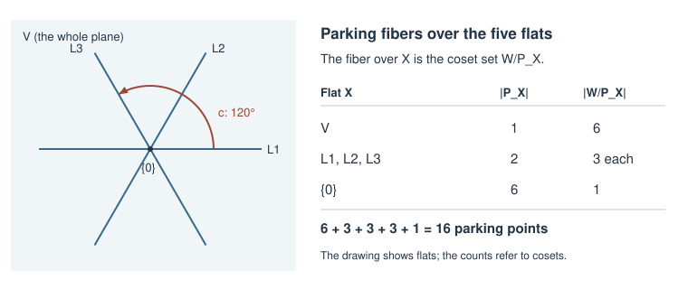

# The weak parking-space conjecture

[](https://github.com/6/clank-lab/actions/workflows/weak-parking.yml)

A [finite reflection group](https://en.wikipedia.org/wiki/Reflection_group)
acts on a space by symmetries generated by reflections. Armstrong, Reiner
and Rhoades associated two parking spaces to such a group and conjectured,
in [April 2012](https://arxiv.org/abs/1204.1760v1), that their complex
representations agree, including a cyclic symmetry. Their weak conjecture
was already known in every irreducible real type except $E_7$ and $E_8$:
their paper proves the classical cases and credits Christian Stump's
computations for the other exceptional types. We give a computer-assisted
proof in these last two cases, completing the weak conjecture for
irreducible finite real reflection groups.

The result concerns equality of characters, equivalently an isomorphism
of complex representations. It does not supply an equivariant bijection
of parking sets or prove the intermediate or strong conjectures, or the
general Fuss extension. The proof uses the original noncrossing parking
action and algebraic character formula, reduces fixed-point counts to
finite subgroup calculations, and checks exact certificates with two
separately implemented programs. Both programs rely on GAP's group
algorithms. The reduction and the identification with published results
are written arguments in the paper; there is no Lean proof.

In the small type $A_2$ example, the plane, three reflection lines and
origin give five noncrossing flats. Each has a fiber of parking points,
namely a coset space: six over the plane, three over each line, and one
over the origin. The drawing shows the flats and their cyclic rotation.



Computer-assisted; not yet reviewed by experts.

[Read the paper](paper/paper.pdf) · [LaTeX source](paper/paper.tex)

Archived on Zenodo: [doi:10.5281/zenodo.24432630](https://doi.org/10.5281/zenodo.24432630)

## Abstract

Armstrong, Reiner and Rhoades conjectured in 2012 that the noncrossing and algebraic parking spaces of an irreducible finite real reflection group have the same character under the group and the cyclic group generated by a Coxeter element. They computed the algebraic character, proved this weak conjecture in the classical and rank-two types, and reported Christian Stump's computer verification for $H_3$, $H_4$, $F_4$ and $E_6$; types $E_7$ and $E_8$ remained open. We prove the weak conjecture in types $E_7$ and $E_8$. Together with these earlier results, including Stump's reported computation, this completes the weak conjecture for real reflection groups. The number of points of the noncrossing parking space fixed by a pair $(w,c^d)$ reduces to counting the elements of a conjugacy class that lie in a coset $P_Xc^d$, where $P_X$ is the pointwise stabilizer of a noncrossing flat. Machine-checkable certificates verify these counts, and the completeness of the list of noncrossing elements, in exact arithmetic. The result concerns the original conjecture, not its Fuss generalization.

This work has not yet been reviewed by experts. The proofs, the computation programs, the certificate checkers and the text were produced by AI models (from OpenAI and Anthropic), working under the author's direction.

## Check it

Install Python 3.10 or later, GAP with its `smallgrp` and `transgrp`
packages, and the Python requirements:

```sh
python3 -m pip install -r checks/requirements.txt
```

On Debian or Ubuntu the GAP packages are `gap-core`, `gap-libs`,
`gap-smallgrp` and `gap-transgrp`. With `gap` on your path, run from this
folder:

```sh
python3 checks/verify.py
```

This checks both exceptional types and a previously solved $E_6$ control,
including the completeness of the noncrossing interval, subgroup classes,
every character entry, and two corruptions that both checkers must reject.
It takes about five minutes. [Checker documentation](checks/README.md)
describes the certificate format, exact trust boundary, parallel options
and commands to regenerate the computation.

## Credits

Drew Armstrong, Victor Reiner and Brendon Rhoades posed the conjecture in
[Parking spaces](https://arxiv.org/abs/1204.1760v3), first posted April 8,
2012. Their Definition 2.6 and cyclic action, Proposition 2.15 (the
algebraic character) and Problem 11.1 supply the objects and the
remaining question. Their Corollary 2.14, Sections 6.2, 7.2 and 8, and
Table 1 cover all other irreducible real types, with Christian Stump's
reported computations for $H_3$, $H_4$, $F_4$ and $E_6$. Without the
cyclic factor, the comparison in $E_7$ and $E_8$ was already known:
Christos Athanasiadis and Victor Reiner
([Theorem 6.3](https://doi.org/10.1137/S0895480103432192)) showed that
noncrossing and nonnesting flat counts agree in each Weyl-group orbit, and Armstrong, Reiner and Rhoades deduced the $W$-set
isomorphism (equation (2.3)).

Theo Douvropoulos and Matthieu Josuat-Vergès proved the arbitrary-Fuss
$W$-character in $E_7$ and $E_8$
([Theorem 3.10](https://arxiv.org/abs/2209.12540v2)); their Section 3.2
says that Rhoades' conjectures, by contrast, involve "a cyclic group of
order $mh$". The
proof uses Carter's reflection-length formula, Brady and Watt's
fixed-space embedding, the real parabolic stabilizer theorem, GAP and
SymPy. The other works the paper credits are listed under
[Further credits](checks/README.md#further-credits).

Apache-2.0 (see the repository's LICENSE), except the third-party material listed in [THIRD_PARTY.md](THIRD_PARTY.md).

## Cite

```bibtex
@misc{GrahamWeakParking2026,
  author       = {Graham, Peter},
  title        = {{The weak parking-space conjecture}},
  year         = {2026},
  howpublished = {\url{https://github.com/6/clank-lab/tree/weak-parking-v2/results/weak-parking}},
  doi          = {10.5281/zenodo.24432630}
}
```
