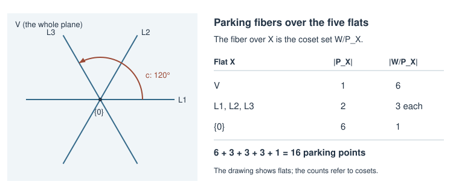

# The weak parking-space conjecture

[](https://github.com/6/clank-lab/actions/workflows/weak-parking.yml)

A [finite reflection group](https://en.wikipedia.org/wiki/Reflection_group)
acts on a space by symmetries generated by reflections. Armstrong, Reiner
and Rhoades associated two parking spaces to such a group and conjectured,
in [April 2012](https://arxiv.org/abs/1204.1760v1), that their complex
representations agree, including a cyclic symmetry. Their weak conjecture
was already known in every irreducible real type except $E_7$ and $E_8$:
their paper proves the classical cases and credits Christian Stump's
computations for the other exceptional types. We give a computer-assisted
proof in these last two cases, completing the weak conjecture for
irreducible finite real reflection groups.

The result concerns equality of characters, equivalently an isomorphism
of complex representations. It does not supply an equivariant bijection
of parking sets or prove the intermediate or strong conjectures, or the
general Fuss extension. The proof uses the original noncrossing parking
action and algebraic character formula, reduces fixed-point counts to
finite subgroup calculations, and checks exact certificates with two
separately implemented programs. Both programs rely on GAP's group
algorithms. The reduction and the identification with published results
are written arguments in the paper; there is no Lean proof.



In the small type $A_2$ example, the plane, three reflection lines and
origin give five noncrossing flats. Each has a fiber of parking points,
namely a coset space: six over the plane, three over each line, and one
over the origin. The drawing shows the flats and their cyclic rotation.

Computer-assisted; not yet reviewed by experts.

The proofs, the computation programs, the certificate checkers and the text were produced by AI models (from OpenAI and Anthropic), working under the author's direction.

[Read the paper](paper/paper.pdf) · [LaTeX source](paper/paper.tex)

## Check it

Install Python 3.10 or later, GAP with its `smallgrp` and `transgrp`
packages, and the Python requirements:

```sh
python3 -m pip install -r checks/requirements.txt
```

On Debian or Ubuntu the GAP packages are `gap-core`, `gap-libs`,
`gap-smallgrp` and `gap-transgrp`. With `gap` on your path, run from this
folder:

```sh
python3 checks/verify.py
```

This checks both exceptional types and a previously solved $E_6$ control,
including the completeness of the noncrossing interval, subgroup classes,
every character entry, and two corruptions that both checkers must reject.
It takes about five minutes. [Checker documentation](checks/README.md)
describes the certificate format, exact trust boundary, parallel options
and commands to regenerate the computation.

## Credits

Drew Armstrong, Victor Reiner and Brendon Rhoades posed the conjecture in
[Parking spaces](https://arxiv.org/abs/1204.1760), first posted April 8,
2012. Their Definition 2.6 and cyclic action, Proposition 2.15, and
Problem 11.1 supply the objects, algebraic character and remaining
computational question. Their Corollary 2.14, Sections 6.2, 7.2 and 8,
and Table 1 cover all other irreducible real types; they credit Christian
Stump for the exceptional computations.

Rhoades's [Evidence for parking conjectures](https://arxiv.org/abs/1504.06869)
strengthens the classical results. Jason Stack's
[Parking Spaces for Complex Reflection Groups](https://arxiv.org/abs/2502.01970)
extends the framework, explicitly excluding $E_7$, $E_8$ and $G_{34}$
from its relevant assertions. Douvropoulos and Josuat-Vergès's
[The generalized cluster complex: refined enumeration of faces and related parking spaces](https://arxiv.org/abs/2209.12540)
proves the underlying reflection-group character statement; the cyclic
enhancement is additional. Ito and Okada's
[On the existence of generalized parking spaces for complex reflection groups](https://arxiv.org/abs/1508.06846)
studies existence of generalized parking characters. Stack and Williams's
[Posh parking spaces](https://arxiv.org/abs/2610.07280)
studies related algebraic constructions. These results and their precise
scope are discussed in the paper. Carter's reflection-length formula,
Brady and Watt's fixed-space embedding, the real parabolic stabilizer
theorem, GAP and SymPy supply mathematical and computational foundations.

Apache-2.0 (see the repository's LICENSE), except the third-party material listed in [THIRD_PARTY.md](THIRD_PARTY.md).

## Cite

```bibtex
@misc{GrahamWeakParking2026,
  author       = {Graham, P.},
  title        = {{The weak parking-space conjecture}},
  year         = {2026},
  howpublished = {\url{https://github.com/6/clank-lab/tree/weak-parking-v1/results/weak-parking}}
}
```
