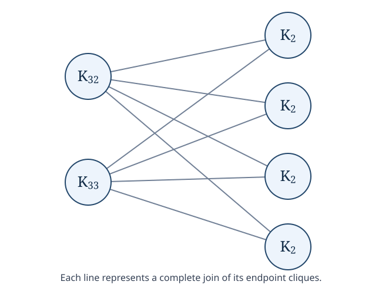

# A graph whose zero-forcing polynomial is not unimodal

[](https://github.com/6/clank-lab/actions/workflows/zero-forcing-unimodality.yml)

In [zero forcing](https://mathworld.wolfram.com/ZeroForcingNumber.html), a colored vertex with exactly one uncolored neighbor colors that neighbor. A set of starting vertices succeeds if this rule eventually colors the whole graph. The zero-forcing polynomial counts successful starting sets by size. [Boyer and coauthors](https://arxiv.org/abs/1801.08910v1) asked in 2018 whether these counts always rise and then fall. We answer no with a graph on 73 vertices, using the modular compression of [Xinjun Wang](https://doi.org/10.5281/zenodo.20388397), Lemma 3.5 and Corollary 3.6.



Each circle represents a complete graph of the indicated size; each line represents all edges between the two circles. There are no other edges between circles. The graph is $G=(K_{32}\sqcup K_{33})\vee(4K_2)$, and

$$Z(G;x)=x^{69}(2096+1592x+1600x^2+73x^3+x^4).$$

The decrease from 2096 to 1592 followed by the increase to 1600 rules out unimodality. No claim of minimum order is made.

The result is new as far as we could check. Seven related publications were read only in part, and what we read shows that each studies a different question. Brimkov–Mikesell–Hicks, *Improved Computational Approaches and Heuristics for Zero Forcing*, computes the minimum size of a zero-forcing set, and Karbasioun–Ameri, *Zero forcing number of fuzzy graphs with application*, studies that minimum for fuzzy graphs; we read their abstracts. Karst–Shen–Troxell–Vu, *Blocking zero forcing processes in Cartesian products of graphs*, and Beaudouin-Lafon and coauthors, *On the zero blocking number of rectangular, cylindrical, and Möbius grids*, bound the minimum size of a fort; we read their abstracts, introductions and references. Menon–Singh, *Exploring the influence of graph operations on zero forcing sets*, and German, *The Path-Extremal Conjecture for Zero Forcing: Distance-Hereditary Graphs and a Split-Decomposition Reduction*, concern whether the path has at least as many zero-forcing sets of each size as any graph with the same number of vertices; we read their preprints in full, and the published abstracts and references match them. Of Iain Beaton's talk *When are Graph Polynomials Unimodal?* only the abstract is available; it concerns conditions that guarantee unimodality. Ben Cameron's problem list still listed this question as open on October 15, 2026. The [checking notes](checks/README.md#source-access) give links and what was read of each.

Computer-assisted; not yet reviewed by experts.

The proofs, the certificate checkers, the figure and the text were produced by AI models (from OpenAI and Anthropic), working under the author's direction.

[Read the paper](paper/paper.pdf) · [LaTeX source](paper/paper.tex)

## Check it

Python 3.10 or newer is sufficient; there are no external packages. From this directory, run:

```sh
python3 -I checks/check.py
```

This takes a few seconds on an ordinary computer. It checks the explicit graph, all polynomial coefficients, coverage of all starting sets, three solved controls and deliberate corruptions. The [checking notes](checks/README.md) explain the separate implementations and their scope.

## Credits

Kirk Boyer, Boris Brimkov, Sean English, Daniela Ferrero, Ariel Keller, Rachel Kirsch, Michael Phillips and Carolyn Reinhart introduced the zero-forcing polynomial and posed the unimodality question. Their work also proves that its coefficients cannot decrease in the first half. Xinjun Wang's modular compression of leaky forcing sets includes ordinary zero forcing: Lemma 3.5 and Corollary 3.6 reduce complements in twin modules to weighted subsets of the modules. That is the counting machinery used here; this work adds the explicit graph and its nonunimodal coefficient sequence.

The computation uses exact integers and ordinary vertex-level color changes. Separate Python implementations count weighted module patterns, enumerate labeled complements, and audit the fort cover. The fort obstruction comes from Fast and Hicks. The short proof explains the same classification without claiming a new compression method. [Further credits](checks/README.md#further-credits) identify related work on graph operations, spans and separator formulas.

Apache-2.0 (see the repository's LICENSE), except the third-party material listed in [THIRD_PARTY.md](THIRD_PARTY.md).

## Cite

```bibtex
@misc{GrahamZeroForcingUnimodality2026,
  author = {Graham, P.},
  title = {{A graph whose zero-forcing polynomial is not unimodal}},
  year = {2026},
  howpublished = {\url{https://github.com/6/clank-lab/tree/zero-forcing-unimodality-v1/results/zero-forcing-unimodality}}
}
```
